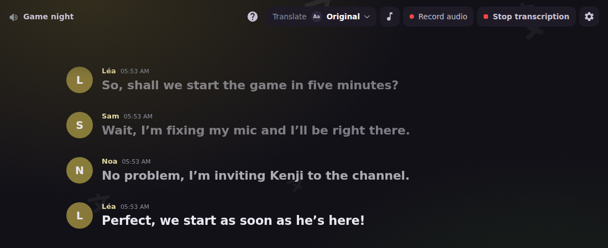
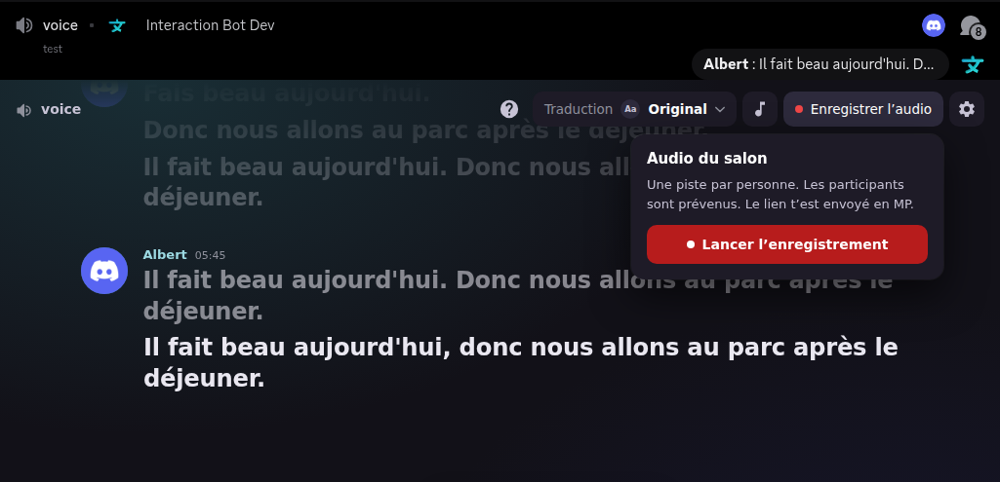

# Live transcription (Activity)

The live transcription is a **Discord Activity** (an embedded app in the voice channel) that shows the transcription of the voice channel as it happens: the sentences appear line by line, with the profile picture of each speaker. It uses the **same transcription** as [`/transcribe start`](voice.md#transcription-speech-to-text): the bot does not make any extra speech request for the Activity, and the time spent counts in the [daily transcription time](limits-and-privacy.md#daily-limits) of the server.

<figure><figcaption>
The live transcription Activity: lines of the speakers, finished sentences and the sentence being spoken.
</figcaption></figure>

* Access rules, daily limits and posting styles of the transcription: [Voice](voice.md).
* Settings of the Activity on the website: [Transcription](../website/dashboard/speech-to-text.md).
* Step by step: [Voice guides](voice-guides.md).

## Requirements

| What | Rule |
| --- | --- |
| Bot on the server | Interaction Bot must be on the server. Without it, the Activity shows how to invite the bot, then connects by itself once it is added. |
| Speech to text enabled | The **Transcription** extension must be on in the dashboard. A disabled extension refuses the command and links to the dashboard. |
| Access | The server is **premium**, or a vote on [top.gg](https://top.gg/bot/893494390142697493/vote) is valid (see [Access](voice.md#access) for the exact rule of each way to start). |
| Bot permissions | **Connect** and **Speak** in the voice channel. The text channel of the transcription needs the permissions of its [posting style](voice.md#posting-styles). |

## Open the Activity

There are two ways. Both need to be in a voice channel of the server.

**With the command `/transcribe live`**

1. Join a voice channel of the server.
2. Run `/transcribe live`.
3. If no transcription runs on the server, the command starts one, with the same checks as `/transcribe start` (daily time, access, bot permissions). Then click the button **Open the live transcription** of the answer, which launches the Activity.
4. If a transcription already runs in **the same** voice channel, the Activity opens directly.
5. If the bot transcribes **another** voice channel of the server, the command answers *I'm transcribing another voice channel. Join it to open the live transcription.*

**With the App Launcher**

1. In the voice channel, click **Start an Activity** in the call controls.
2. Pick **Interaction Bot**.
3. The Activity opens on the start screen. If a transcription is already running, the conversation appears at once. If not, use the start button (see below).

### Who can open it

The dashboard setting **Who can open it** decides who may open the Activity (see [Dashboard settings](#dashboard-settings)):

| Setting | Who can open the Activity |
| --- | --- |
| **Anyone in the voice channel** (default) | Members who are in the voice channel of the Activity, and members with *Manage Server*. |
| **Only members who can manage the server** | Members with *Manage Server* only. Other members see the screen *Join a voice channel* in the Activity, and `/transcribe live` answers *The live transcription is turned off or not allowed for you on this server.* |

The Activity can also be turned off on the dashboard (**Live view enabled**). Then `/transcribe live` answers *The live transcription is turned off or not allowed for you on this server.*

## Start and stop from the Activity

* **Start transcription**: shown on the start screen while no transcription runs. Starting from the Activity needs the *Manage Server* permission. Other members get *You are not allowed to start the transcription on this server.* They can still start it with `/transcribe live`.
* **Stop transcription**: shown to members with *Manage Server* only, while a transcription runs. It asks for a confirmation: the first click changes the button to **Confirm the stop?** for 4 seconds, the second click stops the transcription for everyone.

A stop from the Activity works like `/transcribe stop`: the transcription ends for everyone. The bot stays in the voice channel until it is empty (30 seconds after the last member left). Starts and stops are limited to one request every 5 seconds per member.

## What you see

| Element | Meaning |
| --- | --- |
| **Lines** | One line per sentence. The profile picture and the name of the speaker are shown, with the time the sentence started (your clock). Consecutive lines of the same speaker, less than 6 seconds apart, are grouped under one picture. |
| **Line being spoken** | While someone speaks, their unfinished sentence is shown and its words appear as they are recognised. It is replaced by the finished sentence when the speaker stops. |
| **Halo** | A green ring around the picture of a speaker, while the bot hears their voice. It follows the sound, not the text. |
| **Back to live** | When you scroll up to read older lines, the button **Back to live** brings you back to the newest line. The view follows the speech again. |
| **Start screen** | Shown with music while no transcription runs. It turns into the conversation as soon as a transcription starts. When the transcription ends, the screen says *The transcription has ended.* |

The number of finished lines on screen is set on the dashboard (**Lines kept on screen**: 30, 60, 100 or 200; default 60). A member who opens the Activity late reads the lines already said in the running transcription, up to that number. Each line is cut at 600 characters.

## Reading in your own language (premium)

The **Translation** button (the language picker of the Activity) lets each viewer read the conversation in another language. This is a **premium** feature of the server:

* Choose **Original** to read the text as it was said, or pick one of the languages of the list (99 languages, with their names in your language).
* **Only your view changes**: other members keep their own choice. Your choice is kept on your device.
* Translations appear under the **finished** sentences. The line being spoken is not translated.
* On a free server, the button opens the window *Premium servers only* with a link to the [premium page](../premium/premium.md).


The server translates into **at most 4 different languages at the same time**. If more viewers pick different languages, only four of them are translated (the codes are taken in alphabetical order); the other viewers see the original text of the lines.


If the transcription itself is translated (`translate_to`, see [Translation](voice.md#translation)), the Activity also shows that translation in the **Original** view, unless the dashboard option **Show the translation** is off.

## Recording from the Activity

The Activity can also start and stop an audio recording of the voice channel (the same recording as `/record`, one track per speaker). It is not a transcript: it is the audio.

<figure><figcaption>
The recording panel: the button <i>Start recording</i> and the notice that every member is told.
</figcaption></figure>

* **Start**: the button **Record audio** opens a panel. **Start recording** starts it, and the text channel of the recording is told. A member who does not agree can leave the channel.
* **Who may start**: members who may use the recording permission of the server (by default everyone, the dashboard can restrict it), and members with *Manage Server*. A vote on top.gg or a premium server is needed, as for transcription.
* **Continuous mode**: keeps recording when the channel is empty, up to 24 hours. **Premium only**.
* **Stop**: the **Stop** button of the recording bar ends the recording at once. Unlike the transcription, it has **no confirmation**. Only the member who started the recording, a member with *Manage Server* or *Move Members* can stop it.
* **The link**: the recording is sent by private message to the member who started it, when it is ready. It is kept 24 hours on a free server and 7 days on a premium server.
* **Listening**: **My recordings** in the Activity lists your own recordings of the server and plays them. The download is not offered in the Activity: use the **Account** page of the dashboard, see [Account](../website/dashboard/account.md).

Daily recording time: 1 hour 45 minutes on a free server, 6 hours on a premium server. See [Daily limits](limits-and-privacy.md#daily-limits).

## Transcript

The Activity does not save a transcript and has **no download button**. The lines exist in the Activity while the transcription runs (see [Privacy](#privacy)). The transcription itself is posted as messages in the text channel of the transcription, which you can copy or keep like any message.

## Dashboard settings

The settings are on the dashboard page [Transcription](../website/dashboard/speech-to-text.md), section **Live transcription (Activity)**. They apply to the Activity of the whole server.

| Setting | Default | What it does |
| --- | --- | --- |
| **Live view enabled** | On | Turns the Activity on or off. When off, the Activity cannot be opened. |
| **Who can open it** | Anyone in the voice channel | See [Who can open it](#who-can-open-it). |
| **Show profile pictures** | On | Shows the picture of each speaker. Off: the name only. |
| **Show the translation** | On | Shows the translation of the transcription (`translate_to`) in the **Original** view. It does not change the translation a viewer picks in the language picker. |
| **Lines kept on screen** | 60 | How many finished lines a viewer gets and keeps on screen: 30, 60, 100 or 200. |

**Show profile pictures** and **Show the translation** apply at once to an Activity that is already open. **Who can open it**, **Live view enabled** and **Lines kept on screen** apply the next time someone opens the Activity.

## Privacy

* The voice of the channel is sent to the speech service, as for any transcription. The bot writes **nothing** of the transcript to its database.
* The finished lines are kept **in memory**, only while the transcription runs. When the transcription stops, the lines are dropped. The Activity server keeps the lines of a room while someone watches it, and forgets them about 30 seconds after the last viewer left.
* A viewer's language choice is kept in the browser of the viewer only.
* The recording of a voice channel respects the **Do not record me** opt-out of the [Account](../website/dashboard/account.md#privacy) page. The live transcription does not check this opt-out: see [Limits and privacy](limits-and-privacy.md#privacy-opt-outs).

## Limits

| Limit | Free | Premium |
| --- | --- | --- |
| Daily transcription time, shared with `/transcribe` (per server, UTC day) | 30 minutes | 3 hours |
| Translation of the lines (languages translated at the same time, per server) | Not available | 4 |
| Viewers in the same Activity | 100 (free and premium) | 100 (free and premium) |
| Lines kept on screen | 30 to 200 (dashboard) | 30 to 200 (dashboard) |
| Simultaneous transcriptions of the bot cluster | 20 | 20 |
| Recording, daily time | 1 hour 45 minutes | 6 hours |
| Recording, length of one recording | 24 hours at most (the recording stops by itself) | 24 hours at most |
| Recording, continuous mode (keeps recording when the channel is empty) | Not available | Available |

When the daily transcription time is used up, the transcription stops, the bot leaves the voice channel and the Activity shows *The transcription has ended.* until the next day (midnight UTC).

## Troubleshooting

| What you see | Cause and fix |
| --- | --- |
| The Activity stays on **Connecting to Discord…** and then shows *Discord is not answering the Activity. Close it and start it again from the voice channel.* | Discord did not answer in 20 seconds. Close the Activity and start it again from the voice channel. |
| **Signing in…** or **Connecting to the transcription…** never ends | Close the Activity and start it again from the voice channel. If it happens again, the transcription service may be down: try again later. |
| *Access denied*, with *Join a voice channel* | The Activity was opened outside a voice channel, or you left the channel. Join the voice channel and start the Activity again. If you are already in it, a member with *Manage Server* should check **Who can open it** and **Live view enabled** on the dashboard (see [Who can open it](#who-can-open-it)). |
| *The bot is not on this server* | Invite the bot with the button **Invite the bot**. You need *Manage Server*. The Activity connects by itself once the bot is added. |
| *This room is full.* | The Activity has 100 viewers. Try again later. |
| *Connection lost, retrying…* | The network dropped. The Activity reconnects by itself. |
| *Start transcription* does nothing, or says *You are not allowed to start the transcription on this server.* | Only members with *Manage Server* start a transcription from the Activity. Use `/transcribe live` instead. |
| *A transcription is already running on this server.* | The conversation is shown. Nothing to start. |
| *I'm transcribing another voice channel.* | The bot is busy in another voice channel of the server. Join that channel. |
| *The bot lacks the permissions needed in this voice channel or text channel.* | Give the bot **Connect** and **Speak** in the voice channel, and the permissions of the text channel (see [Requirements](#requirements)). |
| *The daily transcription time of this server is used up.* | Wait for the reset at midnight UTC, or get [premium](../premium/premium.md). |
| *Not a premium server: a member must vote for the bot (top.gg) to start the transcription.* | Vote on [top.gg](https://top.gg/bot/893494390142697493/vote), or get premium. |
| *Too many transcriptions running, or the request was too soon.* | Wait a few seconds and try again. |
| The lines do not appear while people speak | Nobody is heard by the bot (the **Halo** does not light up): check that the speakers are in the voice channel and that the bot is connected to it. Very quiet speech is ignored. |
| Only one language is translated for some viewers | The server translates at most 4 languages at the same time (see [Reading in your own language](#reading-in-your-own-language-premium)). |

For the messages of the commands, see [Voice troubleshooting](voice-troubleshooting.md).

## Related

* [Voice](voice.md): access, commands, posting styles and the transcription rules.
* [Limits and privacy](limits-and-privacy.md): daily limits, `/limits`, `/privacy` and `/reminder`.
* [Transcription](../website/dashboard/speech-to-text.md): the dashboard page.
* [Premium](../premium/premium.md): what changes on a premium server.
