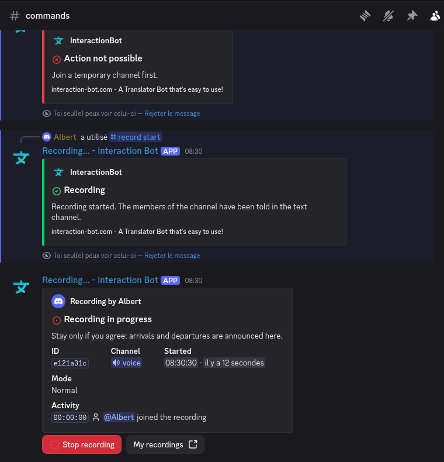

# Voice recording


**Rolling out.** The commands of this page appear in Discord when the bot publishes its new command list. Until then, Discord still shows the previous commands.


The bot can record a voice channel: it joins the channel, keeps the voice of each speaker on **its own track**, and keeps a **mix** of the whole channel. The recording is encrypted while it is kept, and the people who started it get a link to listen to and download it.

<figure><figcaption>
The recording panel, posted in the text channel when a recording starts
</figcaption></figure>

* Recording a server's voice channels is set up on the dashboard: [Voice recording](../website/dashboard/voice-recording.md).
* The recordings of a member are listed and played on the website: [My recordings](../website/recordings.md).
* Speech to text and text to speech of the same channels: [Voice (TTS and transcription)](voice.md).
* Something does not work: see [Troubleshooting](#troubleshooting) below and [Voice troubleshooting](voice-troubleshooting.md).


Recording a voice channel means recording people. Only record when everyone in the channel agrees, and tell them. The bot warns the channel when a recording starts and each time someone joins (see [Announcement and consent](#announcement-and-consent)).


## Access

Recording needs a **premium server** or a **vote on [top.gg](https://top.gg/bot/893494390142697493/vote)**. One vote by a member of the server unlocks recording for the whole server for 24 hours. The rule depends on the command:

| Feature | Who can use it |
| --- | --- |
| `/record start` | The server is premium, **or** a member of the server has voted in the last 24 hours. Also, the member must be allowed to record (see [Who can start a recording](#who-can-start-a-recording)). |
| `/record start continuous` | Premium server only. |
| `/record auto on` | Premium server only. |
| `/record auto off`, `/record auto view` | Members with *Manage Server*. |
| `/record stop` | The member who started the recording, *Manage Server* or *Move Members*. See [Stopping](#stopping). |
| `/record test`, `/record list`, `/record note`, `/record transcribe`, `/record transcribe-cancel` | No vote needed. See [Notes](#notes) and [Transcription](#transcription-of-a-recording) for their own rules. |

When a member runs `/record start` without the vote or the premium server, the bot answers *Recording needs a vote on top.gg (for the whole server, valid 24 hours) or a premium server.* with a *Vote on top.gg* button. The server can be asked to vote, at most once a day.

### Who can start a recording

By default **everyone** can run `/record start`. The dashboard can limit it to some roles and members (*Only the roles and members below*). Members with *Manage Server* can always start a recording.

## Permissions

The bot needs these permissions. See also [Permissions](../permissions.md).

| Where | Permission | Used for |
| --- | --- | --- |
| Voice channel | **Connect** (required) | Joining the channel to record it |
| Voice channel | **View Channel**, **Speak** | `/record test` checks them. Speak is used for the spoken welcome and announcement. |
| Text channel of the command | **Send Messages** and **Embed Links** | The recording panel is an embed. Without them the recording does not start. |
| Server | **Change Nickname** | The bot's nickname shows *Recording...* while it records. Without it, the nickname does not change. |

## Commands

| Command | Description |
| --- | --- |
| `/record start [continuous]` | Start recording the voice channel you are in. The bot joins it, and the panel is posted in the text channel where the command was run. `continuous` keeps the recording going when the channel is empty (premium, see [Stopping](#stopping)). |
| `/record stop` | Stop the recording of the server. The link is sent in private messages to the member who started it. The Stop button of the panel does the same. |
| `/record test` | Checks that a recording will work in your channel, without starting one. One line per check, only you see the answer. |
| `/record list` | Your recent recordings on this server (10 at most), with their status, duration, tracks and a link to each one. Only you see the answer. Expired recordings are not listed. |
| `/record note message` | Add a timestamped note to the running recording. See [Notes](#notes). |
| `/record transcribe [recording]` | Start the transcription of one of your recordings on this server. Without `recording`, your latest one is used. See [Transcription](#transcription-of-a-recording). |
| `/record transcribe-cancel` | Cancel your running transcription on this server. |
| `/record auto on` | Turn the automatic recording on (premium, *Manage Server*). See [Automatic recording](#automatic-recording). |
| `/record auto off` | Turn the automatic recording off. |
| `/record auto view` | Show the automatic recording settings of the server. |

## What is recorded

* **One track per speaker**: the voice of each person who speaks, on one common clock, so the tracks line up. A track has silence where its speaker is quiet.
* **A mix** of the channel: everyone in one file.
* The **bots** are not recorded.
* The **voice of the bot** (text to speech) is not recorded, unless the server chose *Record the bot's voice* on the [dashboard](../website/dashboard/voice-recording.md). When it is on, it is a track of its own. The announcements of the recording itself are never recorded.
* Members who **opted out** are not recorded. See [Opt-out](#opt-out).

Each track and the mix are stored as Ogg Opus, at about 64 kb/s. Recordings made before October 2026 are stored as FLAC.

## Announcement and consent

When a recording starts, the bot:

1. posts the **recording panel** in the text channel. It says *Recording in progress*, shows the consent line (*Stay only if you agree: arrivals and departures are announced here.*), and lists the last arrivals and departures, with the time;
2. says out loud, in the voice channel, that the audio of the channel is being recorded (the message is in English, whatever the language of the server);
3. when a member joins the channel while it is recorded, posts a welcome line in the text channel and says it out loud. The same member is welcomed again at most once a minute.

The panel has two buttons: **Stop recording** (same rules as `/record stop`) and **Add a note**. Its last line is a link to **My recordings**. When the recording ends, the panel changes to *Recording finished* or *Recording interrupted*, with the duration and the number of tracks.

### Opt-out

A member who does not want to be recorded can turn on **Do not record me (opt-out)** on the website, on the Account page, in the **Privacy** section (see [Security and privacy](../security.md)). From then on:

* the bot does not record the member's voice;
* the audio of that member already kept in a recording in progress is removed at once;
* the recordings already made are not changed by the switch. To remove them, use **Delete my data** on the same page: it removes the member's voice from the recordings where they speak, and deletes the recordings they started.

While the bot cannot read a member's choice (a temporary database problem), it does not record that member's voice either.

## Starting and stopping

### Starting

1. Join a voice channel (not a stage channel).
2. In a text channel where the bot can write, run `/record start`. Run `/record test` first if you want to check everything.
3. The bot joins your channel, the panel appears, and it answers *Recording started.* Only you see that answer.

The command can be used once every 5 seconds per member. Only one recording runs per server at a time.

Possible refusals:

| Message | Meaning |
| --- | --- |
| *Join a voice channel first (stage channels cannot be recorded).* | You are not in a voice channel, or it is a stage channel. |
| *A recording is already running on this server.* | Stop the running one first. |
| *The bot is busy on this server (another voice channel, or a transcription). Try again later.* | The bot is already serving another feature in another channel. |
| *The bot is already in another voice channel of this server. Join that channel to use it.* | The bot is in a channel where someone is served. Join it, or wait. |
| *Recording is disabled on this server.* | The server switched recording off on the dashboard. |
| *Recording needs a vote on top.gg ... or a premium server.* | See [Access](#access). |
| *This server has used all its daily Recording time ...* | See [Limits](#limits). |
| *Recording needs a text channel to post its announcement ...* | The bot cannot send messages and embeds in the channel where you ran the command. |

### Stopping

A recording ends for one of these reasons. The panel and the channel say which one.

| Reason | When |
| --- | --- |
| Stopped by a member | `/record stop` or the Stop button, by the member who started it, *Manage Server* or *Move Members*. |
| Nobody left in the channel | A recording that is not `continuous` stops **30 seconds** after the last member left. |
| Maximum length | **24 hours** at most, for any recording. |
| Daily time used up | The server reached its daily recording time. A warning is posted at 80 %. |
| The bot left the channel | The bot was disconnected from the voice channel. |
| Error | The recording could not go on. |
| The bot restarted | The recording is saved with what had been recorded, as **interrupted**. At most about 10 seconds of audio are lost. |

A `continuous` recording (premium) keeps going while the channel is empty, until the maximum length or the daily time is reached.

## Notes

A note is a short text placed at the current moment of the recording. It helps to find the moment you want later.

* Add one with `/record note message` (200 characters at most), or with the **Add a note** button of the panel.
* Who can add a note: the member who started the recording, the members of the recorded channel, and members with *Manage Server*.
* A member waits 3 seconds between two notes. A recording holds 200 notes at most.
* The notes are shown on the recording's page on the website, where a click jumps to that moment. They can also be exported in the ZIP (see [Downloads](#downloads-and-export)).

## Recordings, links and retention

When a recording is saved, the bot sends a **private message** to the member who started it, with a **Download** button that opens the recording's page on the website. If the member's private messages are closed, no link is sent: the member finds the recording with `/record list`, or on the Account page of the [website](../website/recordings.md).

| | Free server | Premium server |
| --- | --- | --- |
| Kept for | **24 hours** | **7 days** |

The retention is decided when the recording starts, from the server's plan at that moment. When it ends, the files are deleted, and the recording shows as *Expired*. A recording that could not be saved (*Failed*) has no file to download: its encrypted blocks are deleted after 7 days.

Transcriptions are deleted with the audio they come from.

## Downloads and export

On the website, the page of a recording offers:

* **Listen and download**, track by track, and the mix. Choose the download format in the list (FLAC by default; M4A, MP3, OGG or WAV are also offered).
* **Download all (ZIP)**: one file per track and the mix, plus `notes.txt` (the notes with their time) and `labels.txt` (labels for Audacity: *File > Import > Labels*).
* **Export as video**: an MP4 that reproduces the call, with a tile per person, a border around the person who speaks, and the audio of the mix. The mix must be 2 hours or less. Only one export runs per server at a time.
* **Transcription**, with the exports TXT, SRT, VTT and JSON.

About the formats:

* The stored file is Ogg Opus, about 64 kb/s. The **OGG** download is that file, without a new encoding.
* FLAC, M4A, MP3 and WAV files are made from the stored Ogg Opus file. Their quality is the quality of the stored file, not of the original voice. A FLAC download of a recent recording is therefore not lossless.
* Recordings made before October 2026 are stored as FLAC, and their FLAC download is the stored file.

For the website side, see [My recordings](../website/recordings.md).

## Transcription of a recording

A recording can be turned into text, one speaker at a time, merged by time.

* Start it with `/record transcribe` (your latest finished recording on the server, or the one you pick in the list), or with the **Transcribe** button on the recording's page on the website.
* You must be the member who started the recording. The recording must be finished or interrupted, and not expired. A track longer than **4 hours** cannot be transcribed.
* The spoken language is **detected automatically**. Each speaker is named after their track.
* The progress is shown on the website. The bot sends a **private message** when the transcription is ready or has failed.
* Cancel it with `/record transcribe-cancel`, or with the **Cancel** button on the website.
* The server can switch transcription off for its recordings: *Allow transcription of recordings* on the [dashboard](../website/dashboard/voice-recording.md).

Each member can ask for a number of transcriptions, counted in a sliding window. The window depends on the plan of the server **when the recording started**:

| | Free | Premium |
| --- | --- | --- |
| Transcriptions per member | 1 every **30 days** | 1 every **24 hours** |

Only one transcription of a member runs at a time. A request counts toward the limit even if it is cancelled or fails.

## Automatic recording

*Premium only.* The bot starts a recording by itself when members join a voice channel, and posts the same panel and announcements as `/record start`.

* Turn it on with `/record auto on` or on the [dashboard](../website/dashboard/voice-recording.md), where you also choose:
  * the **watched voice channels** (none chosen: every voice channel of the server);
  * the **minimum number of members** (bots excluded) needed to start, from 1 to 25;
  * the **trigger roles**: a member with one of these roles starts the recording alone, whatever the minimum;
  * the **panel channel**: where the panel is posted (the first text channel the bot can write in, by default).
* The check runs about 2 seconds after the last arrival or departure in the channel.
* The recording starts on behalf of a member who is allowed to start one (trigger role first). If nobody is allowed, nothing starts.
* An automatic recording stops **30 seconds after the channel is empty**, like a normal one. If it was stopped while members stayed, it does not start again until the channel is empty.
* `/record auto view` shows whether the feature is on, whether the server is premium, the minimum, the watched channels, the trigger roles and the panel channel.

## Limits

| | Free | Premium |
| --- | --- | --- |
| Recording time per server, per day | **1 h 45 min** | **6 h** |
| Length of one recording | 24 hours | 24 hours |
| `continuous` (keep recording when the channel is empty) | No | Yes |
| Automatic recording | No | Yes |
| Retention of a recording | 24 hours | 7 days |
| Transcriptions per member | 1 every 30 days | 1 every 24 hours |
| Start without premium | With a top.gg vote of a member of the server | Always |

* The **daily time** counts the time actually recorded, for all the recordings of the server, and starts again at **midnight UTC**. When the bot reaches the limit it stops the recording, and the server sees when the time starts again.
* A warning is posted in the text channel when 80 % of the day is used.
* `/limits` shows the time used, the time left and the time of the next reset, for transcription, text to speech and recording.
* Premium raises these limits. See [Premium](../premium/premium.md).

## Test before recording

`/record test` runs the checks without starting anything, and answers with one line per check:

* you are in a voice channel, and the bot can see, join and speak in it;
* the bot can write and send embeds in this text channel;
* the bot can change its nickname (a warning only);
* recording is on for the server;
* no recording is running;
* the voice announcements (text to speech) are loaded (a warning only);
* your role may start a recording;
* the daily recording time left.

## Troubleshooting

| Symptom | What to check |
| --- | --- |
| The command answers with the vote message | The server needs premium, or a member must vote on top.gg. |
| *Recording needs a text channel ...* | Give the bot **Send Messages** and **Embed Links** in the channel where you run the command. |
| *The bot could not join the voice channel.* | Give the bot **Connect** in that channel, then try again. |
| No link in private messages | Your private messages are closed. Use `/record list`. |
| The recording stopped with *the daily recording time ... is used up* | The server's daily time is used. It starts again at midnight UTC. |
| The recording says *interrupted* | The bot restarted during the recording. The part recorded before the restart was saved. |
| The bot's name does not show *Recording...* | Give it **Change Nickname**. |
| A member's voice is missing | The member opted out, or their choice could not be read. See [Opt-out](#opt-out). |
| The bot is still in the voice channel after a recording could not start | Use `/disconnect` (see [Voice](voice.md#connecting-and-leaving)). |

For the messages of the other voice features, see [Voice troubleshooting](voice-troubleshooting.md).

## Related

* [Voice recording on the dashboard](../website/dashboard/voice-recording.md): settings, defaults and automatic recording.
* [My recordings](../website/recordings.md): listening, downloads, transcriptions and privacy on the website.
* [Voice (TTS and transcription)](voice.md): the other voice features.
* [Premium](../premium/premium.md): what changes on a premium server.
* [Security and privacy](../security.md): how the bot keeps your data.
