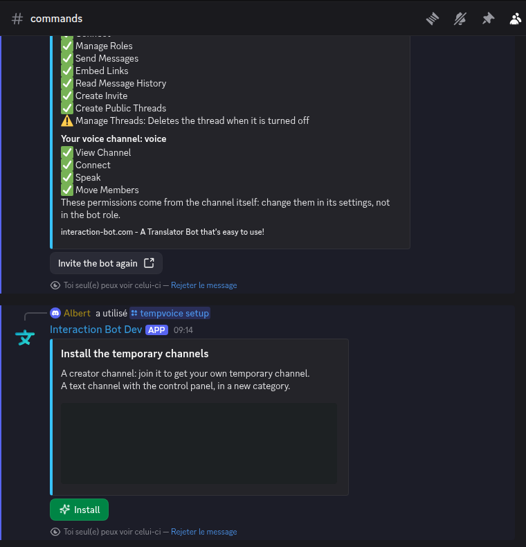
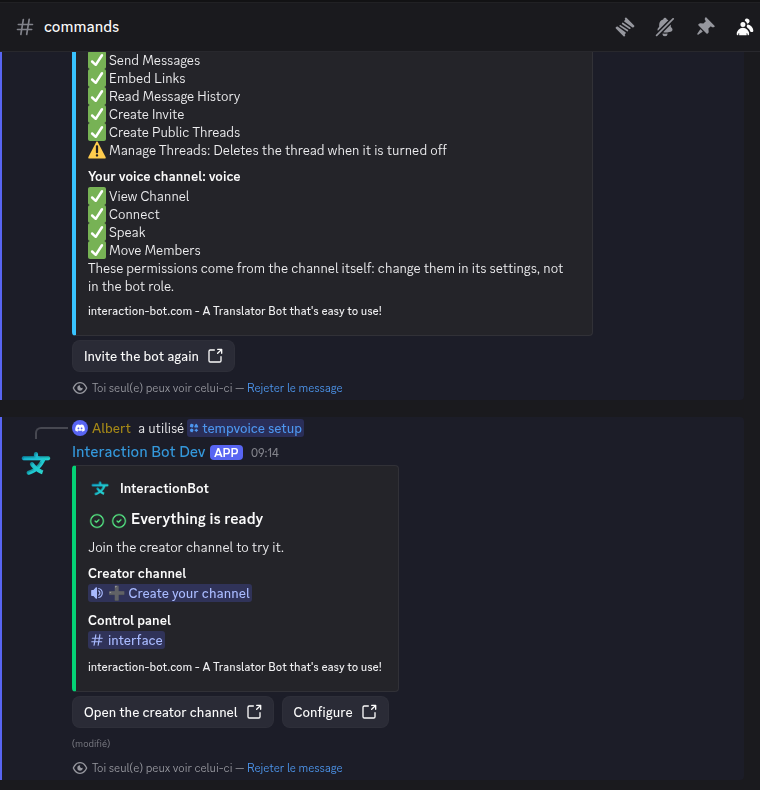

# Temporary voice channels

Temporary voice channels let each member of a server get **their own voice channel**, which they control, and which is **deleted automatically** when everyone has left.

* Quick setup: [Set up in 2 minutes](#set-up-in-2-minutes).
* Settings on the website: [Temp voice](../website/dashboard/temp-voice.md).
* Permissions the bot needs: [Permissions needed](#permissions-needed).

## How it works

1. An admin creates a **Join to create channel** (a voice channel named `➕ Create your channel` by `/tempvoice setup`, or from the dashboard).
2. A member joins it. The bot creates a new voice channel for this member, moves the member into it, and makes the member its **owner**.
3. The owner controls the channel: name, user limit, privacy, members, and so on. The owner's commands are `/voice ...`, the buttons of the control panel, and the context menus of a member.
4. When the **last human leaves**, the channel is deleted at once. A temporary channel left empty while the bot was offline is deleted when the bot starts again.

Each new channel gets the name of the template of its Join to create channel (default `{OWNER_NICKNAME}'s Channel`). The owner's remembered name, limit, privacy and lists can come back in the next channel of the same owner (see the dashboard, section _Restore the owner's settings_).

Temporary voice channels are **free**: no vote on [top.gg](https://top.gg/bot/893494390142697493/vote) and no premium server are needed. The only premium option is the fallback categories of the dashboard (see [Temp voice](../website/dashboard/temp-voice.md)).

## Permissions

The administrator sets the feature up with `/tempvoice setup` or `/tempvoice config` (Manage Server). The other commands need the owner role of the channel, see [Commands](#commands).

| Who | Can do |
| --- | --- |
| Members with **Manage Server** | Everything, in every channel, whatever the function rules of the dashboard. |
| Owner of a temporary channel | The `/voice` commands and the control panel, as allowed by the [function roles](../website/dashboard/temp-voice.md#who-can-use-each-function) of the server. |
| Other members of a temporary channel | `/voice user kick` and the vote kick (see [Vote kick](#vote-kick)), `/find`, `/join`. |
| Members without an access role | Cannot create a channel (see [Who can create a room](../website/dashboard/temp-voice.md#who-can-create-a-room)). |

## Set up in 2 minutes

1. **Invite the bot with the permissions of the feature.** The list is in [Permissions needed](#permissions-needed). Without them, the setup refuses and tells you what is missing.
2. **Run `/tempvoice setup`** (you need Manage Server). The bot shows a confirmation with an **Install** button. The button is valid for 3 minutes and only you can press it.

   <figure><figcaption>
The confirmation of <code>/tempvoice setup</code>
</figcaption></figure>

3. **Press Install.** The bot creates:
   * a category **TempVoice**;
   * a text channel **interface**, read only for everyone, with the control panel;
   * the voice channel **➕ Create your channel** (the Join to create channel).

   The feature is then turned on. If Discord refuses one of these creations, the bot removes what it had created and says so.

   <figure><figcaption>
The result of <code>/tempvoice setup</code>
</figcaption></figure>

4. **Try it.** Join **➕ Create your channel**. You are moved to your own channel, and the control panel is posted in its chat.
5. **Optional, in one command:** send the moderation log to a text channel with `/tempvoice config log:#journal`, and check the vote share with `/tempvoice config` (see the options of `/tempvoice config` above).

Everything else (names, roles, placement, greeting) is set on the [dashboard](../website/dashboard/temp-voice.md).

## Commands

### `/tempvoice` (Manage Server)

| Command | Description |
| --- | --- |
| `/tempvoice setup` | Installs the category, the interface channel and the Join to create channel, after a confirmation. Works even when the feature is off. |
| `/tempvoice config [vote_kick] [log] [role] [role_action] [name_moderation]` | Shows the settings, or changes them. Without an option, it only shows them and writes nothing. Works even when the feature is off. |
| `/tempvoice interface [channel]` | Posts the control panel in a text channel (this one by default). Its buttons act on the temporary channel the member is connected to. You can post it several times. |
| `/tempvoice panel` | Owner only: posts the control panel in the chat of your temporary channel. |

Options of `/tempvoice config`:

| Option | Meaning |
| --- | --- |
| `vote_kick` | Share of the connected members needed for a vote kick, from **10** to **100**, by steps of **5**. Default **50**. |
| `log` | Text channel of the moderation log. |
| `role` and `role_action` | `Add`, `Remove` or `Clear` a role allowed to create a temporary channel. Without `role`, `Clear` empties the list. |
| `name_moderation` | Hide offensive words, links and mass mentions in the names and statuses. Default on. |

### `/voice` (the owner of the channel)

Each command of this table can also be run from the buttons of the control panel, unless said otherwise.

| Command | Description |
| --- | --- |
| `/voice name <name>` | Renames the channel (64 characters at most). Two renames need **5 minutes** between them. |
| `/voice limit <0-99>` | Sets the user limit. `0` means no limit. |
| `/voice privacy <mode>` | `Public`, `Locked` (lock), `Unlock`, `Hide`, `Unhide`, `Lock chat`, `Unlock chat`. Lock and hide are independent: both can be on at once. |
| `/voice claim` | Takes over the channel when its owner has left (refused while the owner is still connected). |
| `/voice transfer <member>` | Gives the channel to a member who is in it. A bot cannot be an owner. |
| `/voice delete` | Deletes the channel for everyone. A confirmation button appears, valid 60 seconds. |
| `/voice info` | Shows the owner, the creation date, whether there is a password, the locks, the chat lock, the waiting room, the limit, and the trusted and blocked members. Only you see it. |
| `/voice status [text]` | Sets the status shown under the channel (500 characters at most, censored). Empty clears it. |
| `/voice waiting` | Turns the waiting room on or off. The channel stays locked while it is on. |
| `/voice password [password]` | Sets a password for `/join` (8 characters at most). It needs a locked channel. Empty removes it. |
| `/voice thread` | Turns the chat thread of the channel on or off. |
| `/voice invite [message] [channel]` | Posts the message and an invite link in a **public** text channel (see [Invitations](#invitations)). The message has 250 characters at most. |
| `/voice region <region>` | Sets the voice region, or `Automatic`. |
| `/voice bitrate <kbps>` | Sets the audio quality, from **8** to **384** kbps. The value is capped by the boost level of the server. |
| `/voice reset` | Back to the defaults of the creator channel: name, limit, privacy, chat, bitrate, region. Removes the trusted, blocked and invited members, the password, the waiting room and the thread. Forgets the saved settings of the owner. |

### `/voice user` (members of the channel)

| Command | Description |
| --- | --- |
| `/voice user trust <member> [member2] [member3]` | Lets members in while the channel is locked or hidden. Up to 3 members at once. |
| `/voice user untrust <member> [member2] [member3]` | Removes the trust. |
| `/voice user block <member> [member2] [member3]` | Keeps members out of the channel. A member who is inside is disconnected. Moderators cannot be blocked. |
| `/voice user unblock <member> [member2] [member3]` | Removes the block. |
| `/voice user invite <member>` | Sends the member a private message with a one-use invite (see [Invitations](#invitations)). |
| `/voice user kick <member> [member2] [member3]` | The owner disconnects up to **3** members at once. Any other member of the channel starts a [vote kick](#vote-kick) against one member. |

### `/find` and `/join`

| Command | Description |
| --- | --- |
| `/find <member>` | Tells you in which temporary channel a member is, when you can see and join it. |
| `/join <password>` | Gives you access to the channel of this password, and moves you there when you are connected. |

### Context menus (right click on a member)

| Menu | Description |
| --- | --- |
| **Disconnect** | Disconnects the member from your channel (owner). |
| **Transfer Ownership** | Gives your channel to the member (owner). |
| **Send Invite** | Sends the member a private invitation (see [Invitations](#invitations)). |

### Control panel

The panel is a message with **15 buttons**, posted in the chat of the channel (`/voice panel`, or when the channel is created if the greeting includes it) or in a text channel (`/tempvoice interface`). The buttons are:

| Button | Action |
| --- | --- |
| Name | Renames the channel (a window asks for the name). |
| Limit | Sets the user limit (a window, from 0 to 99). |
| Privacy | A menu: Lock, Unlock, Hide, Unhide, Lock chat, Unlock chat. |
| Waiting room | Turns the waiting room on or off. |
| Chat thread | Creates or deletes the chat thread. |
| Trust | Trusts up to 10 members picked in a list. |
| Untrust | Removes the trust of members picked in a list. |
| Block | Blocks members picked in a list. |
| Unblock | Unblocks members picked in a list. |
| Invite | Sends a private invitation to a member. |
| Kick | The owner kicks up to 3 members; a member of the channel starts a vote kick. |
| Region | A menu of the voice regions, or Automatic. |
| Claim | Takes over the channel when its owner has left. |
| Transfer | Gives the channel to a member who is in it. |
| Delete | Deletes the channel (with confirmation). |

Only the owner can use the buttons, except **Kick** (a member can start a vote kick) and **Claim**. The panel is refreshed after each change and shows the state of the channel (owner, limit, privacy, region, bitrate, chat, waiting room, thread, password).

## Waiting room

A waiting room is a second voice channel attached to a locked channel.

* A member who is **not trusted** and joins a locked channel is moved to the waiting room. The owner receives a message in the waiting room with **Accept** and **Refuse** buttons.
* **Accept**: the member gets access to the channel as an invited member, and is moved in.
* **Refuse**: the member is disconnected. Only the owner can answer. An answer for a member who has already left says that the request has expired.
* The waiting room cannot be turned on for a **hidden** channel, and needs the Lock function. Turning it off unlocks the channel only once the waiting room is off.
* A trusted member is not sent to the waiting room.

## Vote kick

A vote kick removes a member from a channel when enough of the members agree.

* **Who starts it:** any member of the channel, with the **Vote kick** function of the server (see [Who can use each function](../website/dashboard/temp-voice.md#who-can-use-each-function)). The owner also gets it when the owner's instant kick is not allowed. When both are open, the owner chooses between _Kick now_ and _Start a vote_.
* **Conditions:** the channel must be **locked**, **hidden** or have a **user limit**. The target must be in the channel, must not be the owner, and must not be a **moderator** (a member with Kick Members, Ban Members or Timeout Members). A second vote cannot run in the same channel at once.
* **Votes:** the members of the channel who are not bots vote **Yes** or **No**, for **2 minutes**. The target cannot vote. The starter's vote is a yes.
* **Number of yes votes needed:** the vote share of the server (default **50 %**, see `/tempvoice config vote_kick`) applied to the number of voters, rounded up, and at least one. For example, with 5 eligible voters and a share of 50 %, 3 yes votes are needed.
* **Result:** the target is disconnected when the yes votes reach the number needed. The vote fails when the no votes make it impossible to reach that number. If nobody answers in 2 minutes, it expires.
* If the target becomes the owner during the vote (for example by a claim), the vote is cancelled.
* No top.gg vote is asked for a vote kick.

## Invitations

* **`/voice user invite`, Send Invite, and the Invite button:** the member receives a private message with a link that works **once**, for **1 hour**. Giving the access makes the member a trusted (invited) member of the channel. The message has two buttons: _Stop receiving invitations_ and _Receive invitations again_. A member who chose not to receive them gets nothing.
  * A member who is a bot, is blocked, or does not hold an access role of the server cannot be invited. A member who has not accepted the server rules yet cannot be invited either.
  * The owner waits **10 seconds** between two invitations.
  * If the member's private messages are closed, the bot tells the owner.
* **`/voice invite`:** posts a message and a **link that does not expire on use**, valid for **1 hour** (reused meanwhile), in a **public** text channel. A public channel is one that everyone can see and write in, and where the owner can write too. The channel is the one given in the command, else the **public invitations channel** set on the dashboard, else the current channel. The owner waits **60 seconds** between two public invitations. Mentions are never sent.

## Moderation log

When the server has a log channel (`/tempvoice config log`, or the dashboard), the bot writes one line for each event: creation, deletion, renaming, limit, privacy (lock, hide, chat), region, bitrate, password, trust and block, kicks and votes, invitations, owner changes, reset, and channels deleted by hand. Each line has the event, the member and the detail.

## Limits

| Item | Limit |
| --- | --- |
| Owner name (`/voice name`) | 64 characters. The channel name has 100 characters at most (Discord). |
| Renames | One rename every **5 minutes** per channel. Other settings are not delayed. |
| User limit | 0 (no limit) to 99. |
| Bitrate | 8 to 384 kbps, capped by the boost level of the server. |
| Status | 500 characters. |
| Password | 8 characters. A password is unique on the server. |
| Invitation message | 250 characters. |
| Trusted list, blocked list, invited list | 25 members each. |
| Kick at once | 3 members (owner). |
| Trust, untrust, block, unblock in the panel | 10 members at once. |
| Vote kick | 2 minutes, share from 10 % to 100 % by steps of 5 (default 50 %). |
| Channel creation | 5 seconds between two channels for the same member. A member gets a private message when a channel cannot be created, at most once a minute. |
| Server | 500 channels (Discord). When the server has 500 channels, nothing is created and the members are told. |
| Category | 50 channels (Discord). When the category is full, a new category `TempVoice 2`, `TempVoice 3`... is used (on premium servers, the fallback categories of the dashboard are used first). |
| `/join` | 3 seconds between two tries. After 5 wrong tries in 10 minutes, no try is accepted for a while. |
| Greeting message | 1900 characters. |
| Confirmation of `/voice delete` | 60 seconds. |
| Confirmation of `/tempvoice setup` | 3 minutes, author only. |

## Permissions needed

These are the permissions read from the code (`helpers/extension_permissions.py`). Grant them to the bot role, or to the channels where the feature works.

**Required** (without them the feature cannot run, and `/tempvoice setup` refuses):

| Permission | Used for |
| --- | --- |
| Manage Channels | Creates, renames, edits and deletes the temporary channels. |
| Move Members | Moves the members into their channel, and out of it when they are kicked or blocked. |
| Connect | Gives access to the channels (locks, waiting room). |
| Manage Roles | Sets the permissions of each channel (trusts, blocks, owner). Also gives the temporary voice role. |

**Recommended** (the feature works without them, but a part is lost):

| Permission | Lost without it |
| --- | --- |
| Send Messages | The control panel, the notices, the vote and the waiting room messages. |
| Embed Links | The embed messages. |
| Read Message History | The control panel reads its messages after a restart. |
| Create Invite | `/voice invite`, and the invitations of members. |
| Create Public Threads | The chat thread (`/voice thread`). |
| Manage Threads | Deletes the thread when the chat thread is turned off or when the channel is deleted. |

The setup and the dashboard say when a permission is missing. The bot also needs its own permissions on the **category** and the **Join to create channel**, where it creates the channels: if Discord refuses the creation, the member gets a private message with the reason.

## Troubleshooting

| Message or problem | What to do |
| --- | --- |
| _I need to see, write and embed links in that channel to post the panel there._ | Give the bot View Channel, Send Messages and Embed Links in that text channel. |
| _Discord refused to create your temporary channel._ | Check the Manage Channels permission of the bot, and the permissions of the category. |
| _No temporary channel can be created: Discord limits how many channels can be created._ | Discord's channel creation limit is reached. Try again in a few minutes. |
| _You cannot create a temporary channel: you need one of the roles this server allows._ | Give yourself one of the roles of [Who can create a room](../website/dashboard/temp-voice.md#who-can-create-a-room), or ask an admin. |
| _Join a temporary channel first._ | The command works only inside a temporary channel. |
| _Only the owner of this channel can do that._ | Ask the owner, or use `/voice claim` if the owner has left. |
| _The owner is still in the channel._ | `/voice claim` works only when the owner has left. |
| _Discord allows two renames per 10 minutes..._ | Wait the number of seconds given, then rename again. |
| _Your roles do not allow this action on this server._ | An admin gives your role the function, on the dashboard. |
| _This function is disabled on this server._ | An admin enables it on the dashboard. |
| _No temporary channel has this password._ | Check the password with the owner. Too many wrong tries block `/join` for a while. |
| _A vote kick is already running in this channel._ | Wait for the running vote to end. |
| The channel was not deleted when everyone left | Check that the bot has Manage Channels, and look at the log channel. |
| The members of a channel are not moved | Check that the bot has Move Members. |

## Related

* [Temp voice (dashboard)](../website/dashboard/temp-voice.md): every setting of the website.
* [Permissions](../permissions.md): permissions of the bot, by feature.
* [Voice](voice.md): text to speech and speech to text.
