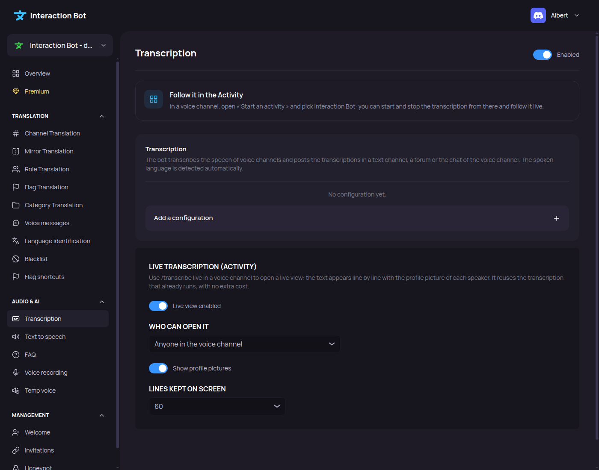

# Voice guides

Each guide starts from a server where the bot is installed, with the permissions of [Voice](voice.md#permissions). Check the [access rules](voice.md#access) first: most voice features need a premium server or a vote on [top.gg](https://top.gg/bot/893494390142697493/vote).

## 1. Read a message aloud (`/tts say`)

1. Join a voice channel of the server.
2. Run `/tts say` and type the text in `query`. The text can have up to 500 characters.
3. Optional: in `language`, start typing a language name and pick it from the suggestions. Leave it empty to detect the language automatically.
4. The bot joins your voice channel and reads the text. It answers with the embed *The bot is saying `...` in the voice channel.*
5. To stop the speech and empty the queue, run `/tts stop`. To make the bot leave, run `/tts stop` or `/disconnect`, or wait: it leaves 30 seconds after nobody but bots is left in the channel.


If you have not voted in the last 24 hours, `/tts say` answers *You need to vote for the bot to use this command.* This is true even on a premium server: the vote of the member who runs the command is checked.


## 2. Read a text channel aloud (TTS channel)

Every message of the channel is read in the voice channel of its author, for the members who are in a voice channel.

**With the command**

1. Make sure you have the *Manage Server* permission.
2. Run `/tts-channel set channel:#chat`. Optional: `language` (detected for each message if empty), `translate-to` (translate each message before reading it), and `voice-channel` (the voice channel where the messages are read, instead of the voice channel of their author).
3. The bot confirms: *The messages of #chat will be read aloud for the members who are in a voice channel.*
4. Check the list with `/tts-channel list`. To stop reading the channel, run `/tts-channel remove channel:#chat`.

**On the dashboard**

1. Open the dashboard of the server, then the page **Text to speech** (category *Audio & AI*). The page has three tabs: *Reading channels*, *Settings* (the reading options and the voices) and *Permissions*.
2. Click *Add a channel*, choose the channel, then set the *Destination* (optional), the *Language*, the *Translate to* option (premium) and the *Enabled* switch.
3. Click *Save*.

<figure><figcaption>
Text to speech page
</figcaption></figure>


A message is read only if it is 200 characters or less, has text, does not start with `/`, `!`, `.` or `$`, and either its author is in a voice channel, or the channel has a destination where someone is. Limits and anti-spam rules are in [Voice](voice.md#tts-channels).


## 3. Transcribe a voice channel manually (`/transcribe start`)

1. Join the voice channel you want to transcribe. If the bot is already connected to another voice channel of the server, it transcribes that channel instead.
2. Go to the text channel where the transcriptions must appear. Without the `channel` option, the transcriptions are posted in the channel where you run the command.
3. Run `/transcribe start`. Optional options:
   * `channel`: another text channel for the transcriptions;
   * `language`: the spoken language (detected automatically if empty);
   * `style`: `webhook` (default, under the speaker's name), `message` or `embed`.
4. Speak. The transcriptions appear in the text channel.
5. Run `/transcribe stop` when you are done. The transcription also stops when the daily time of the server is used up: 30 minutes on a free server, 3 hours on a premium server, counted per UTC day (the time starts again at midnight UTC; see [Daily time and stop](voice.md#daily-time-and-stop)).


`/transcribe start` needs a premium server, or a vote in the last 24 hours from the member who runs it. Only one transcription runs per server at a time.


## 4. Transcribe automatically when someone joins (`/transcribe auto`)

1. Make sure you have the *Manage Server* permission.
2. Check the permissions: the bot must be able to **Connect** and **Speak** in the voice channel, and to **Send Messages** in the text channel. The `embed` style also needs **Embed Links**. The `webhook` style (the default) needs **Manage Webhooks**; without it, plain messages are posted.
3. Run `/transcribe auto enable`. Optional options:
   * `voice_channel`: the voice channel that starts the transcription (any voice channel if empty);
   * `text_channel`: where the transcriptions are posted (this channel if empty);
   * `language`, `translate_to` and `style`, as in guide 3.
4. When a member joins the voice channel, the bot says *Transcription started* in the voice channel (spoken) and transcribes the channel. Nothing is posted in the text channel for the start.
5. The bot leaves 30 seconds after the last human left. To turn the feature off, run `/transcribe auto disable`.

The same settings are on the dashboard page **Transcription**: switch on *Enabled*, click *Add a configuration*, set the fields, then *Save*. A free server has **one** configuration on this page; a premium server has no limit. Up to 3 configurations can listen to the same voice channel.

<figure><figcaption>
Transcription page
</figcaption></figure>


If the bot does not start, the permissions of the channels are the first thing to check: when a permission is missing, nothing is posted. See [Voice troubleshooting](voice-troubleshooting.md).


## 5. Transcribe with a translation (premium)

The translation of a transcription is a **premium** feature. Only the translation is posted.

1. Make sure the server is premium.
2. For a one-time transcription, run `/transcribe start` with the option `translate_to`, and pick the target language from the suggestions.
3. For an automatic transcription, run `/transcribe auto enable` with the same option. You can also set *Translate to* on the dashboard page **Transcription**.
4. What is said in the target language is not translated again. If the translation fails, the original text is posted.


On a free server, `/transcribe start translate_to:...` answers *The translation of the transcription is reserved for premium servers.* Start the transcription without the option, or get [premium](../premium/premium.md).


## 6. Follow the transcription live (`/transcribe live`)

1. Join the voice channel. Make sure the server is premium, or that you have voted in the last 24 hours.
2. Run `/transcribe live`. If no transcription runs, the command starts one (same rules as `/transcribe start`). If one already runs in this channel, the view opens at once.
3. Click **Open the live transcription**. The Activity opens with the sentences as they are said.
4. On a premium server, choose the language you read in the **Translation** button. Only your view changes.
5. A member with *Manage Server* can stop the transcription from the Activity: click **Stop transcription**, then **Confirm the stop?** within 4 seconds.


The live view can be turned off or limited to members who can manage the server on the dashboard page Transcription. See [Live transcription](live-transcription.md).


## Next steps

* [Voice](voice.md): the full reference of the commands and limits.
* [Voice troubleshooting](voice-troubleshooting.md): messages and fixes.
