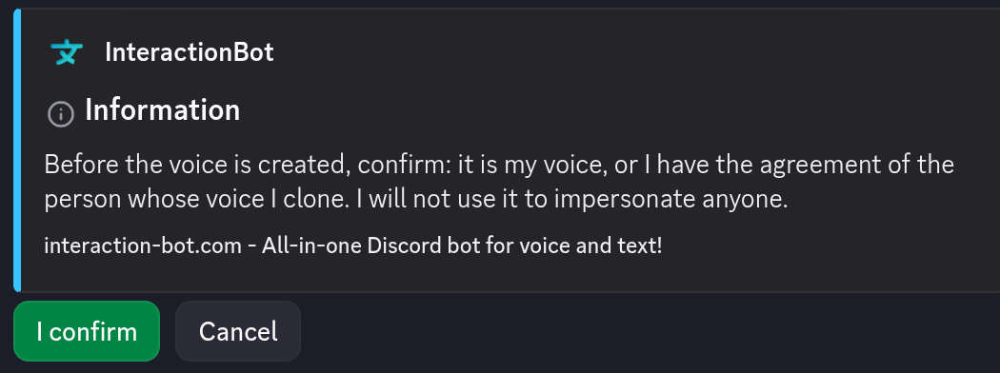

# Voices and cloning

The bot reads text with a **voice**. A voice is chosen from the **catalogue** of the speech service, either by you (with `/tts voice`) or by the server. Premium members can also create a **cloned voice** from a recording of their own voice, and use it on Discord and on the website.

* Commands and limits of the voice features: [Voice (TTS and transcription)](voice.md).
* Step-by-step examples: [Voice guides](voice-guides.md).
* Creating and managing your voices on the website: [My voice](../website/my-voice.md).

## Access

| Feature | Free | Premium |
| --- | --- | --- |
| Choose a voice from the catalogue (`/tts voice`) | Yes, if the server allows it | Yes, if the server allows it |
| Create a cloned voice (`/tts clone create`) | No | Yes, up to **5 voices** |
| List and delete your cloned voices (`/tts clone list`, `/tts clone delete`) | Yes, for the voices you already have | Yes |
| Use a cloned voice | No | Yes, see [Who can use a cloned voice](#who-can-create-and-use-a-cloned-voice) |

Voice features need a **premium server** or a **vote on [top.gg](https://top.gg/bot/893494390142697493/vote)**, as described in [Access](voice.md#access). `/tts voice` and the `/tts clone` commands need no vote. `/tts say` needs **your own** vote.


A voice is a feature of the speech service. The catalogue and the cloning depend on it: when the service does not answer, the last catalogue known is used, and a cloning request can be refused for the moment. Try again later.


## The voice catalogue

* The voices come from the speech service: the bot does not keep its own list. A voice has a name, a gender and the list of the languages it speaks.
* A voice that does not speak the language of a text is not used for it: the speech service's default voice for that language reads the text instead.
* A server can **switch off** voices, change their **order** and choose the **default voice**, on the dashboard page [Text to speech](../website/dashboard/tts-channels.md) (section *Voices*). At least one voice must stay enabled, and the default voice cannot be switched off.

## Choose your voice (`/tts voice`)

| Command | What it does |
| --- | --- |
| `/tts voice` | Shows the voice you chose. Without a choice, the message says that you get an automatic voice. |
| `/tts voice voice:<name or id>` | Chooses a voice. The name is not case sensitive. The autocompletion lists the voices you can choose. |
| `/tts voice reset:True` | Removes your choice: you get an automatic voice again. |

* The command works only if the server allows members to choose a voice (**Members choose voice** in `/tts settings`, or on the dashboard) and if you have the permission **Choosing the voice** (see [Who can do what](#who-can-do-what)).
* In a session started with `/tts start`, your voice is used from your next message, when no one else in the channel has it. Otherwise you keep the voice you have, and your choice is applied the next time you join the channel.
* A voice that does not exist on the server, or that is switched off, is refused: *This voice does not exist on this server, or it is switched off.*

### Voices in a session

When a session starts (`/tts start`), the bot gives **each member of the voice channel a voice of its own**, so that the listeners can tell who is talking:

1. the voice the member chose with `/tts voice`, when it is free and allowed;
2. otherwise the first free voice of the server's order;
3. when every voice is taken, the voices are given in turn.

A member keeps the same voice while they stay in the channel. The voice is freed when they leave. A cloned voice is always personal: it never takes a voice of the catalogue away from someone else.

### Voice of a single message (`/tts say`)

`/tts say` has an optional `voice` option. The voice is chosen in this order:

1. the `voice` given in the command;
2. your voice (`/tts voice`), when it is allowed;
3. the **default voice of the server**.

## Cloned voices

A cloned voice is a voice made from a short recording of **your** voice. Only you can use it.

### Who can create and use a cloned voice

* **Creating** a cloned voice is a Premium feature. The bot checks that **you are premium** (a Premium offer linked to your account) **or that the server where you run the command is premium**.
* **Using** a cloned voice needs the same premium rule at the time you talk: you are premium, or the server where you talk is premium. While the rule is not met, your voices are kept but not used, and the bot reads with a voice of the server.
* The server can refuse cloned voices for all its members: **Cloned voices allowed** in `/tts settings` (or on the dashboard). When it is off, nobody on the server uses a cloned voice.
* On the website, the page [My voice](../website/my-voice.md) accepts a creation when you are premium, or when one of the servers you are a member of is premium.


A voice you create on a premium server stays usable only while that server (or your own Premium offer) is premium. Your voices are never shared: the other members of the server do not see them in their choices.


### Requirements of the recording

| Rule | Value |
| --- | --- |
| Formats | `wav`, `mp3`, `ogg`, `flac`, `m4a` or `opus`. The content of the file must be that format: a file only renamed is refused. |
| Duration | **3 to 30 seconds** |
| Size | **10 MB** at most |
| Content | Your voice, alone, with clear speech. The speech service may refuse a recording with music or several voices. |
| Name | **1 to 32 characters** |
| Number | **5 voices** per member |

### Create a cloned voice (`/tts clone create`)

Run the command in a server, with two options:

* `audio`: the recording (an attachment);
* `name`: the name of the voice, 1 to 32 characters.

The bot then:

1. checks the recording (format, size, content and duration) and the name;
2. shows a confirmation message, visible to you only, with the text *Before the voice is created, confirm: it is my voice, or I have the agreement of the person whose voice I clone. I will not use it to impersonate anyone.* and two buttons, **I confirm** and **Cancel**;
3. after **I confirm**, sends the recording to the speech service once, creates the voice and says *Your voice ... is ready. Choose it with /tts voice.*

The confirmation expires after **2 minutes**. Then the recording is dropped and you must run the command again. Only the member who started the command can confirm it. A new creation can be started once every **15 seconds**, and only one voice can be created at a time per member.

<figure><figcaption>
The consent confirmation of <code>/tts clone create</code>
</figcaption></figure>

### List your cloned voices (`/tts clone list`)

Shows the name and the date of each voice, and the count, for example *2 of 5 voices used.* Only you see the answer.

### Delete a cloned voice (`/tts clone delete`)

* Run `/tts clone delete voice:<name>` and pick the voice in the suggestions. The bot deletes it at the speech service first, then from its list. If the speech service does not answer, the voice stays in your list: try again.
* Members who had chosen this voice get an automatic voice again, and a session no longer uses it.
* A deleted voice cannot be restored: you must create it again, with a new consent.

## Consent, privacy and deletion

* **Consent**: you confirm that the voice is yours, or that you have the agreement of the person whose voice you clone. The bot keeps the date of your confirmation with the voice. Do not clone someone's voice without their agreement, and do not use a cloned voice to impersonate anyone.
* **The recording is never kept.** It is read in memory, checked, sent to the speech service and dropped. It is not written to disk and it is not logged.
* **What is stored** for each voice: the identifier given by the speech service, the name, the owner, the date of the consent and the date of creation.
* **Deletion when Premium ends**: the voices of a member who is no longer premium are **kept for 30 days**, then deleted at the speech service and from the list. The bot runs this check every 6 hours. If you become premium again in that time, nothing is deleted.
* **Your data on the website**: the [Privacy card](../website/dashboard/account.md#privacy) of the account page shows the number of your cloned voices, lets you download their metadata, and deletes them with **Delete my data** and **Delete my account**.

## Who can do what

The settings of the voice features are on the dashboard page [Text to speech](../website/dashboard/tts-channels.md) or with `/tts settings` (Manage Server).

| Setting | Default | What it controls |
| --- | --- | --- |
| Members choose voice | On | Whether `/tts voice` works on the server |
| Cloned voices allowed | On | Whether the cloned voices of the members are used on the server |
| Choosing the voice (permission) | Everyone | Who can use `/tts voice` (everyone, or a list of roles and members) |

Members with the *Manage Server* permission are always allowed.

## Limits

* **Five cloned voices** per member.
* **Daily time**: each text read aloud counts towards the **text to speech time of the server**, cloned voices included: 30 minutes per day on a free server, 3 hours on a premium server, starting again at midnight UTC. See [Voice](voice.md) for the other limits.
* **Cooldowns**: `/tts clone create` once every 15 seconds per member; the other voice commands have a short cooldown too.

## Troubleshooting

| Message | Cause and fix |
| --- | --- |
| *Creating a cloned voice is for premium members. Get premium to unlock it.* | The member and the server are not premium. Get [Premium](../premium/premium.md), or run the command on a premium server. |
| *You already have 5 cloned voices, the maximum. Delete one before creating another.* | Delete a voice first. |
| *A voice is already being created. Wait for it to finish or for its confirmation to expire.* | Finish or cancel the confirmation in progress, or wait 2 minutes. |
| *The name must be 1 to 32 characters long, without links or invitations.* | Shorten the name, or remove the link or invitation. |
| *The recording must be a wav, mp3, ogg, flac, m4a or opus file.* | Export the recording in a supported format. |
| *The recording is larger than 10 MB.* | Shorten the recording or lower its quality. |
| *The recording lasts X s: it must last between 3 and 30 seconds.* | Record between 3 and 30 seconds. |
| *The API did not accept this recording. Try a clearer recording with a single voice.* | Use a recording with only your voice and no background noise. |
| *The voice cannot be created right now. Try again later.* | The speech service is busy or unavailable. Try again later. |
| *The voice cannot be deleted right now: it stays in your list, try again.* | The speech service did not answer. Try the deletion again. |
| *A cloned voice is no longer available: the default voice takes over.* | The speech service no longer knows the voice. The default voice reads instead, and the voice is removed from your list. |

## Related

* [Voice (TTS and transcription)](voice.md): the commands and the limits.
* [Voice guides](voice-guides.md): step-by-step examples.
* [My voice](../website/my-voice.md): the page of the website to create and delete your voices.
* [Premium](../premium/premium.md): what changes on a premium server or with a Premium offer.
