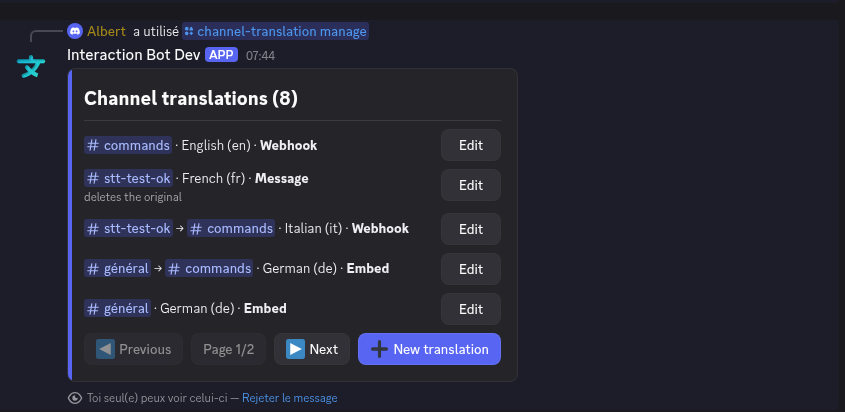
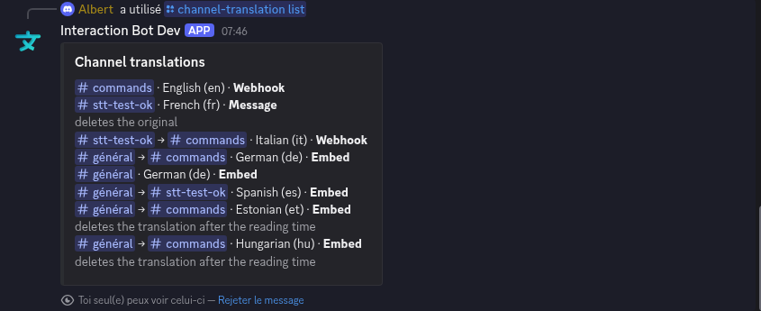
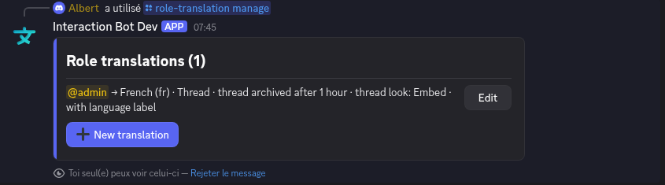
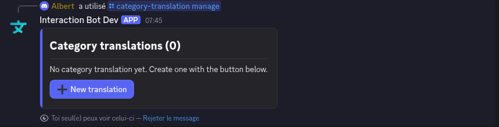
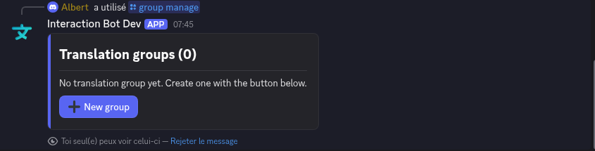
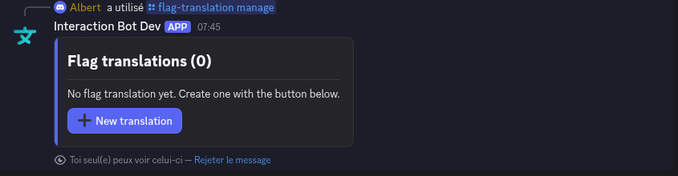
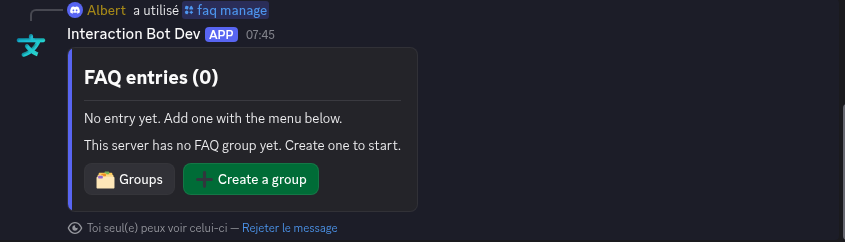
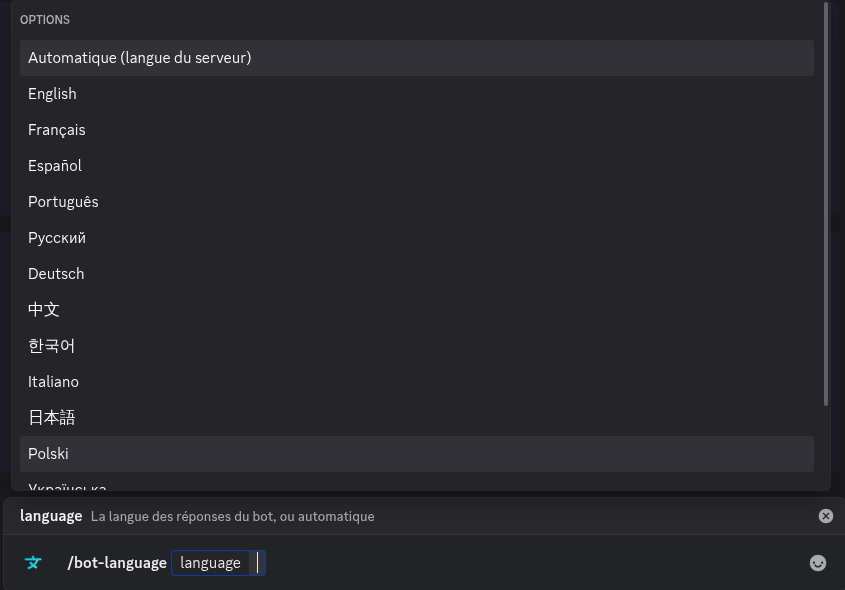
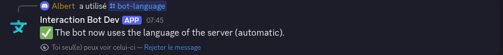

# Configuration commands

Everything you can set up on the [dashboard](../website/dashboard/README.md) can also be set up **in Discord**, with commands. These commands are for members with the **Manage Server** permission, and they work in a server where the bot is added. Their answers are **private**: only you see them.

Each family of commands has the same four commands:

| Command                | What it does                                                                                         |
| ---------------------- | ---------------------------------------------------------------------------------------------------- |
| `… set`                | Create a configuration, or change an existing one. Only the options you give are changed.            |
| `… remove`             | Delete a configuration.                                                                              |
| `… list`               | List the configurations of the server, with all their options.                                       |
| `… manage`             | Open an **interactive panel** (buttons and menus): no option to type.                                 |


The easiest way is **`manage`**: you see the existing configurations, click **Edit** on one, or **New translation**, and choose everything in menus. The commands `set`, `remove` and `list` are handy when you know exactly what you want, or to script a setup.


The same settings are in the dashboard and in the commands: a change made in one is immediately visible in the other. The options and limits (20 configurations, 500 with Premium) are the same too.

## Channel translation

`/channel-translation set | remove | list | manage` (dashboard: [Channel Translation](../website/dashboard/channel-translation.md))

<figure><figcaption>
<code>/channel-translation manage</code>: the configurations, with their style, and a button to edit each one
</figcaption></figure>

The panel lists the configurations (5 per page, with **Previous** and **Next**). The text of each line tells the source channel, the sending channel, the language and the style (*Webhook*, *Message*, *Embed*, *Thread*), and the options turned on (for example *deletes the original*). **Edit** opens the options of a configuration, **New translation** creates one.

<figure><figcaption>
The options of a configuration (here with the Thread style)
</figcaption></figure>

In the edit panel, the menus choose the **channel to translate**, the **target channel** (optional) and the **style**. The buttons turn *Delete the original*, *Delete the translation*, *Translate bots*, *Always send* and *Active* on or off. **Language** opens the choice of the language, and **Save** applies the configuration.

`/channel-translation list` shows the same information as a plain list.

<figure><figcaption>
<code>/channel-translation list</code>
</figcaption></figure>

### /channel-translation set

`/channel-translation set source:<channel> language:<language> [target] [style] [thread-look] [thread-archive] [thread-label] [delete-original] [delete-translation] [delete-after] [translate-bots] [always-send] [enabled]`

| Option               | What it does                                                                                                   |
| -------------------- | -------------------------------------------------------------------------------------------------------------- |
| `source`             | The channel whose messages are translated.                                                                     |
| `language`           | The language of the translation (choose in the list).                                                          |
| `target`             | The sending channel. By default, the same channel as `source`.                                                 |
| `style`              | **Webhook**, **Message**, **Embed** or [**Thread**](../translation/threads.md).                                |
| `thread-look`, `thread-archive`, `thread-label` | Options of the **Thread** style: look, archive delay, language label. See [Translation in threads](../translation/threads.md). |
| `delete-original`    | Delete the original message once translated.                                                                   |
| `delete-translation`, `delete-after` | Delete the translation after `delete-after` seconds (5 to 86400), or after the reading time if it is empty. |
| `translate-bots`     | Also translate the messages of bots (**Premium**).                                                             |
| `always-send`        | Send the translation even if the message already looks like the target language.                               |
| `enabled`            | Pause (`False`) or resume (`True`) the configuration.                                                          |

Example: `/channel-translation set source:#english language:French style:Thread thread-archive:3 days`

With `style:Thread`, leave `target` empty (or the same channel as `source`), and do not use `delete-original`: the thread is created under the original message. If the bot lacks the permissions to create threads, the answer warns you. See [Translation in threads](../translation/threads.md).

### /channel-translation remove

`/channel-translation remove source:<channel> [language]`: removes the translations of the channel. With `language`, only this language is removed.

## Role translation

`/role-translation set | remove | list | manage` (dashboard: [Role Translation](../website/dashboard/role-translation.md))

<figure><figcaption>
<code>/role-translation manage</code>: here a role translated in a thread, with a language label
</figcaption></figure>

`/role-translation set role:<role> language:<language> [target] [style] [thread-look] [thread-archive] [thread-label] [delete-original] [delete-translation] [always-send] [enabled]`: the messages of the members who have `role` are translated into `language`, in every channel. Without `target`, the translation is sent in the channel of the original message. The **Thread** style is available.

## Category translation

`/category-translation set | remove | list | manage` (dashboard: [Category Translation](../website/dashboard/category-translation.md))

<figure><figcaption>
<code>/category-translation manage</code> with no configuration yet
</figcaption></figure>

`/category-translation set category:<category> language:<language> [target] [style] [thread-look] [thread-archive] [thread-label] [delete-original] [delete-translation] [translate-bots] [always-send] [enabled]`: all the channels of the category are translated into `language`. The **Thread** style is available.

## Translation groups

`/group create | delete | set-channel | remove-channel | settings | list | manage` (dashboard: [Translation Groups](../website/dashboard/translation-groups.md))

<figure><figcaption>
<code>/group manage</code>: create and edit the groups with buttons and menus
</figcaption></figure>

`/group manage` opens a panel to create a group, add or remove its channels and change its settings. The other commands are described in [Translation groups](groups.md).

## Flag translation

`/flag-translation set | remove | list | manage` (dashboard: [Flag translation](../website/dashboard/flag-translation.md))

<figure><figcaption>
<code>/flag-translation manage</code>
</figcaption></figure>

`/flag-translation set channel:<channel> [enabled] [auto-delete] [mode]`: choose the channels where a flag reaction translates a message, delete the translations automatically, and translate at each new flag or only the first time. See [Flag translation](../translation/flags.md).

## Language identification and blacklist

* `/language-detection set | reset | list | manage`: ignore the messages shorter than a number of characters (0 to 500) in a channel. Dashboard: [Language identification](../website/dashboard/language-identification.md).
* `/blacklist add | remove | list | manage`: roles, channels and languages that are never translated (**Premium**). Dashboard: [Blacklist](../website/dashboard/blacklist.md).

## FAQ

`/faq add | list | remove | manage` (dashboard: [FAQ](../website/dashboard/faq.md))

<figure><figcaption>
<code>/faq manage</code>: the entries, and the groups with <strong>Groups</strong> and <strong>Create a group</strong>
</figcaption></figure>

`/faq manage` opens a panel to manage the **groups** and the **entries** (questions and answers) of the FAQ with buttons and menus, without leaving Discord. The other commands are described in [FAQ and /ask](../qa/faq.md).

## Language of the bot

`/bot-language [language]` (dashboard: [Overview > Bot Language](../website/dashboard/overview.md#bot-language))

Sets the language of the replies of the bot in your server (help, errors, panels, confirmations). By default, **Automatic**: the bot uses the language of the server on Discord.

<figure><figcaption>
<code>/bot-language</code>: Automatic, or one of the available languages
</figcaption></figure>

Choose a language in the list to apply it at once; the confirmation is already written in the new language. Without a language (or with **Open the panel**), the command opens a panel.

<figure><figcaption>
Confirmation with <strong>Automatic</strong>
</figcaption></figure>

The names of the commands stay in English; their descriptions and the replies follow the language of the user or of the server.

## Server settings

`/server-settings [warning]`: turns on or off the warning posted when a message is translated into more languages than the limit of your offer. This is the **Simultaneous Translation Warning** of the [dashboard overview](../website/dashboard/overview.md#warning). Without option, the command shows the current state.

## Related

* [Translation in threads](../translation/threads.md)
* [Styles and options](../translation/styles-and-options.md)
* [All commands](all-commands.md)
