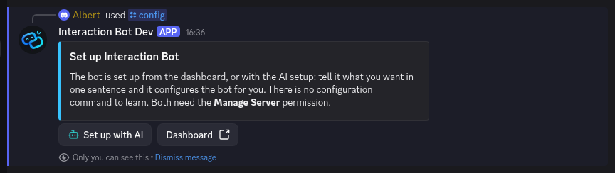

# General

These commands are not about one feature. The complete list of every command is on the [All commands](all-commands.md) page.

| Command | What it does | Who |
| --- | --- | --- |
| `/help [command]` 👤 | A card with the sections of the bot. `/help <command>` shows the details of one command. | Everybody |
| `/config` | Says how the bot is set up, with two buttons: **Set up with AI** and the link to the dashboard. | Everybody |
| `/ai setup` | Opens the AI setup conversation in the channel. See [AI setup](../management/ai-setup.md). | Manage Server |
| `/dashboard` 👤 | Sends the link to the dashboard. | Everybody |
| `/premium add [guild-id]` | Gives Premium to a server with one of your slots. See [Usage](../premium/usage.md). | Everybody |
| `/premium remove [guild-id]` | Removes Premium from a server. See [Usage](../premium/usage.md). | Everybody |
| `/limits` | The daily audio limits of the server. | Everybody |
| `/privacy` 👤 | What the bot keeps about you, and your opt-out. | Everybody |
| `/reminder <enable>` 👤 | Turns on or off the reminder to vote for the bot on top.gg. | Everybody |
| `/about` | Information about the bot. | Everybody |
| `/ping` 👤 | The latency of the bot. | Everybody |
| `/invite` 👤 | The invitation card of the bot. | Everybody |
| `/support` 👤 | The invitation to the support server. | Everybody |
| `/documentation` 👤 | The link to this documentation. | Everybody |
| `/check-permissions` | Lists the permissions the bot lacks in the channels that are set up. | Manage Server |

👤 means that the command also works as a [user app](user-app.md).

## Setting up the bot

The bot has no configuration command. Everything is set up on the [dashboard](../website/dashboard/README.md) of [interaction-bot.com](https://interaction-bot.com), or by talking to the AI setup: `/ai setup`, or the **Set up with AI** button of `/config` and `/help`. The AI setup reads the settings of the server, writes the plan of its changes, and changes nothing until you confirm it. See [AI setup](../management/ai-setup.md).

`/config` needs a server: it does not work in private messages.

<figure><figcaption>
The answer of /config
</figcaption></figure>

## Help

`/help` is a card that answers at once. Its menu opens the sections of the bot, in the order of the dashboard: **Overview and Premium**, **Translation**, **Audio and AI**, **Management** and **Help and links**. The list of a section is a private answer. `/help` also works without the bot in the server, as a [user app](user-app.md).

## Links

* `/invite` shows a card with five buttons: **Add to a server**, **Add to my account** (to install the bot as a [user app](user-app.md)), **Support**, **Dashboard** and **Vote**.
* `/support` gives the invitation of the support server.
* `/documentation` gives the link to this documentation.
* `/dashboard` gives the link to the dashboard.

## About and ping

`/about` describes the bot and shows its uptime, the cluster that answers you, and the number of servers, users and shards.

`/ping` shows the latency of the bot in milliseconds.

## Premium and limits

* `/premium add` and `/premium remove` turn Premium on and off for a server. The offers and the slots are explained in [Premium](../premium/premium.md) and [Usage](../premium/usage.md).
* `/limits` shows how much of the daily transcription, text to speech and recording time the server has used. The limits start again every day at midnight UTC. See [Limits and privacy](../audio/limits-and-privacy.md).

## Privacy

`/privacy` tells what the bot keeps about you: your voice in the recordings where you speak, your notes and your settings. It shows your choices (opted out or not) and how to change them. The opt-outs are also on the [Account page](../website/dashboard/account.md). See [Limits and privacy](../audio/limits-and-privacy.md).

## Vote reminder

Some voice features need a vote for the bot on [top.gg](https://top.gg/bot/893494390142697493/vote), unless the server has Premium. A vote is valid for 24 hours, and the vote of one member of a server unlocks these features for everyone in that server.

`/reminder enable:True` asks the bot to send you a private message, once a day, as long as your last vote is more than 24 hours old. `/reminder enable:False` turns it off. The setting is personal: it applies on every server. The same switch is on the [Account page](../website/dashboard/account.md).

## Who sees the answer

Most answers are posted in the channel, for everybody to see. These answers are private, shown only to the person who ran the command:

* `/config`, `/privacy`, `/rules`, `/personal-language`, `/record list`, `/tts clone` and `/invite-info`;
* the answers of the commands that only members with a Discord permission can run, such as `/ai setup`, `/check-permissions` and the `/invite-admin` commands;
* the commands of the temporary voice channels menus, and the right-click menus **Translate**, **Detect** and the transcription of a voice message.

`/translate`, `/detect` and `/languages` are public. The buttons and menus keep their own setting.
