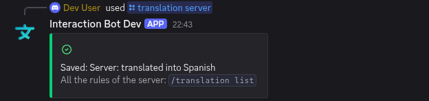
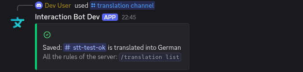
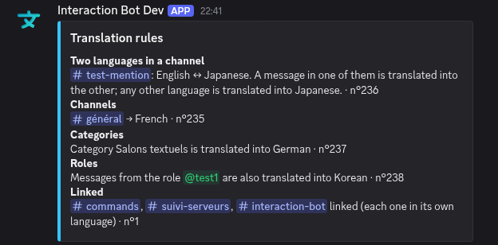
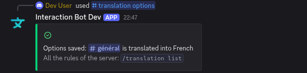
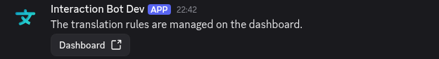

# Translation commands

| Command                            | Description                                                                                          |
| ---------------------------------- | ---------------------------------------------------------------------------------------------------- |
| `/translate <message> [language]`  | Translate a text. Without `language`, your default language ([Account page](../website/dashboard/account.md)) or your Discord language is used. The answer is public. Works as a [user app](user-app.md).          |
| `/detect <text>`                   | Tell the language of a text. The answer is private.                                                                          |
| `/languages`                       | List the 100 supported languages.                                                                    |
| **Apps > Translate**               | Right click a message: private translation in your default or Discord language. Works as a [user app](user-app.md).                                 |
| **Apps > Detect**                  | Right click a message: language of the message.                                                      |
| `/personal-language <language>`    | Choose the language of your own translations (**Apps > Translate** and `/translate`). `none` goes back to your Discord language. The answer is private. Same setting as on the [Account page](../website/dashboard/account.md). |
| `/translation ...`                 | Translation rules set up from Discord, see [Translation rules](#translation-rules) below. |
| `/group ...`                       | Translation groups, see [Translation groups](groups.md).                                              |
| `/channel-translation`, `/role-translation`, `/category-translation` | Automatic translation set up from Discord (`set`, `remove`, `list`, `manage` panel), thread style included, see [Configuration commands](configuration.md). |
| `/flags set` / `/flags clear`      | Flag shortcuts under the messages of a channel, see [Flags](flags.md).                                |
| `/check-permissions`               | List the permissions the bot lacks in the configured channels.                                       |

## Translation rules

`/translation` groups the automatic translation commands. All its sub-commands are free, except the `translate-bots` option.

| Sub-command | What it does |
| --- | --- |
| `/translation setup` | Guided setup in one command: bilingual channel, one channel per language, the whole server, or one channel. |
| `/translation server language` | Translate all the messages of the server. |
| `/translation channel place language [target] [replace]` | Translate a channel or a category. |
| `/translation reverse channel language_1 language_2 [replace] [other]` | Two languages in one channel, in both directions. `other`: where a message in a third language goes (the first language, the second one by default, or none). |
| `/translation link channel_1 language_1 channel_2 language_2 [channel_3 language_3] [replace]` | Link 2 or 3 channels, each one translated into the language of the others. |
| `/translation list` | List all the rules of the server, numbered. |
| `/translation remove rule` | Remove a rule or a link. |
| `/translation options rule ...` | Advanced options of a rule: style (Webhook, Message, Embed, Thread), delete after, always send, delete the original, pause, thread look and archive. `translate-bots` (translate the messages of bots) is **Premium**. |
| `/translation delay seconds [rule]` | Time before the translations are deleted: 5 to 86400 seconds, `auto` (reading time) or `off`. Without `rule`, applies to all the rules. |
| `/translation copy source channel_1 [... channel_5] [replace]` | Copy the rule of a channel to up to 5 channels. |
| `/translation help [topic]` | Help on the rules. |
| `/translation manage` | Points to the [dashboard](../website/dashboard/) where the rules are managed. |

<figure><figcaption>
Result of /translation server
</figcaption></figure>

<figure><figcaption>
Result of /translation channel
</figcaption></figure>

<figure><figcaption>
/translation list
</figcaption></figure>

<figure><figcaption>
/translation options
</figcaption></figure>

<figure><figcaption>
/translation manage
</figcaption></figure>

A server holds up to **30 rules** (free) or **200** (Premium), links included. A channel has one rule: use `replace` to change it.

The older commands (`/channel-translation`, `/category-translation`, `/role-translation`, `/group`) still exist. On a server whose rules were converted, they do nothing and answer privately with the equivalent `/translation` command.


`/translate`, `/detect`, `/languages`, `/help`, `/invite`, `/dashboard`, `/support` and the **Translate** / **Detect** menus can be used without adding the bot to the server: see [User app](user-app.md).



Everything about **how translation works** (automatic translation, flags, limits, detection, troubleshooting) is in the [Translation section](../translation/overview.md). Automatic translation by channel, role and category is configured on the [dashboard](../website/dashboard/).



[overview.md](../translation/overview.md)

