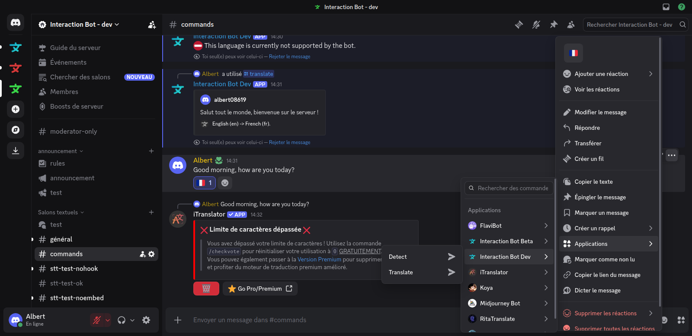

# Translation

Interaction Bot provides many ways to translate messages. The advanced configuration (channels, roles, categories, flags, blacklist...) is done on the [dashboard](../website/dashboard/).

There are several ways to translate a message:

* **Command** -> translate a text into a given language (see `/translate`).
* **Application - Translate** -> right click (or long press) a message, then *Apps* > *Translate*. The target language is your Discord application language. The result is ephemeral: only you can see it.\
  
  
* **Application - Detect** -> *Apps* > *Detect* shows the language of the selected message.
* **Flag reaction** -> add a flag emoji below a message (see [Flag translation](../website/dashboard/flag-translation.md)).
* **Automatic** -> translation of the sent messages by [channel](../website/dashboard/channel-translation.md), [role](../website/dashboard/role-translation.md) or [category](../website/dashboard/category-translation.md).

| Command                           | Description                                                                                          |
| --------------------------------- | ---------------------------------------------------------------------------------------------------- |
| `/translate <message> [language]` | Translate the message. Without `language`, your Discord language is used. The answer is ephemeral.   |
| `/detect <text>`                  | Detect the language of a text.                                                                       |
| `/languages`                      | Display all the languages supported by Interaction Bot.                                              |


The old `/config` commands no longer exist: everything is configured on the [dashboard](../website/dashboard/).


#### Common parameters (dashboard)

| Parameter                | Possible values         | Usage                                                                                   |
| ------------------------ | ----------------------- | --------------------------------------------------------------------------------------- |
| Language                 | Any language of `/languages` | The target language of the translation.                                            |
| Style                    | embed \| webhook \| message | How the translation is sent.                                                      |
| Delete message           | on \| off               | Delete the original message and keep only the translation.                              |
| Delete translation       | on \| off               | The bot deletes its translation after a delay depending on its length.                  |
| Translate bot            | on \| off               | Also translate messages sent by bots (**premium only**).                                |
| Always send              | on \| off               | Send the translation even if the message is already in the target language.             |
