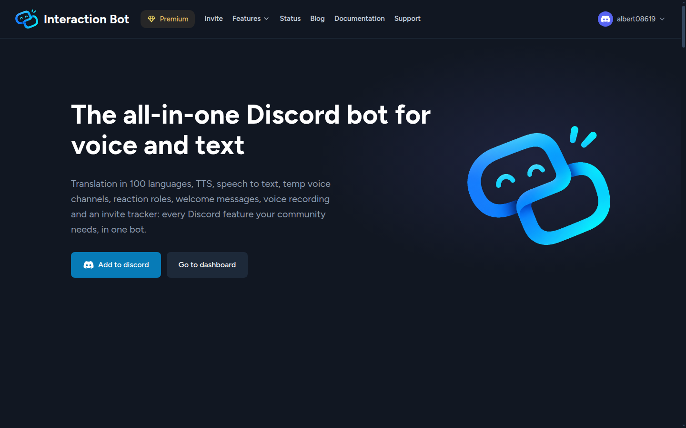
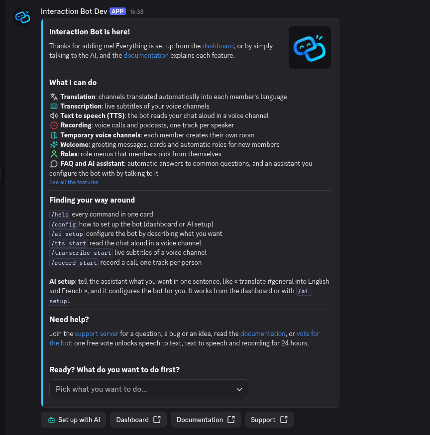
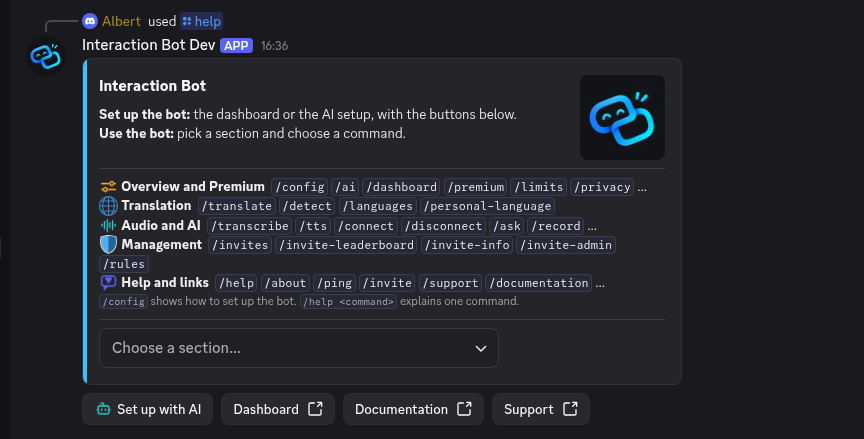
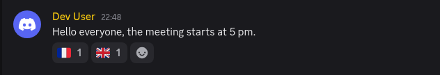
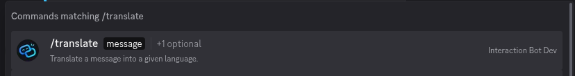

# Getting started

## :white\_check\_mark: Invitation of the bot

First, invite the bot to your Discord server from the website [<mark style="color:blue;">interaction-bot.com</mark>](https://interaction-bot.com): click **Add to Discord**, then choose your server.

<figure><figcaption>
The home page of the website
</figcaption></figure>

You need the **Manage Server** permission on the server. The invitation asks for the permissions the bot uses; they are listed in [Permissions](permissions.md).


After clicking on _Continue_ for the next steps, you have invited Interaction Bot, congratulations!


## :wave: The welcome message of the bot

When the bot joins your server, it posts a card in a channel where it can write. The card says what the bot does, lists the commands to know, and then asks **what you want to do first**:

* **Translate messages**: channels translated automatically, or one message on demand;
* **Transcribe a voice channel**: live subtitles of what people say;
* **Read the chat in a voice channel (TTS)**: the bot reads aloud what you type;
* **Record a voice channel**: one track per person;
* **Temporary voice channels**: each member creates their own room.

Pick one in the menu. The card turns into a guide of at most three steps, with the commands to type and the matching page of the dashboard. For transcription, text to speech and recording, a button runs the real command for you when you are in a voice channel.

Under the card, the buttons lead to the **AI setup**, the **Dashboard**, the **documentation** and the **support server**.

<figure><figcaption>
The welcome card of the bot on a new server
</figcaption></figure>

## :rocket: Set it up in a minute

There is no configuration command to learn. Three ways, which all write the same settings:

1. **Quick setup** on the dashboard: a guided page that sets the main modules one after the other. See [Quick setup](management/quick-setup.md).
2. **The AI setup**: say what you want in one sentence, for example *translate #general into English and French*. The assistant reads your server, shows a plan, and applies it after your yes. Start it with `/ai setup`, or with the **Set up with AI** button of the welcome card. See [AI setup](management/ai-setup.md).
3. **The dashboard**: pick the channels, the languages and the options of each feature yourself, on [interaction-bot.com](https://interaction-bot.com). See [Dashboard](website/dashboard/README.md).

Quick setup, the AI setup and the dashboard need the **Manage Server** permission.

Not sure where to start? Type `/config`. It explains the two ways, with a button for the AI setup and a link to the dashboard of your server.

## :books: Find your way around with /help

Type `/help` to see the commands of the bot. They are grouped like the menu of the dashboard:

* **Overview**: quick setup, the AI setup, the dashboard, Premium;
* **Translation**: translate, detect, languages, personal language;
* **Audio and AI**: transcription, text to speech, FAQ, voice recording, temporary voice channels;
* **Management**: invitations and the rules;
* **Help**: the help, the invitation, the support, the documentation.

`/help` with a command name, for example `/help tts`, shows the details of that command.

<figure><figcaption>
The /help card
</figcaption></figure>

## :key: Give the bot its permissions

The bot works with the permissions it receives when you invite it. For translation it needs, in the channels it uses: **View Channel, Read Message History, Send Messages, Embed Links, Attach Files**, plus **Manage Webhooks** for the webhook style and **Manage Messages** to delete original messages. If something does not work, run `/check-permissions`: it tells you which permission is missing in which channel. Details: [Permissions](permissions.md) and [Troubleshooting](translation/troubleshooting.md#permissions).

## :robot: Your first translation

There are three quick ways to translate, without any configuration:

1. **A flag reaction**: send a message, then add a flag emoji below it. The bot answers with the translation.

<figure><figcaption>
React with a flag to translate a message
</figcaption></figure>

2. **The command** <mark style="color:green;">`/translate message [language]`</mark>. The result is posted in the channel.

<figure><figcaption>
The /translate command
</figcaption></figure>

3. **The Apps menu**: right click a message > *Apps* > *Translate*.


**You can't add the bot to a server?** Install it on your own Discord account instead: `/translate`, **Apps > Translate** and **Apps > Detect** then work in any server and in DMs. See [User app](commands/user-app.md).


## :gear: Translate automatically

To translate messages **without anybody doing anything**, set up a translation rule. The simplest is the **server language**: every channel is then translated into it. Quick setup proposes it at its first step. Afterwards, a rule can be made for a channel, a category or a role, and the most precise rule wins.

On the dashboard, section **Translation**:

* [Translation rules](website/dashboard/translation-rules.md): the rules of the server, of channels, categories and roles, and the linked channels;
* [Flags](website/dashboard/flag-translation.md): translation by a flag reaction, and flags added automatically;
* [Exceptions](website/dashboard/exceptions.md): the members, roles, channels and languages that are not translated.

Not sure which one to use? Read the [translation overview](translation/overview.md), the [automatic translation](translation/automatic.md) page and the [setup guides](translation/guides.md).

## :microphone: And more

* **Text to speech** and **transcription** in voice channels: [Voice](audio/voice.md).
* **Voice recording** and **temporary voice channels**: [Recording](audio/recording.md) and [Temporary voice channels](audio/tempvoice.md).
* A **FAQ** that answers your members' questions: [FAQ and /ask](qa/faq.md).
* **Management**: [welcome and goodbye](management/welcome-and-goodbye.md), [invitations](management/invite-tracker.md), [honeypot](management/honeypot.md), [reaction roles](management/reaction-roles.md), [bot profile](management/bot-profile.md) and [event log](management/event-log.md).
* **Premium** for higher limits and more options: [Premium](premium/premium.md).


Need help? Join the [support server](https://support.interaction-bot.com) or read the [FAQ](faq.md).


Where to go next:


[overview.md](translation/overview.md)



[Dashboard](website/dashboard/README.md)



[general.md](commands/general.md)

