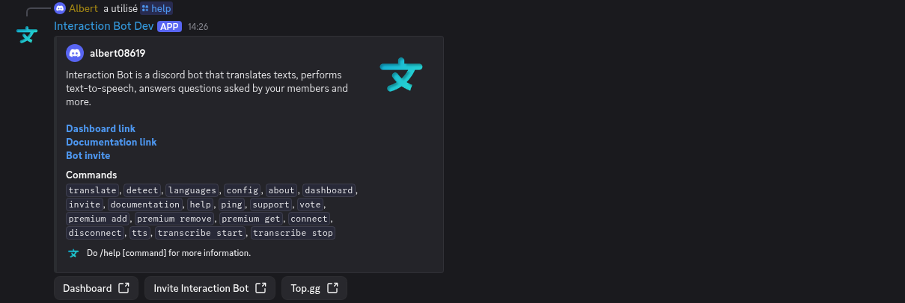
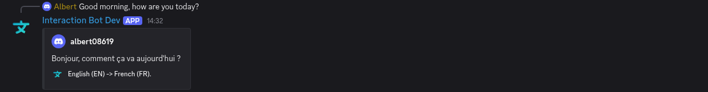
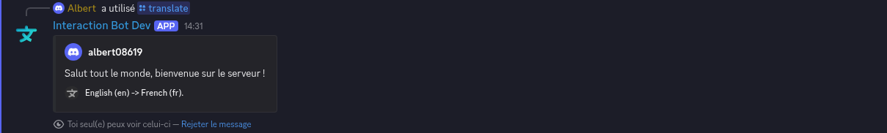

# Getting started

## :white\_check\_mark: Invitation of the bot

First, invite the bot to your Discord server from the website [<mark style="color:blue;">www.interaction-bot.com</mark>](https://interaction-bot.com)

<figure><figcaption>
Click On the button "Add to dicord"
</figcaption></figure>

<figure><figcaption>
Select your server
</figcaption></figure>


#### After clicking on _Continue_ for the next steps, you have invited Interaction Bot, congratulations!


## :key: Give the bot its permissions

The bot works with the permissions it receives when you invite it. For translation it needs, in the channels it uses: **View Channel, Read Message History, Send Messages, Embed Links, Attach Files**, plus **Manage Webhooks** for the webhook style and **Manage Messages** to delete original messages. If something does not work, run `/check-permissions`: it tells you which permission is missing in which channel. Details: [Troubleshooting](translation/troubleshooting.md#permissions).

## :robot: Your first translation

Run `/help` to see all the commands.

<figure><figcaption>
/help command
</figcaption></figure>

There are three quick ways to translate, without any configuration:

1. **A flag reaction**: send a message, then add a flag emoji below it.

<figure><figcaption>
Add a flag emoji below a message
</figcaption></figure>

<figure><figcaption>
The bot answers with the translation
</figcaption></figure>

2. **The command** <mark style="color:green;">`/translate message [language]`</mark>. The result is private.

<figure><figcaption>
/translate command
</figcaption></figure>

3. **The Apps menu**: right click a message > *Apps* > *Translate*.


**You can't add the bot to a server?** Install it on your own Discord account instead: `/translate`, **Apps > Translate** and **Apps > Detect** then work in any server and in DMs. See [User app](commands/user-app.md).


## :gear: Translate automatically

To translate messages **without anybody doing anything**, configure the bot on the [dashboard](website/dashboard/): log in with Discord, select your server and pick:

* [Translation Groups](website/dashboard/translation-groups.md): one channel per language, the easiest for an international community;
* [Channel translation](website/dashboard/channel-translation.md), [Role translation](website/dashboard/role-translation.md) or [Category translation](website/dashboard/category-translation.md).

Not sure which one? Read the [translation overview](translation/overview.md) and the [setup guides](translation/guides.md).

## :microphone: And more

* **Text to speech** and **speech to text** in voice channels: [Voice](commands/voice.md).
* A **FAQ** that answers your members' questions: [FAQ and /ask](commands/faq.md).
* **Premium** for higher limits and more options: [Premium](premium/premium.md).


Need help? Join the [support server](https://support.interaction-bot.com) or read the [FAQ](faq.md).


Where to go next:


[overview.md](translation/overview.md)



[dashboard](website/dashboard/)



[general.md](commands/general.md)

