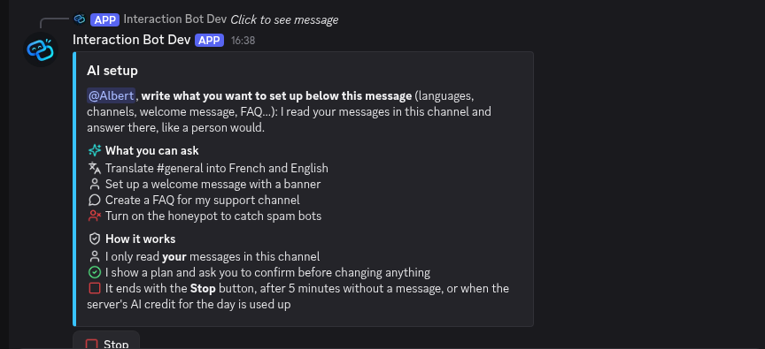
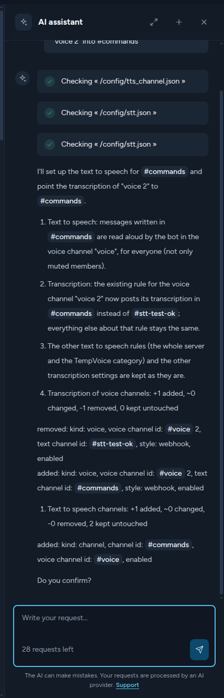
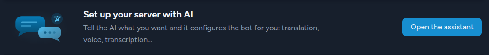

# AI setup

The AI assistant configures Interaction Bot for you. You say what you need in plain words. The assistant reads the current settings of your server, shows a **plan**, and changes anything only after you **confirm** the plan.

There are two ways to use it:

* **In a channel**: the command `/ai setup`, see [Start a conversation](#start-a-conversation).
* **On the dashboard**: the AI assistant panel, see [Dashboard assistant](#dashboard-assistant).

Both use the same assistant, the same tools and the same safety rules.

* Settings the assistant can change: [What the assistant can change](#what-the-assistant-can-change).
* Limits: [Credits and limits](#credits-and-limits).
* Data sent to the AI provider: [Privacy](#privacy).

## Start a conversation

Run **`/ai setup`** in the channel where you want the conversation. The command is in the group `/ai`.

| Command | Description |
| --- | --- |
| `/ai setup` | Start a conversation with the AI in this channel to configure the bot. |

The button **Set up with AI** of `/help` and of `/config` (in a server) starts the same conversation in the channel.

### Requirements

| Requirement | Detail |
| --- | --- |
| Who can start it | Members with **Manage Server** (or Administrator). |
| Bot permissions in the channel | **View Channel**, **Send Messages**, **Embed Links** and **Read Message History**. If one is missing, the bot lists the missing ones and does not start. |
| Your message processing | You must not have opted out of message processing. See [Privacy](#privacy). |
| One conversation per server | While a conversation runs, `/ai setup` says where it runs and who started it. |

After the command, the bot posts the **AI setup** message, with the **Stop** button under it: write your request below it. Only the messages of the person who started the conversation, in that channel, are read.

<figure><figcaption>
The message of /ai setup, with the Stop button
</figcaption></figure>

The bot shows the message **as a notice**: a title with the icon of the bot, the examples, and the rules of the conversation (who is read, the five minutes, and the Stop button).

## How a conversation works

1. **Write what you want.** For example: "Translate #general into French and English" or "Set up a welcome message with a banner".
2. **The assistant reads your server.** It finds channels and roles by name and reads their current settings.
3. **The assistant asks, if needed.** When the request is vague, it asks one or two short questions. It does not guess a choice that changes the server.
4. **The assistant shows a plan.** The plan is a short summary and a list of steps. Nothing is changed yet.
5. **Confirm or change the plan.** Reply with a short yes, such as "yes", "ok" or "go ahead". Any other answer is a new request: "no", or "yes, but keep #general", for example. The assistant then proposes a new plan.
6. **The assistant applies the plan.** It makes only the changes of the plan. Then it lists each change: a green check for a change done, a red cross with the reason for a change that failed.

A plan stays valid for **10 minutes**. A yes sent after that does not confirm the plan.

## Stop and endings

The **Stop** button is on the **AI setup** message posted by the command, not under each answer. It stays there while the conversation runs.

* **Who can press it:** the person who started the conversation, or any member with Manage Server.
* **What it does:** the conversation ends. The changes already made stay in place.

A conversation also ends by itself, for these reasons. The bot then posts a short message in the channel, and removes the Stop button.

| Why it ends | Message in the channel |
| --- | --- |
| You press **Stop** | AI setup stopped. Start it again with `/ai setup` whenever you want. |
| Nobody wrote for 5 minutes | AI setup ended because nobody wrote for a while. Start it again with `/ai setup`. |
| The assistant judges the work finished | AI setup finished. Start it again with `/ai setup` if you need more. |
| The server has used its AI requests for the day | AI setup ended: this server has used all its AI requests for today. Try again tomorrow, or get Premium for more. |
| You have used your own AI requests for the day | AI setup ended: you have used all your AI requests for today (a limit per person, all servers together). Try again tomorrow. |
| The AI service has reached its daily capacity | AI setup ended: the AI service has reached its daily capacity. Try again tomorrow. |
| You no longer have Manage Server | AI setup ended: you no longer have the Manage Server permission. |
| You opted out of message processing | AI setup ended: you opted out of message processing, so your messages are no longer read. |
| The assistant is not available | AI setup ended: the AI assistant is not available right now. |
| The assistant did not answer three times in a row | AI setup ended: I could not reach the assistant several times in a row. |

A single failed answer shows *I could not reach the assistant. Try again in a moment.* The conversation goes on.

Other endings:

* **The 5 minutes** are counted from your last message and from the last reply of the assistant.
* **A conversation is lost when the bot restarts.** It is kept in the memory of the bot only. Start it again with `/ai setup`.


If you start a conversation and then stop it with **Stop**, you can start a new one at any time. Only one conversation runs per server.


## Credits and limits

* **Each request to the assistant uses one credit.** A request is one of your messages that the assistant answers.
* **The credit is per server, per day.** The `/ai setup` conversations and the dashboard assistant share the same credit for a server.
* **Free and Premium servers have different daily credits.** A free server has **50** requests a day, a Premium server **1000**. The number of requests left is shown in the status line of the dashboard assistant (*n requests left*). The conversation in the channel ends when the credit is used up.
* **Each person has a daily limit too, across all servers:** **40** requests a day, Premium or not. It applies to the dashboard and to `/ai setup` together. Premium does not raise it.
* **The AI service has a daily budget shared by all servers.** When it is used up, the assistant is not available until the next day.
* **A longer message is cut to 4000 characters.** The assistant reads only the first 4000 characters.
* **One answer at a time.** Send the next message when the assistant has answered.

The `/ai setup` command itself does not need Premium. The settings the assistant changes keep their own rules: for example, translating voice messages is a Premium feature, see [Premium](../website/dashboard/premium.md).

## What the assistant can change

The assistant reads and changes the **settings of the dashboard**, for this server only. Nearly everything a page of the dashboard can change is open to it (the exceptions are listed below). For example:

* translation: rules of the server, channels, categories, roles, mirrors, flags and their shortcuts, exceptions, and voice messages;
* transcription of voice channels, text to speech (rules and voices), voice recording;
* FAQ, welcome, goodbye and private messages, the welcome hub, invitations, honeypot, reaction roles and event log;
* the bot profile (nickname and bio; the pictures are sent from the page only);
* temporary voice channels;
* turning features on or off.

The assistant **cannot**:

* change the Premium status of the server, or buy Premium;
* give or invite permissions, or change the invitation link of the bot;
* send the pictures of the bot profile;
* answer questions that are not about Interaction Bot, such as general knowledge, programming, or writing a text for you;
* change its own rules from the conversation. A message that asks it to ignore them is refused.

Rules for changes:

* **Every change is in the plan you confirm.** Nothing is changed before your yes.
* **Deletions are always in the plan.** They need your confirmation like the other changes.
* **Creating things on Discord** (for example, the channels of the temporary voice setup) also needs your confirmation.
* **The assistant reads channel and role names,** and their identifiers, to find them. It does not show identifiers in its messages.

## Dashboard assistant

On the dashboard, the assistant is in a panel on the right side of the page.

* **Open it:** on the **Overview** page, the card **Set up your server with AI** has the button _**Open the assistant**_. The panel is also reachable from the dashboard while you browse the other pages.
* **Header:** the title **AI assistant**, the status line (for example, the number of requests left), and the buttons _**New conversation**_ and _**Close**_.
* **Suggestions:** an empty conversation shows four examples: *Translate my main channel into French*, *Turn on transcription for voice channels*, *Set voice messages to automatic transcription* and *What can you do?*.
* **Plan and confirmation:** the same as in a channel. Reply in the box below.
* **Steps:** each change appears as a line: *Checking*, *Changing* or *Deleting in* the feature. A change made in this panel has an _**Undo**_ button for one hour. _**Undo**_ restores the settings as they were before that change.
* **Stop:** while the assistant answers, the _**Stop**_ button stops the answer. The changes already made stay in place.

<figure><figcaption>
The AI assistant panel: a request, the checks, then the plan to confirm
</figcaption></figure>

<figure><figcaption>
The « Set up your server with AI » card of the Overview page
</figcaption></figure>

* **Limits:** when the daily limit is reached, the box is locked and a banner says *Daily limit reached. Come back tomorrow or go premium for more requests.* The banner has a _**Go premium**_ link. When the budget is used up, the message is *The assistant is busy right now. Try again later.*

The assistant can make mistakes. Check the steps of each change, and the settings page of the feature if you want to be sure.

## Privacy

* **What is sent to an AI provider.** While a conversation runs, the messages of the person who started it, the earlier messages of the same conversation, and the settings the assistant reads or changes are sent to an AI model provider (OpenRouter, which forwards the request to the host of the model) to produce each answer. Nothing else you write on Discord is sent to it. The dashboard says it too: *Your requests are processed by an AI provider.*
* **What the bot keeps.** The bot keeps the conversation in its memory while it runs. It is not written to a database. When the conversation ends, it is forgotten.
* **What the website keeps.** It keeps counters of requests per server and per day, and per person and per day, and the cost of the day. It also keeps a log of the changes made (the feature, a short label of the change, and the result) for **90 days**. The log does not keep the text of the conversation.
* **Opt-out.** A person who opted out of message processing is not read by the assistant. The conversation ends with the notice shown in [Stop and endings](#stop-and-endings). The opt-out is set on the **Account** page of the dashboard. `/privacy` shows its state. See [Security and privacy](../security.md).
