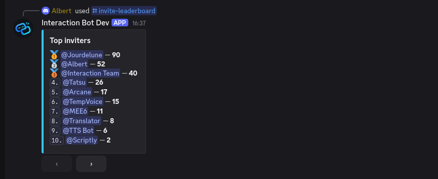

# Invite tracker

The invite tracker tells you **who invited each new member**. For each arrival, the bot finds the invite that was used. The arrival is counted for the member who created that invite.

The tracker is **on** by default on a server that adds the bot. On a server that already had the bot, it is **off** until an administrator turns it on. Nothing is recorded while it is off.

* Settings, rules and ranking on the website: [Invitations (dashboard)](../website/dashboard/invites.md).
* Welcome messages that name the inviter: [Welcome and goodbye](welcome-and-goodbye.md).
* Permissions the bot needs: [Permissions needed](#permissions-needed).

## How it works

1. An administrator turns the tracker on in the dashboard, in _**Management**_ > _**Invitations**_ (the switch at the top of the page).
2. The bot keeps in memory the number of uses of every invite of the server.
3. A member joins. The bot reads the invites again. The invite whose use count went up is the one the member used.
4. The bot records the arrival (member, invite, inviter, date) and gives the result of the arrival: counted, or the reason it is not (see [Counting rules](#counting-rules)).
5. When the member leaves, the bot takes the point back from the inviter, if the arrival was counted.

The bot never guesses. When no invite, or more than one invite, can explain the arrival, the journal shows **Invite not found**. No one gets the point. See [Why an arrival is not attributed](#why-an-arrival-is-not-attributed).

### How a total is computed

**Total = joined - left - fake + added by hand**

| Count | Meaning |
| --- | --- |
| Joined | Arrivals of the members this inviter brought, that were counted. |
| Left | Departures of those members. A departure of a fake account is not counted. |
| Fake | Arrivals of very recent accounts, and of the members who came back when they are not counted again. |
| Added by hand | The corrections of the dashboard and of `/invite-admin`: _Bonus_ and _Regular_ add to the total, _Left_ and _Fake_ take away from it. A negative amount does the reverse. Undone corrections are left out. |

The total is what the ranking and `/invites` show.

## Counting rules

These rules are set on the _**Rules**_ tab of the dashboard. Each arrival gets one result (the reasons are listed in the [Journal](../website/dashboard/invites.md#journal)).

| Rule | Default | What it does |
| --- | --- | --- |
| **Fake accounts** | Younger than 3 days | An account younger than this when it joins is a fake account for its inviter. The total does not change. 0 turns the filter off. The maximum is 300 days. |
| **Self-invites** | Ignored | A member who joins with their own invite is not counted. |
| **When an invitation counts** | On arrival | On arrival, after the member accepts the rules (membership screening), or after the verification. |
| **Minimum time on the server** | None | The invitation counts only if the member is still on the server after this delay (up to 30 days). |
| **Returning members** | Restored | A member who leaves and comes back: the invitation counted before is counted again. Turn on _Do not count returning members_ and the return counts as a fake account for the inviter instead. |
| **Bots** | Not counted | A bot that joins is not counted for anyone. |
| **Raid** | Paused | When many accounts arrive at once, counting stops until it calms down. |
| **Inviters who earn nothing** | - | The invitees are still written in the journal, but nobody gets the point. Up to 1000 members. |
| **Roles that earn nothing** | - | Someone who has one of these roles when a member joins earns nothing for it. Not retroactive. Up to 20 roles. |
| **Labels with no credit** | - | An invite labelled _Nobody earns this invite_ gives no point to anyone. |

A line that waits for the rules or the verification for more than 7 days is closed as not counted.

The welcome messages are not affected by these rules: they still say who invited the member.

## Set up in a few minutes

1. **Give the bot the Manage Server permission.** Without it, the bot cannot read the invites. See [Permissions needed](#permissions-needed).
2. **Open the dashboard**, _**Management**_ > _**Invitations**_ (see [Invitations (dashboard)](../website/dashboard/invites.md)).
3. **Turn the switch on** at the top of the page, then click _**Save**_ in the bar at the bottom of the page if it asks.
4. **Check the lights** on the _**Status**_ tab. When every check is green, the page says _Invite tracking is working_.
5. **Optional:** name your invites and give them a role in the _**Links**_ tab, and add `{inviter}` to your welcome message.

Only the arrivals after the tracker is turned on are counted. Members who joined before are not in the totals, unless you use _Count past uses once_ on the _**Status**_ tab, which adds the uses that the links already have.

## Commands

<figure><figcaption>
The answer of /invite-leaderboard
</figcaption></figure>

| Command | Who sees the answer | What it does |
| --- | --- | --- |
| `/invites [user]` | Everybody | Shows how many people a member invited: the total, and the joined, left, fake and added by hand counts. It also shows the number of arrivals still waiting for a condition, and the rank. The member is you by default. |
| `/invite-leaderboard [period] [role]` | Everyone, in the channel | Shows who invited the most people, 10 per page, with the arrows to change page. The period can be _24 h_, _7 d_, _30 d_ or _All_ (default). The role limits the ranking to the members who have it. Members hidden from the leaderboard and members with a total of 0 are left out. |
| `/invite-info who [user]` | Only you | Shows who invited a member, and with which invite. The member is you by default. |
| `/invite-info codes [user]` | Only you | Lists the invites a member created. The member is you by default. |

To see the information of **another** member with `/invite-info`, you need the *Manage Server* permission, unless the server lets everyone see who invited a member (_Who sees who invited a member_ in the dashboard).

The commands `/invite-admin` are for the people who have the *Manage Server* permission. Their answers are private.

| Command | What it does |
| --- | --- |
| `/invite-admin add` and `/invite-admin remove` | Adds or removes invitations of a member, from 1 to 100 000, with a type (_Regular_, _Bonus_ (default), _Fake_ or _Left_) and a reason. The correction is kept in the list of corrections. |
| `/invite-admin reset` | Starts the counters again: for one member, for everybody, or for the members who left. Only administrators can use it, and it asks for a confirmation. |
| `/invite-admin sync` | Reads the invites of the server again. Adds nothing to the counters. |
| `/invite-admin delete-code` | Deletes an invite of the server, by its code or its link. |
| `/invite-admin purge` | Deletes the invites that match the filters (not used for some days, never used, created by a member, created for a channel, with a limit of uses). The list of what would be deleted is shown first, unless you turn the preview off. |
| `/invite-admin list` | Lists the recorded arrivals, with the reason of each result. Filters: a member who invited, a code, a label, a role. |
| `/invite-admin export` | Sends the leaderboard, the list of arrivals or the journal as a CSV file. |

## Variables for the welcome message

These variables can be used in the texts of the Welcome page, see [Welcome and goodbye](welcome-and-goodbye.md).

| Variable | Shows |
| --- | --- |
| `{inviter}` | The inviter. In a text message, a mention. On the welcome card, the name. |
| `{inviter.name}` | The display name of the inviter. |
| `{invites}` | The current total of the inviter, with separators (for example 1,234). |
| `{invite_label}` | The label of the invite that was used (see [Invite labels](#invite-labels)). |

When the tracker is off, or does not know the arrival:

* `{inviter}` and `{inviter.name}` show `unknown`.
* `{invites}` shows `0`.
* `{invite_label}` shows the label of the invite if it has one, and `unknown` if not. A label can be shown even when the inviter is not known, for example for the custom link of the server.

## Invite labels

A label gives a name to one invite. It tells you where people come from, for example _Partners_ or _Summer event_.

* The invite can be a code or a link (`discord.gg/abc` or `abc`), or the custom link of the server.
* The label can have up to 60 characters. Up to 200 labels for the server.
* The label can give up to **5** roles. Everyone who arrives with this invite gets the roles when they join. The roles come on top of the automatic roles of the Welcome page.
* The label can say that **nobody earns this invite**: the arrivals with it are written in the journal, but not counted.

The bot gives the roles only when Discord allows it. If the bot lacks the Manage Roles permission, or the role is not below the bot's highest role, the member gets no role. The arrival is still recorded.

Labels are set in the _**Links**_ tab of the dashboard, see [Invitations (dashboard)](../website/dashboard/invites.md#invite-labels).

## Tracked links

The bot can create an invite for you, with a name, a channel, a duration and a number of uses. The name is the label of the link, and the roles of the label are given to everyone who uses it. The bot needs the *Create Invite* permission to create links. See [Tracked links](../website/dashboard/invites.md#tracked-links).

## Pinned leaderboards, public page and reports

These features are **free** for every server.

* **Pinned leaderboards**: the bot keeps a leaderboard (all time, daily, weekly or monthly) up to date in a channel, and edits it at most every 15 minutes, only when the ranking changes. If someone deletes its message, the dashboard reports it, and the bot posts it again only when you press _Refresh_. The bot pins the message only if it has *Pin Messages*.
* **Public page**: a page that anyone can open to see the ranking, without Discord. It shows the names unless you hide them, and never the journal.
* **Reports**: a short summary of the arrivals, with the best links and inviters, posted every week or every month in the channel you choose.

## Corrections

A correction changes the total of one member by hand. Use it for an event, or to fix a mistake.

* Add or remove up to **100 000** invitations at a time (not 0). On the dashboard, a reason is required.
* A correction can be undone. The total then goes back to the value it had without this correction.

Corrections are set in the _**Corrections**_ tab of the dashboard, or with `/invite-admin add` and `/invite-admin remove`. They are part of the total, and `/invites` shows them as _added by hand_.

## Planned resets

A reset starts the counters again. It can be done at once, or planned once, every day, every week or every month. Before each reset, the final ranking is archived, and can be read or downloaded on the dashboard. A planned reset is skipped when it is more than 6 hours late, for example when the bot was offline. See [Planned resets](../website/dashboard/invites.md#planned-resets).

## Privacy

Nothing is recorded while the tracker is off. When it is on, the tracker keeps the following data.

| Data | Kept until |
| --- | --- |
| **Journal**, one line for each arrival: member ID, inviter ID, invite code, the result (counted, fake, not found, came back…), date of arrival, date of departure, date the account was created, fake flag. | The retention you chose: forever (default), 30, 90, 180 or 365 days. A member can erase their own lines with `/privacy`. |
| **Counts per inviter**: joined, left, fake and added by hand. | A reset, see [Planned resets](../website/dashboard/invites.md#planned-resets). |
| **Corrections**: member ID, amount, reason, date, and the ID of the dashboard user who made it. | A reset. An undone correction stays in the list, marked as undone, until a reset. |
| **Settings**: the options, the lists of members, the labels (invite code, label text, role ID). | Until they are changed. |

The use counts of the invites are kept in the bot's memory only. They are not saved. They are lost when the bot restarts, and read again.

Each member can see and erase what is kept about them with the `/privacy` command. When _Forget members who leave_ is on, the identity of a member is erased from the journal when they leave, and the counters stay.

**Members who refused the tracking** are counted for their inviter, but the journal does not show their name. The journal shows _A member who keeps their data private_ for them.

When the bot leaves a server, the data of that server is erased.

**Reset** erases all the counts and all the corrections of the server. The journal is not erased by a reset. It is erased when its retention ends. A reset cannot be undone.

## Limits

| Item | Limit |
| --- | --- |
| Retention of the journal | Forever (default), 30, 90, 180 or 365 days |
| Age of the account for a fake account | 0 to 300 days (default 3) |
| Minimum time on the server | 0 to 30 days |
| Roles that earn nothing | 20 |
| Inviters who earn nothing | 1000 |
| Members hidden from the leaderboard | 1000 |
| Invite labels | 200 |
| Roles given by a label | 5 |
| Name of a label | 60 characters |
| Corrections at once | From -100 000 to 100 000, not 0 |
| Reason of a correction | 200 characters |
| Uses of a tracked link | 100 at most (0: no limit) |
| `/invite-leaderboard` | 10 per page |
| Ranking and journal in the dashboard | 50 lines per page |
| Corrections in the dashboard | The last 50 corrections |
| Pinned leaderboards | 4 (all time, daily, weekly, monthly), 10 members each |
| Planned resets | 10 |
| Archived rankings | The last 12 |
| Links deleted by one clean-up | 100 at most, with at least one filter; labelled links are never deleted |

The tracker is free for every server. The limits above are the same for every server.

The tracker only sees what Discord tells it about the invites. It cannot see how a member joined when Discord does not link the arrival to an invite.

## Why an arrival is not attributed

The journal shows **Invite not found** when the bot cannot tell which invite was used. The bot does not guess in these cases:

* **Two or more invites** have a higher use count at the same time. The bot cannot tell which one was used.
* **No invite** has a higher use count. The member joined in a way that is not linked to an invite.
* **The first arrival after the bot starts**, or after the tracker settings are saved. The bot has no earlier count to compare with, so the arrival is not attributed.
* **The bot cannot read the invites.** It lacks the Manage Server permission, or Discord refuses to answer. The state of the tracker then shows a red light on the _**Status**_ tab.
* **The bot was offline** when the member joined or left. The bot does not see these events.

To fix a total that is wrong, use a correction. Labels and corrections are the way to keep the counts right.

## Troubleshooting

| What you see | What to do |
| --- | --- |
| _Invite tracking is on but cannot work yet_ on the _**Status**_ tab | Read the red lights. For the permission, give the bot **Manage Server**. For the member or invite events, contact support: these are set by Interaction Bot. |
| _The bot does not answer right now, so its state cannot be checked._ | The bot could not be reached. Try again later. |
| `/invites` or `/invite-info` says that the tracker is off | Turn the tracker on in the dashboard, then save. |
| Many arrivals show **Invite not found** | See [Why an arrival is not attributed](#why-an-arrival-is-not-attributed). |
| A total is wrong | Correct it in the _**Corrections**_ tab, or with `/invite-admin add` or `/invite-admin remove`. |
| The welcome message shows `unknown` | The arrival is not attributed, or the tracker is off. |
| A member does not get the label role | The bot lacks Manage Roles, or the role is above the bot's highest role. Check the order of the roles. |
| An arrival waits and never counts | It waits for the rules or the verification. After 7 days it is closed as not counted. |
| `/invite-leaderboard` is empty | No inviter has a total above zero yet. Hidden members are not shown by this command. |
| `/invite-info` refuses to show another member | You need Manage Server, unless the server lets everyone see who invited a member. |

## Permissions needed

| Permission | Why the bot needs it |
| --- | --- |
| **Manage Server** | Reads the invites of the server. Without it, no arrival is attributed. Also needed for the `/invite-admin` commands. |
| **Manage Roles** | Gives the role of an invite label. The Welcome page also uses it. |
| **Manage Channels** | Discord sends the creation and deletion of the invites of a channel only with it. |
| **View Audit Log** | Tells who deleted a link, and who added a bot. |
| **Create Invite** | Creates the tracked links. |
| **Send Messages**, **Embed Links** and **Read Message History** | Posts the pinned leaderboards and the reports in their channels. |
| **Pin Messages** | Pins the leaderboards. |

The bot also needs to receive the member and invite events, which Interaction Bot enables. The **Server Members** and **Guild Invites** intents are needed to see the arrivals and the departures of members and the invites. The lights on the _**Status**_ tab show whether these events work.
