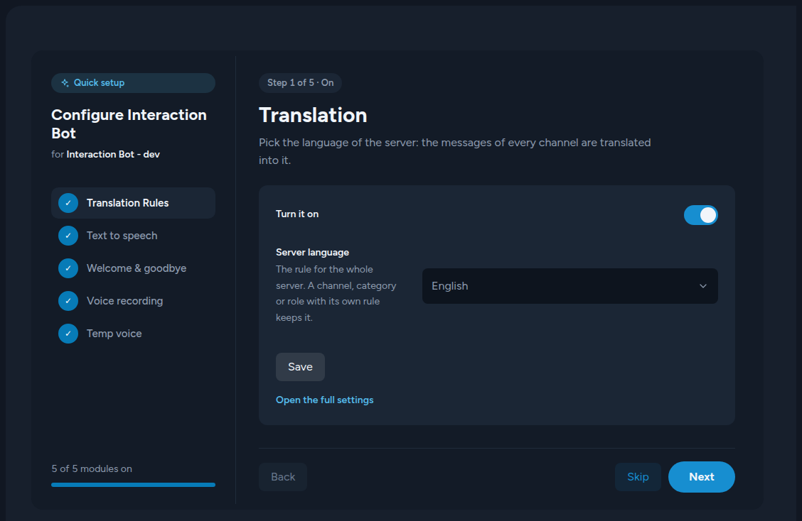

# Quick setup

Quick setup is a guided tour of the dashboard. It goes through five modules, one at a time, sets the few options that matter, and turns each module on. Every step has a link to the full settings page of its module, for the details.

* Open it: **Quick setup**, in the first group of the sidebar (next to **Overview**), page `/dashboard/{guild}/setup`.
* Who can use it: members with **Manage Server** or **Administrator**, like the rest of the dashboard.
* To set up everything from a chat instead, use the [AI setup](ai-setup.md).

<figure><figcaption>
The Quick setup page
</figcaption></figure>

## The five steps

| Step | What you choose | What it changes |
| --- | --- | --- |
| **Translation** | The language of the server. It is proposed from the language of your server on Discord. | Creates the translation rule of the whole server. A rule of a channel, a category or a role keeps its own language. |
| **Text to speech** | Nothing to choose: the step sets the rule for the whole server. | Creates one server rule: when a member who has their microphone muted in a voice channel writes, the message is read aloud in their voice channel. Only one server rule can exist. |
| **Welcome** | A welcome channel, a goodbye channel, or both. At least one is needed. | Turns on the welcome message and the goodbye message in those channels. The texts and the other settings are not touched. |
| **Voice recording** | Two switches: record the voice of the bot too, and allow the transcription of recordings. | Turns on voice recording with these two options. |
| **Temp voice** | One button: **Create the temporary rooms**. | The bot creates the category, the **Join to create** channel and the control panel, with the default settings. Run it once. |

The switch of each step turns its module on or off. It is applied at once. The **Save** button of a step saves its options.

Each step can also be left as it is: **Skip** marks it as skipped, and it is not counted as done.

<figure><figcaption>
A step of the Quick setup
</figcaption></figure>

## Moving through the page

* The left column lists the five steps. Each one shows its state: **On**, **Off**, **Skipped** or **To review**. Click a step to go to it.
* **Back**, **Skip** and **Next** move from one step to the next. **Finish** on the last step shows a summary: the modules that are on, and those that were skipped.
* The progress bar counts the modules that are on, for example *2 of 5 modules on*.
* From the summary, **Go to the overview** opens the dashboard, and **Review the steps** starts again from the first step.
* The welcome screen is shown the first time you open Quick setup on a server, in each browser. It is remembered in the browser, not on the server.


Quick setup only covers these five modules. Transcription, FAQ, invitations, the honeypot, reaction roles, the bot profile and the event log are set up on their own pages of the dashboard, or with the [AI setup](ai-setup.md).


## Limits and Premium

Quick setup itself is free. Each step follows the rules of its module, so the limits of the module apply: for example, text to speech rules are limited to 5 on a free server and 25 on a Premium server. See [Premium](../website/dashboard/premium.md).

If a rule already exists, the step says so and does not add a second one. Open the full settings page of the module to change it.

## Permissions

Quick setup does not need any Discord permission by itself. The modules it turns on need theirs: see [Permissions](../permissions.md). Temporary voice channels need the permissions to create channels and to move members, and the step says when they are missing.

## See also

* [Dashboard overview](../website/dashboard/overview.md) for the rest of the settings.
* [Welcome and goodbye](welcome-and-goodbye.md), [Voice recording](../audio/recording.md) and [Temporary voice channels](../audio/tempvoice.md) for the full settings of the steps.
* [AI setup](ai-setup.md) to describe what you want in one sentence.
