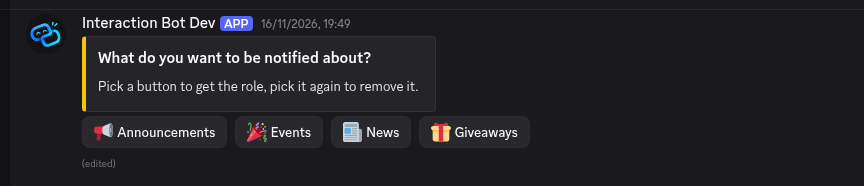

# Reaction roles

Reaction roles let your members pick their own roles. A **panel** is a message of the bot in a channel, with a list of **choices**. Each choice gives one or more roles, or takes them back. Members choose with an emoji under the message, with a button, or in a dropdown.

Examples: colors, pronouns, games, notifications, regional roles, or a team to join.

* Settings on the website: [Reaction roles (dashboard)](../website/dashboard/reaction-roles.md).
* Permissions the bot needs: [Permissions needed](#permissions-needed).
* Ready-made panels: [Role templates](#role-templates).

Reaction roles are **free for every server**: no Premium needed. A server can have up to 50 panels.

<figure><figcaption>
A reaction role panel in its channel
</figcaption></figure>

## How it works

1. An administrator writes a panel in the dashboard, section _**Management**_ > _**Reaction roles**_: the message, the choices and the roles of each choice. The panel is a **draft** until it is published.
2. The administrator chooses a channel and clicks _**Publish**_. The bot writes the message in the channel, or adds its emojis under an existing message.
3. A member clicks a button, chooses in the dropdown, or adds an emoji. The bot gives or takes the roles of that choice, following the **mode** of the panel (see [Modes](#modes)).
4. The bot answers the member as the panel is set to (see [Replies](#replies)).

Nothing is sent to Discord while a panel is a draft. The buttons and the dropdowns keep working after a restart of the bot.

## Types of choices

| Type | What members see | Limit of choices |
| --- | --- | --- |
| **Emoji** | Emojis under the message. The member reacts. | 20 |
| **Buttons** | Colored buttons in the message (gray, blue, green or red). | 25 |
| **Dropdown** | A menu. Each choice has a label and, optionally, a description. | 25 |

Emoji panels can also be written on a message that already exists, for example an announcement: the bot only adds its emojis to that message. Buttons and dropdowns need a message of their own.

Each choice of an emoji panel needs an emoji, and no two choices can use the same emoji. Each button or dropdown choice needs a label (a button can have an emoji instead). A choice gives up to 10 roles.

## Modes

The **mode** decides what happens when a member makes a choice. It is set for the whole panel.

| Mode | What happens |
| --- | --- |
| **Normal** (default) | The first choice gives the roles, the next choice takes them back. With emojis: adding the reaction gives, removing it takes back. |
| **Add only** | The panel only gives the roles. Choosing again does not take them back. |
| **Remove only** | The panel only takes the roles back. It never gives them. |
| **Final choice** | One choice, once: as long as a member has a role of the panel, they cannot change it. |
| **Reversed** | Emoji panels only. Adding the reaction takes the roles, removing it gives them back. Useful to hide channels. |

Buttons and dropdowns have no "removing", so the reversed mode is not offered for them.

### Several roles

By default, a member can have several roles of the panel at once. Turn off **Allow members to take several roles** to keep one role of the panel at a time: picking another choice replaces the previous one.

When several roles are allowed, you can set a **maximum of roles per member** (no limit, or 1, 2, 3, 4, 5, 8, 10, 15 or 25). The member who has reached the maximum must give one up before taking another. This limit does not apply when only one role is allowed.

### Who can use a panel

* **Allowed roles**: if you pick some, only the members who have at least one of them can use the panel.
* **Denied roles**: members who have one of these roles cannot use the panel. This check comes first.

Bots never use a panel.

## Temporary roles

A choice can give its roles for a limited time: 1 hour, 6 hours, 12 hours, 1 day, 3 days, 7 days, 14 days or 30 days. Otherwise the role is permanent. When the time is over, the bot takes the role back by itself, checked about every minute. The timers are kept in the database, so a restart of the bot does not lose them.

A role given again starts its time over.

## Replies

The panel decides where the bot answers the member, and what it says.

| Reply | Where the answer goes | For |
| --- | --- | --- |
| **Only visible to them** | A message only the member sees, right after the click. | Buttons and dropdowns. |
| **Private message** | A private message to the member. Nothing is sent if their private messages are closed. | All types. |
| **In the channel** | A message in the channel of the panel, which disappears after 30 seconds. Only the member is mentioned. | All types. |
| **Nothing** | Nothing is said when a role is given or taken back. | All types. |

A reaction cannot be answered in private to the member alone, so for emoji panels the choices are the private message, the channel, or nothing.

Whatever the reply, the bot always says when a choice is refused (for example, a denied role, or a role it cannot give).

### Texts

By default the bot writes short texts in the language of the server, for example _You now have {role}._ or _You no longer have {role}._ You can replace them, for each case (role given, role taken back), with a text, an embed, a card or blocks written with the message builder. These variables can be used:

| Variable | Replaced by |
| --- | --- |
| `{ROLE}` | The role or the roles concerned. |
| `{USER}` | The member (a mention). |
| `{USER_NAME}` | The name of the member. |
| `{SERVER}` | The name of the server. |

Texts of the panel itself can use `{SERVER}`.

## Role templates

The button _**Role templates**_ in the editor fills the panel with a ready-made message and choices. It replaces the current content of the panel. The bot then **creates** the roles that do not exist yet (up to 25 at once). A role of the server that already has the same name is used as it is.

| Template | Choices | Several roles |
| --- | --- | --- |
| Colors | Red, Orange, Yellow, Green, Blue, Purple, Black, White | No |
| Continents | Europe, Africa, Asia, North America, South America, Oceania, Antarctica | No |
| Zodiac signs | The 12 signs | No |
| Platforms | PC, PlayStation, Xbox, Nintendo Switch, Mobile | Yes |
| RPG roles | Warrior, Mage, Archer, Rogue, Healer, Tank | No |
| Pronouns | He / him, She / her, They / them, Any pronouns | Yes |
| League of Legends | Top, Jungle, Mid, ADC, Support | Yes |
| Notifications | Announcements, Events, News, Giveaways | Yes |

If the bot cannot create the roles (missing Manage Roles, or the server has reached Discord's role limit), the choices are still written: pick their roles yourself.

## Publishing

* **Save** (in the bar at the bottom of the page) keeps the changes of the draft. Nothing changes on Discord.
* **Publish** writes the message in the channel. Once published, the button reads _Update the message_: it applies the latest changes to the message. A saved change is not on the message until you update it.
* **Remove the message** deletes the message of the bot and keeps the panel as a draft. For a panel on an existing message, only the bot's emojis are removed; the message stays.
* **Delete** removes the panel and its message. Members keep the roles they already have.
* **Duplicate** copies a panel as a draft.
* **Off**: the panel is kept and its message stays, but its choices no longer give or take anything, and members are told it is no longer available.

Before a panel is published, the editor lists what prevents it: a choice without a role or emoji, a duplicate emoji, a channel the bot cannot write in, a role the bot cannot give. The bot checks the roles again at each click, so a role that becomes dangerous or is moved above the bot's role later is refused then.

## Roles the bot cannot give

A panel can only give roles that the bot is allowed to give:

* the role must still exist and not be @everyone;
* it must not be managed by an integration or a bot;
* it must be **below** the highest role of the bot, and the bot needs the Manage Roles permission;
* it must not carry moderation or administration permissions: Administrator, Manage Server, Manage Roles, Manage Channels, Manage Messages, Kick, Ban or Timeout Members, Mention Everyone, View Audit Log and a few others. Taking such a role away is always possible.

## Permissions needed

| Permission | Used for |
| --- | --- |
| View Channel, Send Messages, Embed Links (in the channel of the panel) | To write the message. |
| Add Reactions, Read Message History (in the channel of an emoji panel) | To add the emojis and read the reactions. |
| Manage Roles | To give and take roles. The role of the bot must be above the roles of the panel. |
| Manage Messages | To take back the reaction of a member when the panel does not keep it, and to clear the emojis of the bot when the choices change. |

The invitation link of the website includes these permissions. The dashboard shows what is missing in the channel or on a role.

## Limits

| Option | Limit |
| --- | --- |
| Panels per server (drafts included) | 50 |
| Choices of an emoji panel | 20 |
| Choices of a button or dropdown panel | 25 |
| Roles per choice | 10 |
| Allowed roles and denied roles | 25 each |
| Label of a choice | 80 characters |
| Description of a dropdown choice | 100 characters |
| Placeholder of a dropdown | 150 characters |
| Name of a panel | 60 characters |
| Roles created by a template | 25 at once |
| Choices per member | One per second |
| Duration of a temporary role | 1 hour to 30 days, or permanent |

## Troubleshooting

| Message | What to do |
| --- | --- |
| _Pick the channel of the message._ | Choose a channel before publishing. |
| _Pick the role this choice gives._ | Pick the role of the choice, or delete the choice. |
| _Every choice needs a label_ / _an emoji_ | A button or dropdown choice needs a label (a button can have an emoji instead); an emoji choice needs an emoji. |
| _This emoji is already used by another choice._ | Each emoji can belong to one choice only. |
| _The bot cannot see this channel_ / _cannot write in this channel_ / _cannot embed links_ / _cannot add reactions_ / _cannot read the history_ | Give the bot the permission in this channel. |
| _The role {role} is above the role of the bot_ | Move the role of the bot higher in the server settings. |
| _The role {role} is managed by an integration_ | It cannot be given by a panel. Pick another role. |
| _The role {role} has dangerous permissions_ | A panel cannot give a role with moderation or administration permissions. Pick another role. |
| _The role {role} no longer exists_ | Pick another role for this choice. |
| _The message was not found in this channel_ | The message was deleted, or it is in another channel. Paste the link of the right message. |
| _The bot does not answer right now_ | Try again in a moment. |
| _Slow down: one choice per second._ | The member clicked too fast. Try again. |
| _I cannot give {role} right now. Please tell an administrator._ | The bot could not change the role (for example, its role is too low now). Check the role order and the permissions of the bot. |
| _This choice is no longer available._ | The panel is off, or was deleted. Turn it on in the dashboard. |
| _You can have {max} of these roles at most._ | The member must give up one role of the panel first. |

## Commands

Reaction roles have no slash command. Everything is set up on the [dashboard](../website/dashboard/reaction-roles.md).
