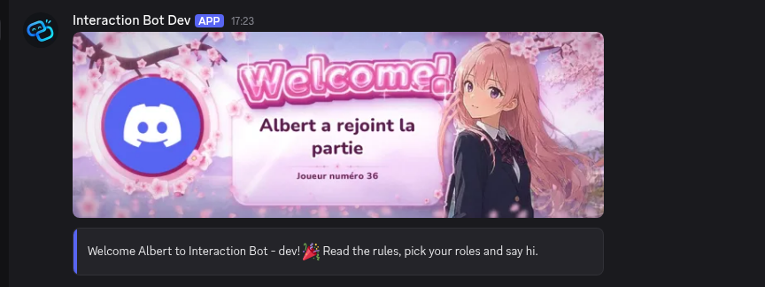
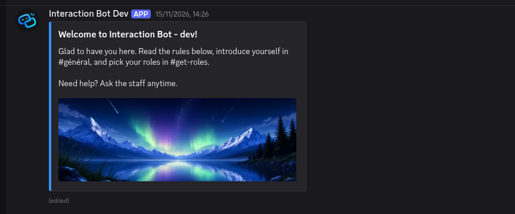

# Welcome and goodbye

Interaction Bot can greet new members, say goodbye to members who leave, send a private message to new members, announce boosts and role changes, give roles automatically, and keep a welcome hub message in a channel. Everything is set on the [Welcome page](../website/dashboard/welcome.md) of the dashboard.

* Settings on the website: [Welcome](../website/dashboard/welcome.md).
* Permissions the bot needs: [Permissions needed](#permissions-needed).
* Invitations (who invited a new member): [Invite tracker](invite-tracker.md).

## What the bot can do

| Feature | Where | What it does |
| --- | --- | --- |
| **Welcome message** | A text channel | Posts a message when a member joins. Can be delayed, shown as a card, with a banner, with random variants. |
| **Goodbye message** | A text channel | Posts a message when a member leaves. Kicks and bans can have their own message. |
| **Private message** | Direct message to the new member | Sends a message to the member who joins, at once or after the rules or the Onboarding. It is sent before the public welcome message. Nothing happens if the member closed their private messages. |
| **Banner** | Inside the message or under it | A picture of 1000 × 350 px with the avatar of the member, a title and a subtitle. |
| **Boost and role messages** | A channel, or a private message | Announces a boost, or a role gained or lost. Up to 10 of each. |
| **Automatic roles** | The member | Gives roles to new members and to new bots, and can give roles to the members already on the server. |
| **Welcome hub** | One message in a channel | A rich message that the bot keeps up to date, with link buttons and an _I accept_ button that gives roles. |

Each message can be a plain text, a card (embed), a banner, or both. The tabs of the page are grouped: _**Messages**_ (Welcome, Goodbye, Private message), _**Roles and events**_ (Roles, Boost, Role gained or lost), _**Welcome hub and rules**_ (Welcome hub) and _**Settings**_ (Settings, Problems).

## Set up in a few minutes

1. **Check the permissions.** The bot needs the permissions of the [Permissions needed](#permissions-needed) section in the channels where it posts. Run `/check-permissions` to see what is missing.
2. **Open the Welcome page.** In the sidebar, section _**Management**_, click _**Welcome**_.
3. **Use the quick start.** On a server where nothing is set yet, the page shows one question: the channel for welcome messages. Choose a channel and click _**Turn on welcome messages**_. The bot writes a message for the welcome. The goodbye and private message get a ready text too, but they stay off until you turn them on.
4. **Check the message.** The _**Preview**_ on the right shows the message as Discord will display it. Use the variables to add details (see [Variables](#variables)).
5. **Save.** The bar at the bottom of the page says _You made changes, save them!_. Click _**Save**_.
6. **Test.** Click _**Send me a test**_. The bot posts a sample about you, with the saved settings. See [Test a message](#test-a-message).

The quick start is only shown when the server has no settings and no message is turned on. Everything can be changed afterwards.

## Variables

A message can contain variables. Each variable is replaced by the real value for each member. Write them between curly brackets, or click the buttons under the text box to insert them.

| Variable | Replaced by | In a goodbye message |
| --- | --- | --- |
| `{user}` | A mention of the member (the member is pinged). | The name of the member, not a mention. Nobody is pinged. |
| `{user.name}` | The username of the member. | Same. |
| `{user.tag}` | The Discord tag of the member. | Same. |
| `{user.display_name}` | The name shown for the member in the server (nickname, else display name). | Same. |
| `{user.id}` | The Discord id of the member. | Same. |
| `{user.avatar}` | The address of the avatar of the member. | Same. |
| `{user.joined}` | When the member joined the server. | Same. |
| `{account_created}` | When the account of the member was created. In a message: a relative time, shown by Discord (for example "3 years ago"). In a banner: the date `YYYY-MM-DD`. | Same. |
| `{account_age}` | The age of the account of the member. | Same. |
| `{arrival_number}` | The number of the arrival: 1 for the first member who joined. | Same. |
| `{arrival_number.ordinal}` | The rank of the arrival: `1st`, `2nd`, `3rd`, `4th`… | Same. |
| `{server}` | The name of the server. | Same. |
| `{server.icon}` | The address of the icon of the server. | Same. |
| `{member_count}` | The number of members of the server, with the number format of the Settings tab (for example `1,234`). | Same. |
| `{member_count.ordinal}` | The rank of the member among the members: `1st`, `2nd`, `3rd`, `4th`… | Same. |
| `{date}` | Today's date. In a message: the date shown by Discord, in the reader's language. In a banner: `YYYY-MM-DD`. | Same. |
| `{rules}` | The rules of the server, when they were written before. | Same. |
| `{inviter}` | Who invited the member (a mention). | `unknown`: the bot knows the inviter only when the member joins. |
| `{inviter.name}` | The name of the inviter. | `unknown`. |
| `{inviter.mention}` | A mention of the inviter. | `unknown`. |
| `{inviter.id}` | The Discord id of the inviter. | `unknown`. |
| `{inviter.avatar}` | The address of the avatar of the inviter. | `unknown`. |
| `{invites}` | How many invitations of the inviter still count (see [Invite tracker](invite-tracker.md)). | `0`. |
| `{invite_label}` | The label given to the invite used. If the invite has no label, its code is shown. | `unknown`. |
| `{invite.code}` | The code of the invite used. Only for labelled links and the custom link of the server. | `unknown`. |
| `{invite.url}` | The link of the invite used. Only for labelled links and the custom link of the server. | `unknown`. |
| `{boosts}` | The number of boosts of the server. Only in the boost messages. | - |
| `{role}` | The name of the role. Only in the role messages. | - |

Notes:

* When invite tracking is off, or the bot does not know who invited the member, `{inviter}`, `{inviter.name}` and the other inviter variables show `unknown`, `{invites}` shows `0`, and `{invite_label}` shows `unknown` or the label that is known.
* The bot escapes the names written by members (name, display name). A name cannot ping anyone or change the layout of the message.
* The ordinal suffix (`1st`, `2nd`…) follows the language of the server. Other languages show the plain number.
* Unknown words between curly brackets are not accepted: the page says which one and refuses to save the message until it is removed.

## Messages as a card

<figure><figcaption>
A welcome message with its banner
</figcaption></figure>

Turn on _**Show the message as a card**_ to show the text in a card: a title, a text, a colored edge and a picture, like a Discord embed. The card can also show:

* the **avatar** of the member as a small picture (_**Show the member's avatar**_, on by default);
* a **large picture** at the bottom, chosen in the card editor (see [Your pictures](#your-pictures));
* a small **footer** text.

The card needs the *Embed Links* permission in the channel.

## Banners

A banner is a picture of 1000 × 350 pixels, drawn by the bot for each new member. It shows the avatar of the member, a title and a subtitle. Turn it on with _**Send a welcome banner**_ (or _**Send a goodbye banner**_, _**Send a banner with the private message**_, _**Send a banner with the boost message**_, _**Send a banner with the role message**_).

Where the banner goes depends on the card:

* When the message is a card and _**Show the banner inside the card**_ is on (default), the banner is the picture of the card.
* Otherwise the banner is sent under the message, and the card can keep its own picture.

### Backgrounds

Without a picture of your own, the banner uses one of the gradient designs (_Aurora_ by default, _Sunset_, _Ocean_, _Forest_, _Midnight_, _Neon_, _Candy_, _Slate_, _Interaction_), or one of the pictures that come with the bot, grouped by category. A background can also be a solid color.

### Your pictures

Drop a picture in the _**Your picture**_ area, or click it to choose one. Accepted formats: **PNG, JPEG or WebP**, **4 MB** at most. The bot resizes and cleans the picture before it keeps it. A server can keep **10 pictures** and **20 MB** in total. Delete a picture with its trash button; a banner that used it goes back to the default design.

The recommended size is **1000 × 350 px** for a banner, and **1200 × 675 px** for the large picture of a card.

### Classic banner or custom layout

The **classic** banner shows the avatar, the _Banner title_ and the _Banner subtitle_. Leave them empty to use the default texts.

_**Design my own layout**_ opens the banner editor. A custom layout is a list of elements placed on the banner:

* **Text**: a font, size, color, alignment, vertical position, bold, shadow, glow, outline. Variables can be used in the text (up to **200** characters).
* **Avatar**: the picture of _The new member_, _Who invited them_ or _The server icon_, in a circle, a rounded square or a square.
* **Shape**: a rectangle or a circle, one or two colors, opacity, rounded corners and border.
* **Picture**: one of your pictures, cropped (_Fill the box_) or shown whole (_Show it all_).

A banner has at most **20 elements** and at most **4 pictures**. The editor starts from one of five templates: _Classic_, _Centered_, _Minimal_, _Framed_ or _Invited by_.

The _**Show the real rendering**_ button asks the bot to draw the exact banner, about you. Use it to check the result before saving.

## Automatic roles

The _**Roles**_ tab gives roles to new members:

* **Roles for new members**: up to **10** roles, given when a member joins.
* **Roles for new bots**: up to **10** roles, given when a bot joins.
* **Wait until the member accepts the rules** (on by default): when the server uses membership screening (its rules), the roles of new members are given after the member accepts the rules, not before.
* **Delay before giving roles**: the roles can wait up to **1 hour**. If the member leaves in the meantime, nothing is given.
* **Roles for specific members**: extra roles for one member, up to 50 members with 10 roles each.
* **Give roles to existing members**: a sync gives the automatic roles to the members already on the server. It can also run every 6 hours, 12 hours, 24 hours or once a week. Members with an excluded role are skipped.

The bot gives a role only when all these are true:

* the role still exists and is not managed by an integration (for example the role of a bot or of an app);
* the role is below the highest role of the bot in the server settings;
* the role has no moderation or administration permission (for example *Manage Roles*, *Kick Members*, *Ban Members*, *Manage Messages* or *Administrator*).

The dashboard also refuses a role that you could not give yourself: you need *Manage Roles*, and the role must be below your highest role.

The order on arrival: the roles are given first, then the welcome message, then the private message.

## Boost and role messages

The _**Boost**_ tab sends a message when a member starts boosting the server. The _**Role gained or lost**_ tab sends a message when a member gets a role or loses it. Each tab keeps up to **10** messages. A boost message can be sent once, for the first boost of the member only.

The bot reads the audit log to know who changed a role of a member who is not in a voice channel: it needs the *View Audit Log* permission for this.

## Welcome hub

<figure><figcaption>
The welcome hub in its channel
</figcaption></figure>

The welcome hub is **one message** that the bot keeps in a channel of your choice. You write it with the message builder, with a title, a text, a color and a background picture. It can have up to **5** link buttons (addresses starting with `https://`).

Each time you press _**Publish / update**_, the bot edits the same message, or sends a new one if it was deleted. Only the saved version is published.

Under the hub, the _**I accept**_ button gives the roles chosen in the Welcome page to a member who clicks it.

The `/rules` command shows the rules of the server, in the language of the member (translated on demand, in 14 languages). The rules written before are still published in the hub message. There is no rules editor on the dashboard anymore.

## Test a message

_**Send me a test**_ (on each tab) makes the bot send the message as if you had just joined (or left). It uses the **saved** settings, so save first: the button stays disabled while there are unsaved changes.

* The welcome and goodbye messages are posted in the channel of the message. A test welcome or goodbye message is deleted after **2 minutes** at most. A person can send at most **6 tests per minute**.
* The private message is sent to you. The page then says _Check your private messages._

The test can imitate a situation: joined with an invite link, with a labelled link, with the custom server link, as a bot, from an unknown source, while the bot cannot see the invites, coming back, with a brand new account. On the Goodbye tab, a kick or a ban.

Errors shown by the test:

| Message on the page | Cause |
| --- | --- |
| _The bot cannot write in this channel. Give it the permission to send messages there._ | Missing *View Channel* or *Send Messages*. |
| _The bot cannot show cards in this channel. Give it the permission to embed links._ | Missing *Embed Links*. |
| _The bot cannot send pictures in this channel. Give it the permission to attach files._ | Missing *Attach Files*. |
| _Choose a channel and save first._ | No channel chosen, or the channel was not found. |
| _Turn this message on and save first._ | The message is off. |
| _Save the settings first._ | Nothing is saved yet. |
| _Your private messages are closed: the bot cannot write to you._ | Your private messages are closed for the server. |
| _The message is empty._ | No text, no card and no banner. |
| _The bot does not answer right now. Try again in a moment._ | The bot is not reachable. Try again. |

## Limits

| Item | Limit |
| --- | --- |
| Text of a message | 2000 characters |
| Title of a card | 256 characters |
| Text of a card | 4096 characters |
| Footer of a card | 2048 characters |
| Title, text and footer of a card together | 6000 characters (Discord limit) |
| Title and subtitle of a banner | 120 characters each |
| Text element of a custom banner | 200 characters |
| Elements in a custom banner | 20 |
| Pictures in a custom banner | 4 |
| Pictures kept by a server | 10 pictures, 20 MB in total |
| Picture sent from the page | PNG, JPEG or WebP, 4 MB |
| Variants of a message | 20 |
| Ghost mention channels | 5 |
| Reactions on the welcome | 2 |
| Automatic roles | 10 for new members, 10 for new bots |
| Roles for specific members | 50 members, 10 roles each |
| Roles given by the _I accept_ button | 5 |
| Delay before a welcome message | 10 minutes |
| Delay before roles | 1 hour |
| Minimum account age | 30 days |
| Minimum stay before a goodbye | 1 hour, 1 day or 7 days |
| Boost messages and role messages | 10 each |
| Deletion of a welcome message | Never, or after 10 seconds, 30 seconds, 1 minute, 5 minutes or 1 hour |
| Welcome and goodbye messages sent by the bot | 10 every 10 seconds for a server, see [Anti-raid](#anti-raid) |
| Private messages | One per member a day; 20 a minute for all the servers of the bot's cluster |

## Anti-raid

When many members join in a short time (a raid), the bot limits the messages it posts:

* At most **10 welcome and goodbye messages every 10 seconds** for a server. The messages beyond this limit are not sent.
* The boost and role messages have their own limit: at most **10 every 10 seconds** for a server.
* At most **2 banners** are drawn at the same time, for all servers.
* The _**Pause during a raid**_ option (on by default) stops the public welcome, the ghost mentions and the private messages while the server is in raid mode. The goodbye messages, the roles and the invitation tracking go on.

The bot does not store the members. It uses the arrival and departure events on the spot, and keeps only the settings of the server.

## Permissions needed

| Where | Permission | Used for |
| --- | --- | --- |
| Welcome or goodbye channel | *View Channel* and *Send Messages* | Posting the message. |
| Welcome or goodbye channel | *Embed Links* | Messages shown as a card. |
| Welcome or goodbye channel | *Attach Files* | Banners and pictures. |
| Welcome channel | *Add Reactions* and *Read Message History* | Reactions on the welcome message. |
| Server | *Manage Roles* | Giving the automatic roles. The role must also be below the highest role of the bot. |
| Server | *View Audit Log* | Telling a kick from a departure, and who added a bot or changed a role. |
| Server | *Server Members* intent (see [Server Members intent](#server-members-intent)) | Knowing who joins and who leaves. |

The private message needs no permission in a channel: the bot writes to the member directly. The member must accept private messages from the server members.

The invitation link of the bot includes the permissions of these features. If you invited the bot with a restricted link, add the missing ones in the server role of the bot. The page _**Problems**_ lists the missing permissions.

## Server Members intent

Discord only tells a bot who joins or leaves a server when the bot has the privileged **Server Members** intent. If the Welcome page says _Not available on this bot yet_, the bot does not receive these events yet. The settings are saved and start to work as soon as the intent is on.

## Invite tracking

The invite tracker tells who invited each new member. When it is on, the variables `{inviter}`, `{inviter.name}`, `{invites}` and `{invite_label}` are filled. Without it, they show `unknown` and `0`.

The tracker is turned on by default on a server that adds the bot. On a server that already had the bot, it is turned on in the Invitations page of the dashboard. See [Invite tracker](invite-tracker.md).

## Free or premium

Welcome and goodbye messages, private messages, banners, pictures, the welcome hub, the boost and role messages and automatic roles are **free** for every server. There is no premium option for this feature.

## Troubleshooting

| Problem | Cause | What to do |
| --- | --- | --- |
| No message when a member joins. | The welcome message is off, the channel is not chosen, or the bot cannot write in the channel. | Check the tab is on, the channel is saved, and run `/check-permissions`. Use the test. |
| The message is sent without the banner. | The bot cannot attach files in the channel, or the banner could not be drawn. | Give the bot *Attach Files*. Check the banner in the editor with _**Show the real rendering**_. |
| The card is not shown. | The bot cannot embed links in the channel. | Give the bot *Embed Links*. |
| The roles are not given. | The bot lacks *Manage Roles*, the role is above the bot's role, or the role has a moderation permission. | Put the role of the bot above the roles you chose, and give it *Manage Roles*. Check the Problems tab. |
| The roles are given after the rules, not at once. | _Wait until the member accepts the rules_ is on, and the server uses membership screening. | This is expected. Turn the option off to give the roles on arrival. |
| The welcome message comes a few minutes late. | A delay is set in the _Sending_ part of the tab. | Expected. Set the delay to _Right away_ to post at once. |
| No welcome message for a new account. | The minimum account age of the message is not reached. | Expected. Lower the age, or write a variant for young accounts. |
| The private message is not received. | The member closed private messages from server members, or the message waits for the rules. | Nothing the bot can do. The bot does not retry. |
| The goodbye message does not appear. | The goodbye message is off, the channel is not saved, the bot cannot write there, or the member stayed less than the minimum stay. | Same checks as the welcome message, and the minimum stay in the _Sending_ part. |
| The messages stop during a raid. | The limit of 10 messages every 10 seconds was reached, or the raid pause is on. | This is expected. Only the messages beyond the limit are not sent. |
| `{inviter}` shows `unknown`. | Invite tracking is off, or the bot did not find the invite. | Turn on the Invitations feature (see [Invite tracker](invite-tracker.md)). |
| A banner or card shows the default design or no picture. | The picture was deleted from the library. | Choose another picture or design, then save. |
| The page says _Not available on this bot yet_. | The bot does not have the Server Members intent. | See [Server Members intent](#server-members-intent). |
| The welcome hub does not change. | The hub was not published after the change. | Click _**Publish / update**_. Only saved settings are published. |

## Commands

The settings are on the dashboard only: there is no command to configure the welcome messages.

| Command | What it does |
| --- | --- |
| `/rules [language]` | Shows the rules of the server, in your language (or the language you choose, among 14). Only you see the answer. |

## Related pages

* [Welcome page of the dashboard](../website/dashboard/welcome.md): every tab and setting, with its default value.
* [Invite tracker](invite-tracker.md): who invited each new member, and the variables of the invitations.
* [Permissions](../permissions.md): the permissions of each feature.
* [Temp voice](../audio/tempvoice.md): another feature with a greeting message.
