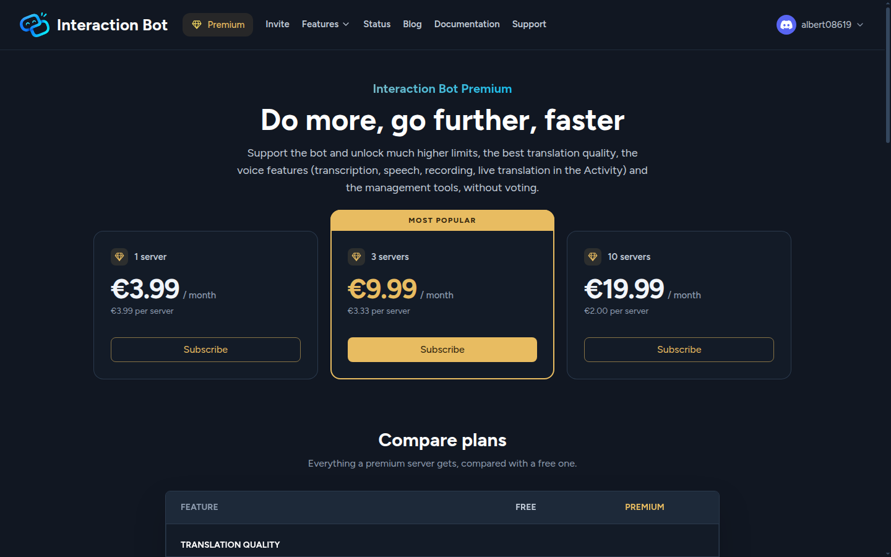

# Premium

Premium adds higher limits, the best translation quality and the voice features to the servers you choose. It is set **per server**: a member buys server slots, and each server with Premium uses one slot.

The offers are monthly, and bought on the [Premium page](https://interaction-bot.com/premium) of the website, with Stripe:

| Offer | Price per month | Price per server | Servers |
| --- | --- | --- | --- |
| 1 server | €3.99 | €3.99 | 1 |
| 3 servers | €9.99 | €3.33 | 3 |
| 10 servers | €19.99 | €2.00 | 10 |

A yearly offer is shown on the Premium page but is not available yet. Premium is reserved for people aged 18 or over. To buy it, and to change your offer, see [Subscribe](subscribe.md). To turn it on for a server, see [Usage](usage.md).

<figure><figcaption>
The Premium page of the website
</figcaption></figure>

## How the slots work

* Premium is set **per server**, not per member. One offer gives you 1, 3 or 10 slots.
* A slot is used when a server gets Premium: with the **Premium** switch of the [dashboard](../website/dashboard/premium.md), or with `/premium add`. Turning Premium off, or running `/premium remove`, frees the slot.
* When all your slots are used, first remove Premium from one server to give it to another.
* One person has one subscription at a time. You can change the offer from **My subscription**.
* When your subscription ends, or is stopped by a refund or a lost dispute, Premium is removed from the servers it served. See [Subscribe](subscribe.md).
* The user app uses Premium too: if you have a Premium subscription, the translations you ask for with `/translate` and the **Apps** menus use it, in any server or in direct messages, see [User app](../commands/user-app.md).

## What Premium brings

The comparison below is the one of the Premium page of the website. The limits are for each server (for the user app, see above).

### Translation quality

| Feature | Free | Premium |
| --- | --- | --- |
| Best translation model | Unless the service is busy | Always |
| Priority when the service is busy | No | Yes |

### Translation

| Feature | Free | Premium |
| --- | --- | --- |
| Translation rules (channels, roles and categories) | 30 in total | 200 in total |
| Languages in one rule | 5 | 20 |
| Translations of one message | Up to 3 | Up to 20 |
| Mirrors | 1 mirror of 3 channels | 5 mirrors of 5 channels |
| Messages of bots translated | No | Yes |
| Flag reactions on messages of bots | No | Yes |
| Embeds, buttons and link previews translated | No | Yes |
| Channels for flag reactions and minimum message size | 20 | 500 |

### Voice

| Feature | Free | Premium |
| --- | --- | --- |
| Transcription time per day | 30 min | 3 h |
| Speech to text without a top.gg vote | No | Yes |
| Most accurate transcription model | No | Yes |
| Transcription rules | 1 | 25 (3 per voice channel) |
| Speech to text translation | No | Yes |
| Live translation in the Activity | No | Yes |
| Text to speech time per day | 30 min | 3 h |
| Text to speech without a top.gg vote | No | Yes |
| Text to speech rules (channels, categories, whole server) | 5 | 25 |
| Translation before reading aloud | No | Yes |
| Bot's translations read aloud | No | Yes |
| Voice cloning (5 voices per member) | No | Yes |
| Voice messages transcribed up to | 2 min | 15 min |
| Voice messages translated and dubbed | No | Yes |

### Recording

| Feature | Free | Premium |
| --- | --- | --- |
| Recording time per day | 1 h 45 | 6 h |
| Recording without a top.gg vote | No | Yes |
| Continuous mode (up to 24 h, even in an empty channel) | No | Yes |
| Automatic recording | No | Yes |
| Recordings kept available for | 24 h | 7 days |
| Transcription of recordings | 1 per month | 1 per day |

### Management

| Feature | Free | Premium |
| --- | --- | --- |
| FAQ assistant | 1 group, 5 answers, 3 channels | 5 groups, 150 answers, 10 channels |
| AI setup requests per day | 50 | 1000 |
| Blacklist (roles, channels, languages) | No | Yes |
| Fallback categories for temporary voice channels | No | Yes |
| Bot profile on your server (name, avatar, banner, bio) | No | Yes |
| Premium on several servers | No | With the 3 and 10 servers offers |

## Free for every server

These features are available without Premium, on every server:

* the [welcome and goodbye messages](../management/welcome-and-goodbye.md), the welcome hub and the reaction roles;
* the [invite tracker](../management/invite-tracker.md), including the pinned leaderboards;
* the [honeypot](../management/honeypot.md) and the event log;
* the [temporary voice channels](../audio/tempvoice.md), except the fallback categories;
* the [voice messages](../audio/voice-messages.md) transcription, within the quota and the duration above;
* the [AI setup](../management/ai-setup.md), within its free daily requests;
* the personal language, the [user app](../commands/user-app.md) and the live transcription Activity (without its live translation).

Without a top.gg vote, a free server can use speech to text, text to speech and recording when a member of the server has voted for the bot in the last 24 hours. No vote is needed during the first 24 hours after the bot is added to a server. See [Limits and privacy](../audio/limits-and-privacy.md).

Example: with the role @french translated into English, Japanese, Brazilian and Spanish, a message of a member with this role produces 4 translations. A free server is limited to 3 translations per message, a Premium server to 20. The warning shown when the limit is exceeded is explained on the [Overview](../website/dashboard/overview.md) page.


Turning Premium off on a server removes its Premium features at once. The options that are saved (for example the translation of bot messages) stay in the settings, but they are not used while the server has no Premium.


Where to configure each feature: [Translation rules](../website/dashboard/translation-rules.md), [Flags](../website/dashboard/flag-translation.md), [Exceptions](../website/dashboard/exceptions.md), [Transcription](../website/dashboard/speech-to-text.md), [Text to speech](../website/dashboard/tts-channels.md), [Voice recording](../website/dashboard/voice-recording.md), [FAQ](../website/dashboard/faq.md) and [Bot profile](../website/dashboard/bot-profile.md).

**Refund policy:** in case of any problem, contact the support and we will handle refunds case by case, in a transparent way.
