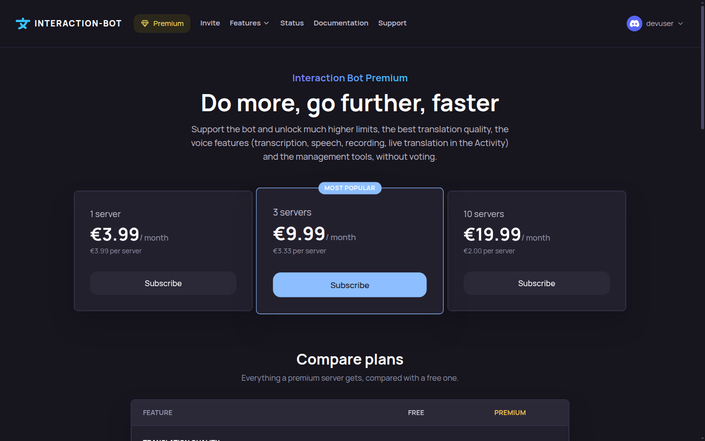
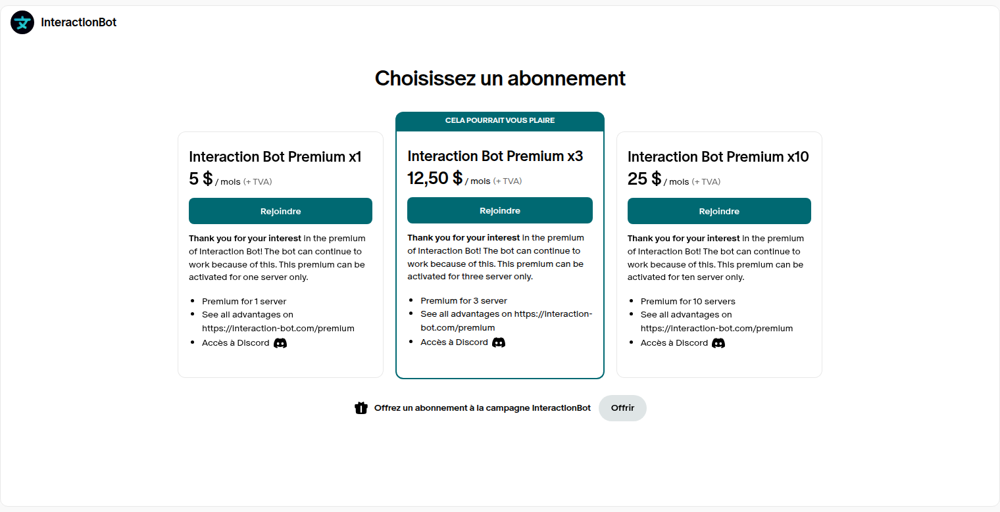

# Premium

Interaction Bot Premium adds features and higher limits to the bot on your servers. Premium is bought on the [Premium page](https://interaction-bot.com/premium) of the website, with Stripe (existing Patreon subscriptions keep working). The offers give a number of **server slots**: **1**, **3** or **10** servers. Each server with Premium uses one slot.

Monthly prices on the Premium page: **1 server 3.99 EUR**, **3 servers 9.99 EUR**, **10 servers 19.99 EUR** per month (a yearly option is shown but not available yet). Patreon subscribers keep their offer: [Patreon](https://www.patreon.com/interactionbot).

<figure><figcaption>
Premium page of the website
</figcaption></figure>
<figure><figcaption>
Patreon page
</figcaption></figure>

## How the slots work

* Premium is set **per server**, not per member.
* A slot is used when a server gets Premium, with the `/premium add` command or with the **Premium** toggle of the [dashboard](../website/dashboard/premium.md). Turning Premium off, or running `/premium remove`, frees the slot.
* To give Premium to another server when all your slots are used, first remove it from a server.
* Premium is also used by the [user app](../commands/user-app.md): a member with an active Premium subscription (Stripe, or a Patreon offer linked to the Discord account) gets it when using `/translate` and the Apps menus outside the servers where the bot is added.
* To buy, see [Subscribe](subscribe.md). To activate it, see [Usage](usage.md).

## What Premium brings

| Feature | Free | Premium |
| --- | --- | --- |
| Translation quality | Free tier of the translation service | Premium tier, routed to the best model |
| Priority when the service is busy | No | Yes |
| Translation rules (server, channel, category, role and links; servers using the new rules) | 30 | 200 |
| Channels, roles and categories translated (servers still on the former configurations) | 20 of each | 500 of each |
| Translations of one message | Up to 3 | Up to 20 |
| Link channels (translation groups) | 1 group of 3 channels | 5 groups of 5 channels |
| Messages of bots translated | No | Yes |
| Text to speech reads the translations of the bot | No | Yes (setting **Read translations**, on by default) |
| Flag reactions on messages of bots | No | Yes |
| Embeds and buttons translated | No | Yes |
| Blacklist (channels, roles, languages) | No | Yes |
| Speech to text time (per server, per UTC day) | 30 minutes | 3 hours |
| Speech to text without a top.gg vote | No | Yes |
| Speech to text configurations | 1 | Unlimited (3 per voice channel) |
| Speech to text translation | No | Yes |
| Most accurate speech to text model | No | Yes |
| Live translation in the Activity | No | Yes |
| Text to speech without a top.gg vote | No | Yes |
| Text to speech time per day | 30 minutes | 3 hours |
| Translation before reading aloud | No | Yes |
| Text to speech channels | 5 | 25 |
| Voice cloning (5 voices per member) | No | Yes |
| FAQ | 1 group, 5 questions | 5 groups, 150 questions |
| Voice messages: transcription of one message | Up to 2 minutes | Up to 15 minutes |
| Voice messages: translation and voice dubbing | No | Yes |
| Recording time per day | 1 hour 45 minutes | 6 hours |
| Recording without a top.gg vote | No | Yes |
| Continuous recording (up to 24 hours, even in an empty channel) | No | Yes |
| Automatic recording | No | Yes |
| Recordings kept available for | 24 hours | 7 days |
| Transcription of recordings | 1 per month | 1 per day |
| Fallback categories for temporary voice channels | No | Yes |
| Premium on several servers | - | With the 3 and 10 servers offers |

Without a top.gg vote, a free server can use speech to text and text to speech when a member of the server has voted for the bot in the last 24 hours.

The [welcome and goodbye messages](../management/welcome-and-goodbye.md), the [invite tracker](../management/invite-tracker.md), the [honeypot](../management/honeypot.md), [`/ai setup`](../management/ai-setup.md) (within its daily credit) and the [temporary voice channels](../audio/tempvoice.md) are available to **every server**, without Premium.

Example: with the role @french translated into English, Japanese, Brazilian and Spanish, a message of a member with this role produces 4 translations. The free version is limited to 3 translations per message, the Premium version to 20. The limit and the warning shown when it is exceeded are explained on the [Overview](../website/dashboard/overview.md) page.

Where to configure each feature: [Channel Translation](../website/dashboard/channel-translation.md), [Role Translation](../website/dashboard/role-translation.md), [Category Translation](../website/dashboard/category-translation.md), [Link channels](../website/dashboard/translation-groups.md), [Flag Translation](../website/dashboard/flag-translation.md), [Blacklist](../website/dashboard/blacklist.md), [Transcription](../website/dashboard/speech-to-text.md), [Text to speech](../website/dashboard/tts-channels.md) and [FAQ](../website/dashboard/faq.md).

**Refund policy:** In case of any problem, contact the support and we will handle refunds case by case, in a transparent way.
