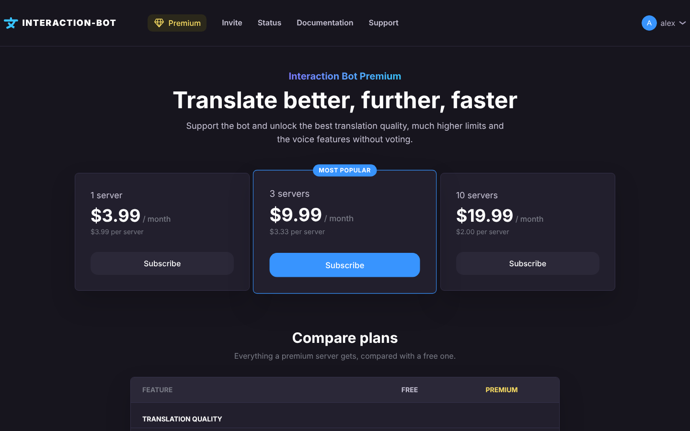
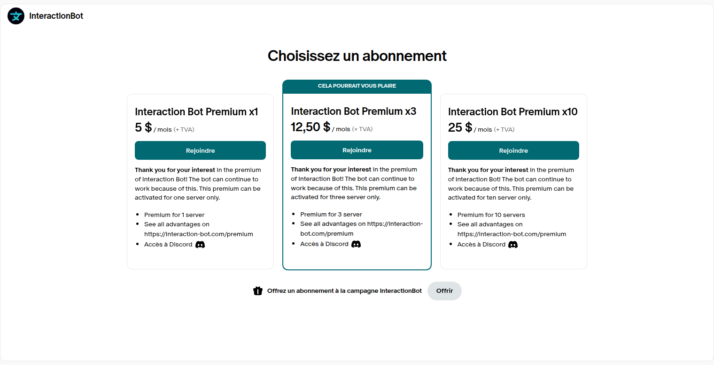

# Premium

Interaction Bot Premium adds functionality to the bot on your servers. Offers cover 1, 3 or 10 servers and are managed on Patreon; the premium page of the website shows the full comparison.

The offers are available [here](https://www.patreon.com/interactionbot).

<figure><figcaption>
Premium page of the website
</figcaption></figure>
<figure><figcaption>
Patreon page
</figcaption></figure>

Premium offers allow new features:

| Feature                                   | Free                          | Premium                                 |
| ----------------------------------------- | ----------------------------- | --------------------------------------- |
| Translation quality                       | Best model unless the service is busy | Always the best model, priority when the service is busy |
| Channels, roles and categories translated | 20 of each                    | 500 of each                             |
| Translations of one message               | Up to 3                       | Up to 20                                |
| Translation groups                        | 1 group of 3 channels         | 5 groups of 5 channels                  |
| Messages of bots translated               | No                            | Yes                                     |
| Embeds and buttons translated             | No                            | Yes                                     |
| Blacklist (channels, roles, languages)    | No                            | Yes                                     |
| Speech to text session                    | 30 minutes                    | 2 hours                                 |
| Speech to text without a top.gg vote      | No                            | Yes                                     |
| Speech to text configurations             | 1                             | Unlimited (3 per voice channel)         |
| Speech to text translation                | No                            | Yes                                     |
| Text to speech without a top.gg vote      | No                            | Yes                                     |
| Text to speech channels                   | 5                             | 25                                      |
| FAQ                                       | 1 group, 5 questions          | 5 groups, 150 questions                 |
| Premium on several servers                | -                             | With the 3 and 10 servers offers        |

Example: with the role @french translated into English, Japanese, Brazilian and Spanish, a message of a member with this role produces 4 translations: the free version stops at 3 translations per message, the premium one allows up to 20.

**Refund policy:** In case of any problem, contact the support and we will handle refunds case by case, in a transparent way.

See the page [subscribe](subscribe.md) to buy a premium on patreon.
