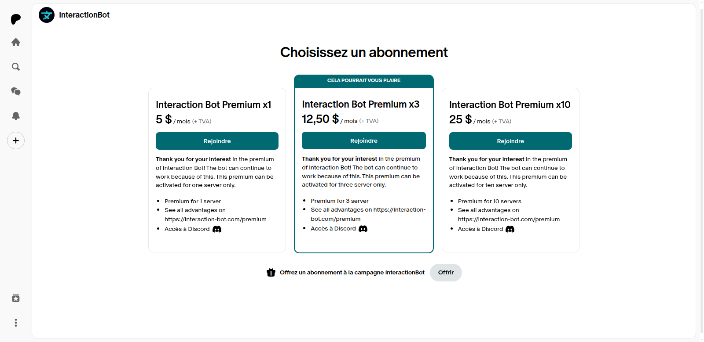

# Subscribe


Premium is bought on the [Premium page](../website/dashboard/premium.md) of the website, with Stripe. You pay for one plan, monthly: 1 server (€3.99), 3 servers (€9.99) or 10 servers (€19.99). You have one subscription at a time: you can change plan from **My subscription** (the difference is prorated; going down is refused while more servers than the new plan allows have Premium) and manage payment and cancellation from the **Manage my subscription** button. Premium stays until the end of the paid period after a cancellation. A full refund or a lost dispute suspends Premium. Patreon is no longer used for new subscriptions: the Patreon steps of this page are for existing Patreon subscribers only.


## Subscribe with Stripe (new subscriptions)

1. Log in to the [Premium page](https://interaction-bot.com/premium) of the website with your Discord account.
2. Choose your plan (1, 3 or 10 servers) and click **Subscribe**. Stripe opens the payment page.
3. Pay. When you come back to the website, the page confirms the payment and shows _Activating your Premium…_ until your subscription is active.

To change plan later, use **Change plan** in **My subscription**. The difference is charged at once, or credited if you go down.

Then activate Premium on your server: see [Activate Premium on your server](#activate-premium-on-your-server).

## Existing Patreon subscriptions

Patreon is no longer used for new subscriptions. If you already have a Patreon offer, follow these steps.

## 1. Patreon offer

1. Go to [Patreon](https://www.patreon.com/interactionbot).
2. Your offer (1, 3 or 10 servers) is the one you already have.

<figure><figcaption></figcaption></figure>

3. Nothing to buy again.

The offers of the dashboard are monthly. The yearly option is not available yet.

## 2. Link your Discord account to Patreon

Once the purchase is done, connect your Discord account on the [Patreon connections page](https://www.patreon.com/settings/apps).

The bot finds your offer through this link: it only reads the Discord account that is connected to your Patreon account.

## 3. Wait for the bot to update

The website checks Patreon every **10 minutes**. If you linked your Discord account less than 10 minutes ago, wait a little. Then refresh the dashboard page.

## Activate Premium on your server

Use one of these two ways:

* the **Premium** toggle of the [Premium page](../website/dashboard/premium.md) of the dashboard, then click on _**Save**_. You need the **Administrator** or **Manage Server** permission on this server;
* the `/premium add` command, typed in the server, see [Usage](usage.md). Your Discord account must have an active subscription (Stripe) or be linked to Patreon.

If all your slots are used, the bot refuses: remove Premium from one of your servers first (the Premium toggle, or `/premium remove`), then activate it on the new server.

Premium is now active on the server: the server shows the **Premium** badge, instead of **Free**, on the [Overview](../website/dashboard/overview.md) page of the dashboard.
