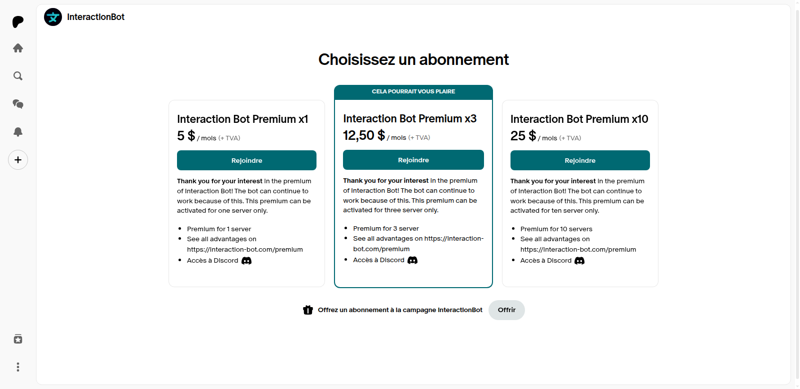

# Subscribe

Buying Premium takes four steps: buy an offer on Patreon, link your Discord account to your Patreon account, wait for the bot to update, then activate Premium on your server.

## 1. Buy an offer on Patreon

1. Go to [Patreon](https://www.patreon.com/interactionbot).
2. Select your offer (1, 3 or 10 servers) and click on **Join**.

<figure><figcaption></figcaption></figure>

3. Enter the requested information and complete the purchase.

The offers of the dashboard are monthly. The yearly option is not available yet.

## 2. Link your Discord account to Patreon

Once the purchase is done, connect your Discord account on the [Patreon connections page](https://www.patreon.com/settings/apps).

The bot finds your offer through this link: it only reads the Discord account that is connected to your Patreon account.

## 3. Wait for the bot to update

The bot checks Patreon every **10 minutes**. If you linked your Discord account less than 10 minutes ago, you can either wait a little, or click on **Refresh my Patreon status** in the Patreon block of the [Premium page](../website/dashboard/premium.md) of the dashboard to update it right away.

To protect Patreon, the button can only be used about once per minute for the whole bot: if it is greyed out with a countdown, someone just refreshed, so your status is probably already up to date. Wait for the countdown, then try again.

## 4. Activate Premium on your server

Use one of these two ways:

* the **Premium** toggle of the [Premium page](../website/dashboard/premium.md) of the dashboard, then click on _**Save**_. You need the **Administrator** or **Manage Server** permission on this server;
* the `/premium add` command, typed in the server, see [Usage](usage.md). Your Discord account must be linked to Patreon.

If all your slots are used, the bot refuses: remove Premium from one of your servers first (the Premium toggle, or `/premium remove`), then activate it on the new server.

Premium is now active on the server: the server shows **PREMIUM: Yes** on the [Overview](../website/dashboard/overview.md) page of the dashboard.
