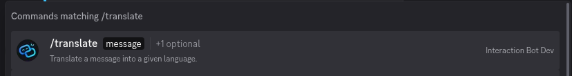
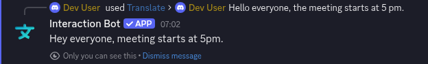

# Translation commands

These tools work **everywhere**, without any configuration. They also work in servers where the bot is not added, once the bot is [installed on your account](../commands/user-app.md).

| Tool                         | Answer                                                              |
| ---------------------------- | ------------------------------------------------------------------- |
| `/translate`                 | **Public**: everybody in the channel sees it                        |
| Apps > Translate             | **Private**: only you see it                                        |
| `/detect`                    | **Public**: everybody in the channel sees it                        |
| Apps > Detect                | **Private**: only you see it                                        |

The language of your translations is your **personal language**, set with [`/personal-language`](#personal-language) or on the [Account page](../website/dashboard/account.md). Without one, the language of your Discord client is used.

## /translate

`/translate message [language]`

Translates the text you type.

* `message`: the text to translate.
* `language`: the target language. Pick it in the list that appears while you type (its name or its code). If you don't set it, your personal language is used, or the language of your Discord client.

You can use it once every 5 seconds. The answer is public.

<figure><figcaption>
The /translate command
</figcaption></figure>

## Apps menus

Right click (long press on mobile) any message, then **Apps**:

* **Translate**: translates the message into your personal language (see above). The result is only visible to you.
* **Detect**: tells you in which language the message is written. The answer is only visible to you.

The **Translate** menu on a message written by **another bot** needs [Premium](../premium/premium.md) (the server or your personal subscription).

<figure> Translate: the translation, only visible to you"><figcaption>
Apps > Translate: the translation, only visible to you
</figcaption></figure>

## /detect

`/detect text`

Tells you the language a text is written in. The answer of `/detect` is posted in the channel; the **Apps > Detect** menu answers privately.

## /languages

Lists the languages supported by the bot (100 languages) with their codes. See [Languages and flags](languages.md).

## /personal-language

`/personal-language language`

Sets the language of your translations, for you only: the Translate menu and `/translate` use it. Choose `none` to go back to the language of your Discord client. The answer is private. The same setting is on the [Account page](../website/dashboard/account.md).

## /check-permissions

Checks why the bot does not translate: it lists the permissions the bot lacks in the channels that have a translation rule. The [Translation rules](../website/dashboard/translation-rules.md) page does the same for one channel, with its **Check a channel** tool. See [Troubleshooting](troubleshooting.md).

## Setting up the translation

There is no configuration command for translation. Two ways do the job:

* the [dashboard](../website/dashboard/translation-rules.md) (**Translation** > **Translation rules**, **Flags**, **Exceptions**, **Voice messages**);
* the [AI assistant](../management/ai-setup.md): run `/ai setup` in a channel, or press the **Set up with AI** button of `/config`.

`/config` explains both ways.

## Related

* [Flag reactions](flags.md): translate for everybody with one emoji.
* [Automatic translation](automatic.md): translate a channel, a role, a category, the whole server or linked channels.
