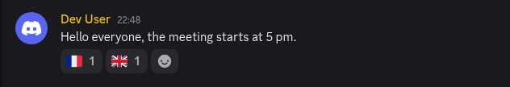
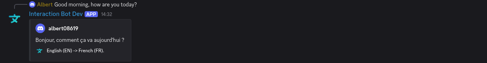

# Flag translation

The simplest way to translate: **add a flag emoji** under a message. The bot replies to the message with the translation in the language of the flag. Nothing to configure: it works on every channel by default.

<figure><figcaption>
1. Add a flag emoji below a message
</figcaption></figure>

<figure><figcaption>
2. The bot answers with the translation
</figcaption></figure>

## Which flags?

Around 175 flags are supported, covering 68 languages (🇫🇷 French, 🇬🇧 or 🇺🇸 English, 🇪🇸 Spanish, 🇩🇪 German, 🇯🇵 Japanese...). Some fun ones:

* 🏴‍☠️ the **pirate flag** translates the message into English, then into "pirate speak".
* the Hebrew 🇮🇱, Bengali 🇧🇩, Tswana 🇧🇼, Welsh 🏴 and Scottish 🏴 flags are supported.

Messages written by bots are translated only on a [premium](../premium/premium.md) server.

## Configure it per channel

On the dashboard, [Flag translation](../website/dashboard/flag-translation.md) lets you change the behavior of a channel:

| Option           | What it does                                                                                                                                                  |
| ---------------- | ------------------------------------------------------------------------------------------------------------------------------------------------------------- |
| **Activated**    | Turn the flag translation off for this channel.                                                                                                               |
| **Sending mode** | *Each time*: every new flag reaction triggers a translation. *One time*: the message is translated once, further flags are ignored.                          |
| **Style** | How the translation is sent: *Embed* (default), *Webhook*, *Message*, *Thread* (in a thread under the message), or *Private message* (sent only to the person who reacted). |
| **Auto delete**  | The translation is deleted after a delay (reading time, 25 seconds minimum). If off, it stays forever. By default it is deleted automatically.              |

A server can configure flag translation for 20 channels (500 with Premium).

## Flag shortcuts

**Flag shortcuts** make the translation one click away: the bot itself **adds 1 to 5 flags** under every message of a channel, and members only click one.

* With a command: `/flags set #general 🇬🇧 🇫🇷 🇪🇸`, and `/flags clear #general` to stop.
* On the dashboard: [Flag shortcuts](../website/dashboard/flag-shortcuts.md).

The bot needs *View Channel*, *Add Reactions* and *Read Message History* in the channel.

## Flags or commands?

| Flag reaction                          | `/translate` or Apps > Translate                  |
| -------------------------------------- | ------------------------------------------------- |
| Visible by everybody in the channel    | Only you see the result (Apps > Translate); `/translate` posts it in the channel               |
| Language chosen by the flag            | Language chosen with the command / your Discord language |
| Deleted automatically after a while    | Disappears when you close it (Apps > Translate); `/translate` stays in the channel                      |
