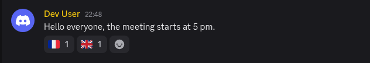
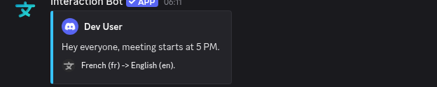

# Flag translation

The simplest way to translate for everybody: **add a flag emoji** under a message. The bot replies to the message with the translation into the language of the flag. Nothing to configure: it works in every channel by default.

<figure><figcaption>
Flag reactions under a message
</figcaption></figure>

<figure><figcaption>
A translation by the bot, with the languages in its footer
</figcaption></figure>

## Which flags?

The bot knows **175 flags**. Several flags can give the same language: for example 🇬🇧, 🇺🇸 and 🇨🇦 all give English, 🇨🇭 and 🇦🇹 give German, 🇧🇷 and 🇵🇹 give Portuguese. Examples: 🇫🇷 French, 🇪🇸 Spanish, 🇩🇪 German, 🇯🇵 Japanese. The full list is in [Languages and flags](languages.md).

Two special flags:

* 🏴‍☠️ the **pirate flag** translates the message into English, then into "pirate speak".
* 🇮🇱 is Hebrew, 🇧🇩 Bengali, 🇧🇼 Tswana, and the Welsh and Scottish flags (🏴 with their region code) give Welsh and Scottish Gaelic.

Messages written by **bots** are translated only on a [Premium](../premium/premium.md) server. A reaction added by a bot never triggers a translation.

## Configure it per channel

On the dashboard, the **React with a flag** card of the [Flags](../website/dashboard/flag-translation.md) page (**Translation** > **Flags**) changes the behaviour of a channel:

| Option                                                     | What it does                                                                                                                                                                 |
| ---------------------------------------------------------- | ---------------------------------------------------------------------------------------------------------------------------------------------------------------------------- |
| **Members can translate by reacting with a flag here**     | Turns the flag translation off in this channel, without losing its settings.                                                                                                |
| **Style of the translation**                               | How the translation is sent: *Embed* (the default, a card), *Webhook* (as the author), *Message* (a plain message), *Thread* (in a thread under the message) or *Private message* (sent to the member who added the flag, nothing is posted in the channel). |
| **How often is it translated?**                            | *Each time someone reacts* (the default): every new flag makes a new translation. *Once per message*: only the first flag on a message is translated; the bot remembers the last 1,000 translated messages. |
| **Delete the translation automatically**                   | The translation is deleted after the reading time (0.13 second per character, 25 seconds at least). A new configuration starts with this option off.                       |

Without any configuration, a channel works with the default settings: the translation is an embed, it is translated each time someone reacts, and it is deleted automatically after the reading time.

Each channel has one configuration. A free server can configure **20 channels**, a Premium server **500**.

## Automatically added flags

**Automatically added flags** make the translation one click away: the bot adds **1 to 5 flags** under every **new** message written by a member of a channel, and members only click one of them.

On the dashboard, this is the second card of the [Flags](../website/dashboard/flag-translation.md) page, **Automatically added flags**. Choose the channel and its flags there.

* The bot needs the *Add Reactions* and *Read Message History* permissions in the channel. Without them, it adds nothing.
* The bot does not add flags under the messages of bots.
* Flags added by the bot are only a shortcut: a click on one of them is a normal flag reaction, with the settings of the channel above.

## Flags or commands?

| Flag reaction                                          | `/translate` or Apps > Translate                                                  |
| ------------------------------------------------------ | --------------------------------------------------------------------------------- |
| Everybody in the channel sees the translation           | `/translate` is public: everybody sees it. Apps > Translate is private: only you |
| The language is the one of the flag                     | The language is the one you choose, or your personal language, or your Discord language |
| Deleted automatically after a while, if you chose it    | `/translate` stays in the channel. Apps > Translate disappears when you dismiss it |
| The [exceptions](../website/dashboard/exceptions.md) of the server do not apply | The exceptions do not apply to commands either                  |
