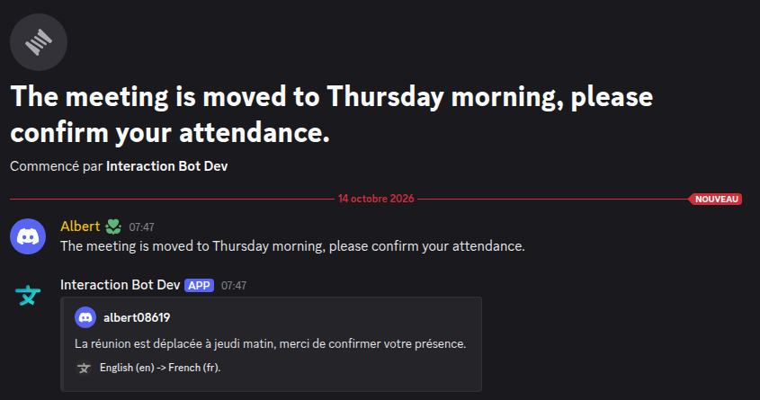

# Translation in threads

The **In a thread** style sends the translations of a message **in a thread under that message**, instead of posting them in the channel. The original message stays where it is, and all the languages of this message are grouped in one thread that members can open when they want to read them.

<figure><figcaption>
A translation thread under a message
</figcaption></figure>

## Why use threads?

* **A clean channel**: with several languages, a conversation is quickly drowned in translations. With threads, the channel only shows the original messages.
* **Every language in one place**: the translations of one message are all in the same thread, one message per language.
* **Nothing is deleted**: the original message is always kept, the thread is attached to it.
* **Discussions in the thread are translated too**: see [Messages written in a thread](#messages-written-in-a-thread).

Use the classic styles ([as the author, bot message or bot card](styles-and-options.md#the-styles)) when the translation must be visible directly in the channel.

## Enable it

### For a channel rule

On the [Translation rules](../website/dashboard/translation-rules.md) page, add or edit a **Channels** rule with the channel itself as the source. In **More options**, open **Advanced** and turn on **In a thread under the original message**.

The thread style is available **only for a channel rule**, and only when the translations are sent to the **same channel**. It is not available for two languages in one channel, linked channels, categories, roles or the whole server. The original message is kept with this style, so *Delete the original message* is not available.

### For a flag reaction

On the [Flags](../website/dashboard/flag-translation.md) page, in the **React with a flag** card, choose **Thread** as the style of the channel. The translation of a flag then goes in a thread under the message that was reacted to.

### The options of the thread style

| Option (dashboard)           | What it does                                                                                                                                                                                  |
| ---------------------------- | --------------------------------------------------------------------------------------------------------------------------------------------------------------------------------------------- |
| **Look in the thread**       | How the translations look in the thread: *As the author* (name and avatar of the author, the default), *Bot message* (plain message from the bot) or *Bot card* (a card with the author and the languages). |
| **Archive the thread after** | Inactivity before Discord archives the thread: **1 h**, **24 h** (the default), **3 d** or **7 d**.                                                                                          |
| **Show the language**        | Writes the language above each translation (on by default). Not shown with the *Bot card* look, the languages are already in the footer.                                                      |

## What members see

The first translation of a message creates the thread, named after the beginning of the message. The next languages of the same message are added to the same thread.

* A message has **one thread** at most. If a member already created a thread on the message, the bot uses it.
* An **archived thread is reopened** by the bot when a new translation has to be written in it.

## Messages written in a thread

When a member writes in a thread (a translation thread, or any thread of a configured channel), the bot applies the rules of the **parent channel**: the message is translated and the translation is sent **in the same thread**, with the look chosen in the configuration. A thread cannot contain another thread, so the *In a thread* style becomes the *look in the thread* in this case.

This means members can discuss in several languages inside a thread and everybody can follow.

## Permissions

The bot needs these permissions in the channel of the original messages:

| Permission                   | Used for                                                       |
| ---------------------------- | -------------------------------------------------------------- |
| **Create Public Threads**    | Creating the thread under the message                          |
| **Send Messages in Threads** | Writing the translations in the thread                         |
| Manage Webhooks              | The *As the author* look (otherwise a bot message is sent)     |
| Manage Threads               | Reopening a **locked** archived thread (optional)              |

If the bot lacks *Create Public Threads* or *Send Messages in Threads*, the translation is **not lost**: it is sent as a webhook message in the channel. The [Translation rules](../website/dashboard/translation-rules.md) page flags the rule, and `/check-permissions` lists the missing permissions.

## Limits

* The thread starts under a message of a **text or announcement channel**. Forums, voice channels, threads and direct messages are not concerned.
* The thread style is not available for linked channels, categories, roles, the whole server or two languages in one channel (see above).
* The limits of your offer (number of rules, number of translations per message) are the same as for the other styles, see [Premium](../premium/premium.md).

## Troubleshooting

| Symptom                                                     | Check                                                                                                                  |
| ----------------------------------------------------------- | ---------------------------------------------------------------------------------------------------------------------- |
| The translations are posted in the channel, not in a thread | The bot lacks *Create Public Threads* or *Send Messages in Threads* in the channel. Run `/check-permissions`.          |
| No thread for a message                                     | The rule skips the message (already in the target language, exceptions, too short): see [Troubleshooting](troubleshooting.md). |
| The translations in the thread have no author name          | The look is *Bot message* or *Bot card*, or the bot lacks *Manage Webhooks* for the *As the author* look.              |
| A thread stays closed                                       | The thread was locked by a moderator: give the bot *Manage Threads*.                                                    |


[styles-and-options.md](styles-and-options.md)



[automatic.md](automatic.md)

