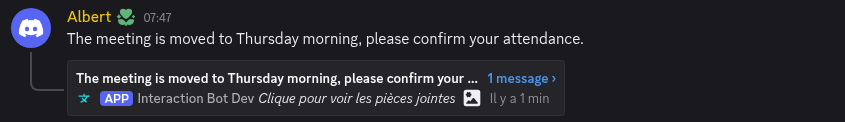
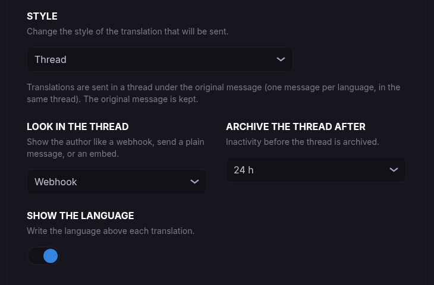
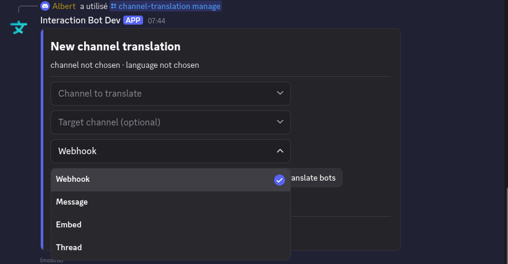
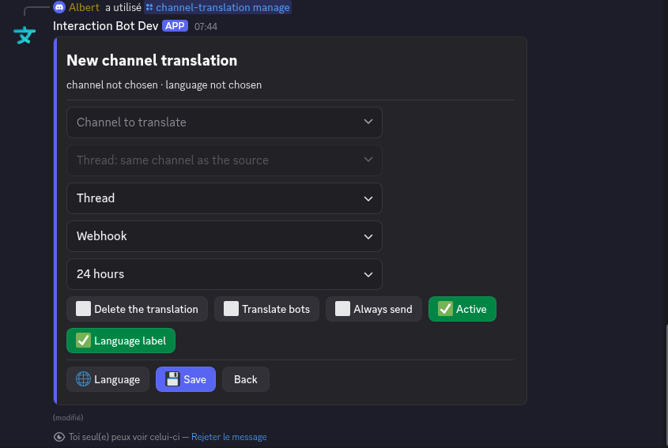
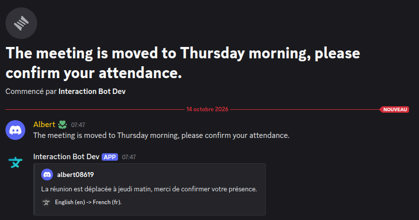

# Translation in threads

The **Thread** style sends the translations of a message **in a thread under that message**, instead of posting them in the channel. The original message stays where it is, and all the languages of this message are grouped in one thread that members can open when they want to read them.

<figure><figcaption>
The original message, with its translation thread under it
</figcaption></figure>

## Why use threads?

* **A clean channel**: with several languages, a conversation is quickly drowned in translations. With threads, the channel only shows the original messages.
* **Every language in one place**: the translations of one message are all in the same thread, one message per language.
* **Nothing is deleted**: the original message is always kept (the thread is attached to it).
* **Discussions in the thread are translated too**: see [Messages written in a thread](#messages-written-in-a-thread).

Use the classic styles ([Embed, Webhook, Message](styles-and-options.md)) when you want the translation to be visible directly in the channel, for example in a channel where everybody reads in the same language as the translation.

## Enable it

The Thread style is a **style** like the others. It is available for [channel](../website/dashboard/channel-translation.md), [role](../website/dashboard/role-translation.md) and [category](../website/dashboard/category-translation.md) translations, from the dashboard or with commands.

### On the dashboard

Open the configuration of a channel, role or category, click on **OPTIONS** and choose **Thread** in **STYLE**.

<figure><figcaption>
Options of the Thread style on the dashboard
</figcaption></figure>

### With commands

Use [`/channel-translation set`](../commands/configuration.md#channel-translation), `/role-translation set` or `/category-translation set` with `style:Thread`, or open the panel with `/channel-translation manage` and choose **Thread** in the style menu.

<figure><figcaption>
The style menu of the panel: Webhook, Message, Embed, Thread
</figcaption></figure>

## The options of the Thread style

When **Thread** is chosen, the sending channel is not needed: the thread is created under the original message, in the same channel.

<figure><figcaption>
The options of the Thread style in the <code>/channel-translation manage</code> panel
</figcaption></figure>

| Option (dashboard)       | Option (command)  | What it does                                                                                                      |
| ------------------------ | ----------------- | ----------------------------------------------------------------------------------------------------------------- |
| **Look in the thread**   | `thread-look`     | How the translations look in the thread: **Webhook** (name and avatar of the author, default), **Message** (plain message from the bot) or **Embed** (a card with the author and the languages). |
| **Archive the thread after** | `thread-archive` | Inactivity before Discord archives the thread: **1 hour**, **24 hours** (default), **3 days** or **7 days**.       |
| **Show the language**    | `thread-label`    | Writes the language above each translation (on by default). Not shown with the *Embed* look, the languages are already in the footer. |

The other options (**Delete translation**, **Translate bot**, **Always send**, **Enabled**) work as usual. **Delete message** cannot be used with this style: the thread is attached to the original message, so the message is kept.

## What members see

The first translation of a message creates the thread, named after the beginning of the message. The next languages of the same message are added to the same thread.

<figure><figcaption>
The thread of a message: the translation in the language of the configuration
</figcaption></figure>

* A message has **one thread** at most. If a member already created a thread on the message, the bot uses it.
* An **archived thread is reopened** by the bot when a new translation has to be written in it.

## Messages written in a thread

When a member writes in a thread (the translation thread or any thread of a configured channel), the bot applies the configuration of the **parent channel**: the message is translated and the translation is sent **in the same thread**, with the look chosen in the configuration. A thread cannot contain another thread, so the *Thread* style becomes the *look in the thread* in this case.

This means members can discuss in several languages inside a thread and everybody can follow.

## Permissions

The bot needs these permissions in the channel of the original messages:

| Permission                 | Used for                                       |
| -------------------------- | ---------------------------------------------- |
| **Create Public Threads**  | Creating the thread under the message          |
| **Send Messages in Threads** | Writing the translations in the thread       |
| Manage Webhooks            | The *Webhook* look (otherwise a plain message is sent) |
| Manage Threads             | Reopening a **locked** archived thread (optional) |

If the bot lacks *Create Public Threads* or *Send Messages in Threads*, the translation is **not lost**: it is sent as a webhook message in the channel, and `/channel-translation set` warns you when you save the configuration. `/check-permissions` also lists the missing permissions, see [Permissions](../permissions.md).

## Limits

* The thread starts under a message of a **text or announcement channel**. Forums, voice channels, DMs and system messages are not concerned.
* The thread style is not available for [translation groups](../commands/groups.md) and [flag translation](flags.md).
* The limits of your offer (number of configurations, number of translations per message) are the same as for the other styles, see [Premium](../premium/premium.md).

## Troubleshooting

| Symptom                                         | Check                                                                                                  |
| ----------------------------------------------- | ------------------------------------------------------------------------------------------------------ |
| The translations are posted in the channel, not in a thread | The bot lacks *Create Public Threads* or *Send Messages in Threads* in the channel. Run `/check-permissions`. |
| No thread for a message                         | The configuration skips the message (already in the target language, blacklist, too short): see [Troubleshooting](troubleshooting.md). |
| The translations in the thread have no author name | The look is *Message* or *Embed*, or the bot lacks *Manage Webhooks* for the *Webhook* look.        |
| A thread stays closed                           | The thread was locked by a moderator: give the bot *Manage Threads*.                                    |


[styles-and-options.md](styles-and-options.md)



[configuration.md](../commands/configuration.md)

