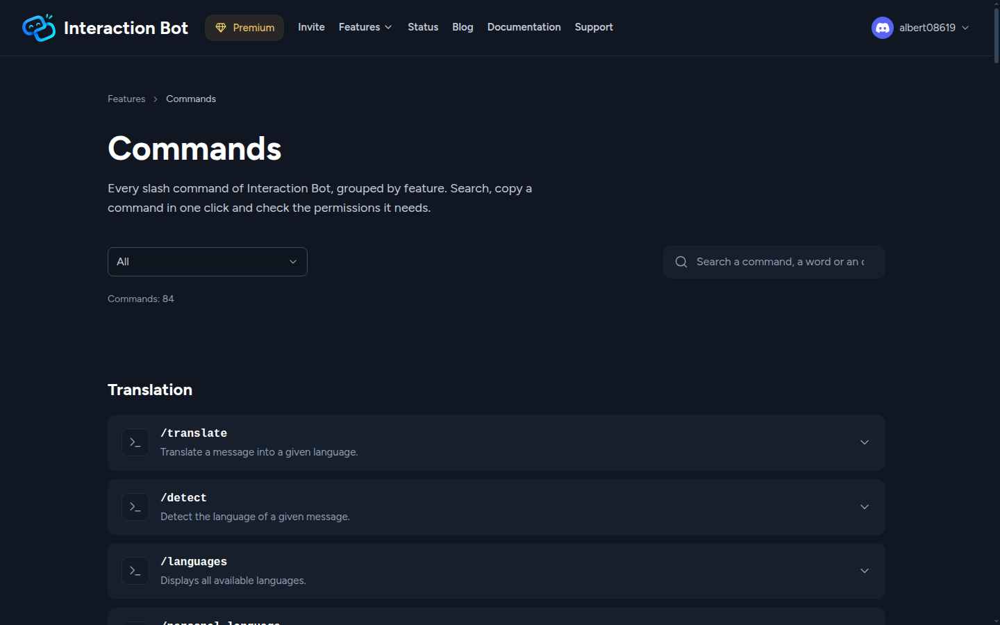

# Commands page

The **Commands** page (`interaction-bot.com/commands`) lists every slash command of Interaction Bot, grouped by feature. It needs no login. The list comes from the bot itself, so it matches the commands of the running version.

<figure><figcaption>
The Commands page of the website
</figcaption></figure>



## Find a command

* **Search**: type a command, a word or an option name. The search ignores capital letters and accents (_Français_ and _francais_ find the same result). The counter shows how many commands match.
* **Filter by category**: _Translation_, _FAQ_, _Text to speech_, _Speech to text_, _Recording_, _Temp voice_, _Premium and limits_, _Configuration_ and _Utilities_. _All_ removes the filter.
* **Copy**: the _Copy_ button of a command copies it, ready to paste in Discord.
* **Link to a command**: a command can be opened directly from its link, and a category has its own anchor.

## Read a command card

Each card shows the command with its usage, a description in the language of the website, and the list of its options. An optional option is marked _optional_, and the possible choices of an option are listed under it.

Badges tell what a command needs:

* **Premium**: a Premium server is needed for the command or for one of its options, see [Premium](../premium/premium.md).
* **Vote**: a recent [top.gg](https://top.gg/bot/893494390142697493/vote) vote is needed, see [Limits and privacy](../audio/limits-and-privacy.md).
* **Manage Server**: only the members with this permission can use the command.

The same commands are described in this documentation: [All commands](../commands/all-commands.md), with the details of the [audio commands](../commands/audio.md) and of the [general commands](../commands/general.md).
