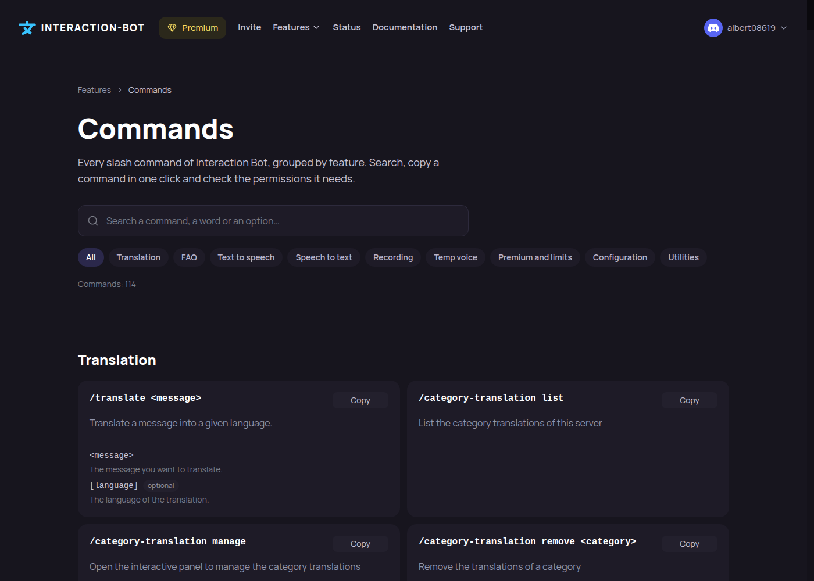

# Commands page

<figure><figcaption>
The Commands page
</figcaption></figure>

The **Commands** page (`interaction-bot.com/commands`) lists every slash command of Interaction Bot, grouped by feature. It needs no login. The list comes from the bot itself, so it always matches the commands of the running version.



## Find a command

* **Search**: type a command, a word or an option name. The search ignores capital letters and accents (_Français_ and _francais_ find the same result).
* **Filter by category**: _Translation_, _FAQ_, _Text to speech_, _Speech to text_, _Recording_, _Temp voice_, _Premium and limits_, _Configuration_ and _Utilities_. _All_ removes the filter. The counter shows how many commands match.
* **Copy**: the _Copy_ button of a command copies it, ready to paste in Discord.
* **Link to a command**: every command has its own anchor, so you can share a link that opens the page on a given command.

## Read a command card

Each card shows the command with its required options, a description in the language of the website, and the list of its options (_optional_ is written next to the options that can be left empty, and the possible choices are listed when there are some).

Badges tell what a command needs:

* **Premium**: a premium server is needed for the command or for some of its options, see [Premium](../premium/premium.md).
* **Vote**: a recent [top.gg](https://top.gg/bot/893494390142697493/vote) vote is needed, see [Limits and privacy](../audio/limits-and-privacy.md).
* **Manage Server**: only members with this permission see the command.

The same commands are described in this documentation: [All commands](../commands/all-commands.md) and [Audio commands](../commands/audio.md).
