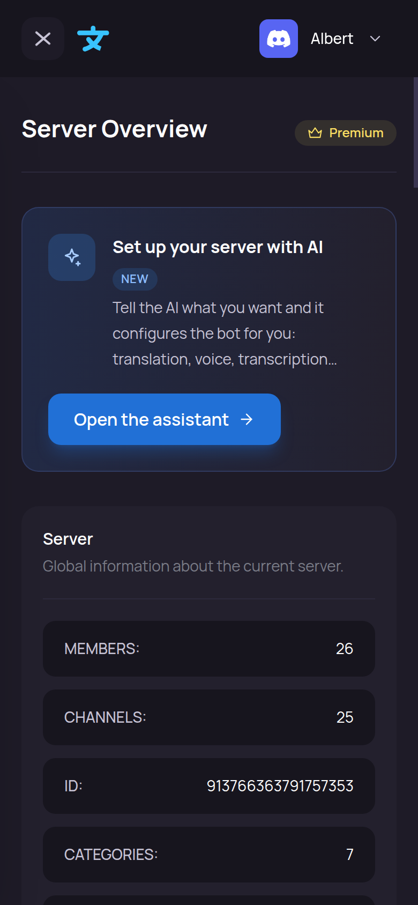
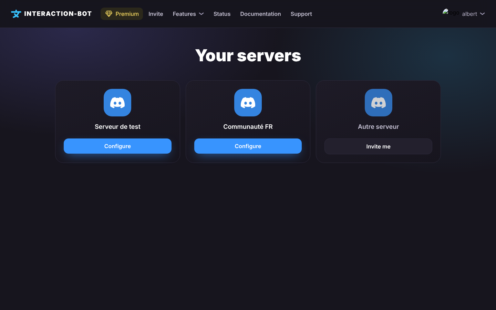
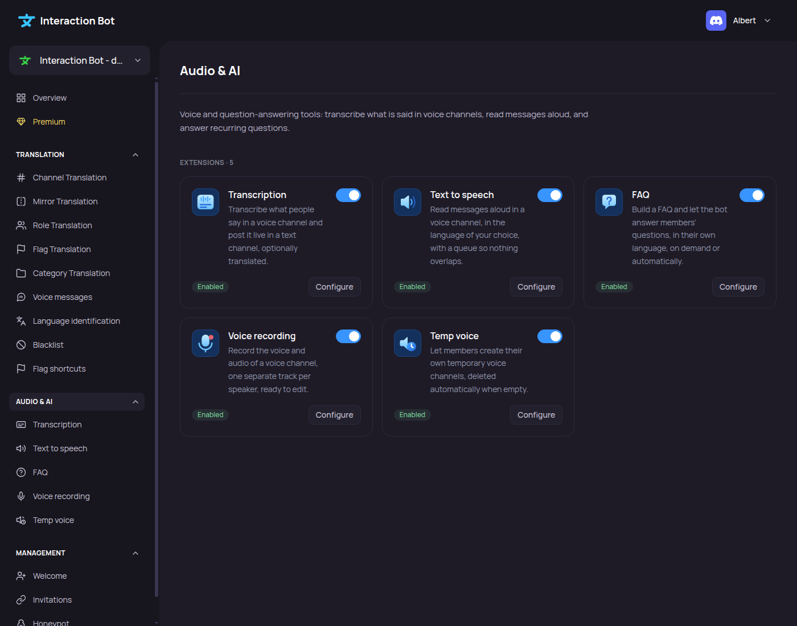

# 🌐 Dashboard

The configuration of the bot is done on the dashboard. First, link your Discord account, then select the server you want to configure. Each feature has its own page in the navigation bar.

## Login to the dashboard

Go to the website of the bot, you can find it at the bottom of this text :)



Click on the _**Login**_ button: you are redirected to the Discord login page. The dashboard only asks Discord for your identity (`identify`) and the list of your servers (`guilds`). Your Discord password is never shared with the bot.

<figure><figcaption></figcaption></figure>

Once you are logged in, select the server that you want to configure and click on the _**Configure**_ button. You are now on the configuration page of your server.

## Who can configure a server

You can change the configuration of a server if you have the **Administrator** permission or the **Manage Server** permission on it, and if the bot is on this server. Otherwise, the dashboard refuses access.

The bot checks this right again at **every save**: a change is only applied if you still have the permission at that moment, even when the page showed you the server a few minutes earlier.

The list of your servers is kept for **10 minutes**, so that the dashboard does not ask Discord for it at every click (several open tabs would otherwise reach the Discord limit). A permission you lost can therefore still show in the pages for a few minutes, but it is refused when you save. The _My servers_ page refreshes the list (at most every 15 seconds), so a server where you just added the bot appears at once.

## Navigate on the dashboard

The dashboard has a left sidebar, a top bar and a content area.

<figure><figcaption>
The sidebar (left) and the Overview page
</figcaption></figure>

* **Server picker** (top of the sidebar): shows the server you are configuring. Click it to switch to another server without going back to the list. The picker lists your servers.
* **Sidebar**, organized in sections:
  * **Overview** and **Premium** at the top.
  * **Translation**: Channel Translation, Mirror Translation, Role Translation, Flag Translation, Category Translation, Voice messages, Language identification, Blacklist and Flag shortcuts.
  * **Audio & AI**: Transcription, Text to speech, FAQ, Voice recording and Temp voice.
  * **Management**: Welcome, Invitations and Honeypot.
* **Top bar**: your name opens the user menu: **My servers**, the **language** of the website and **Log out**. The language only changes the website, not the language of the bot (see [Bot Language](overview.md#bot-language)).

You can fold a section of the sidebar with the arrow on its right. Click the **name of a section** to open its page.

Your personal settings (vote reminder, [user app](../../commands/user-app.md), recordings, privacy) are on the [Account page](account.md), which is not linked to a server.

For mobile users, the sidebar is hidden: tap the burger button at the top left of the page to open it, and the cross to close it.

<figure><figcaption>
The sidebar on a phone
</figcaption></figure> The pages are made to be used on a phone, without horizontal scrolling.

To return to the server selection, open the user menu and click _**My servers**_.

### Your servers

The _**Your servers**_ page (`interaction-bot.com/servers`) lists the servers where you can configure the bot. _**Configure**_ opens the dashboard of the server, and _**Invite me**_ opens the invitation of the bot for a server where it is not present yet. A server where you just added the bot appears without waiting.

<figure><figcaption>
Your servers
</figcaption></figure>

## Category pages and extensions

Each feature of the bot is an **extension**: it can be turned on or off on each server, and it has its own page. Click a **section name** in the sidebar (_Translation_, _Audio & AI_, _Management_) to see all its extensions as cards.

<figure><figcaption>
A category page: one card per extension
</figcaption></figure>

Each card shows:

* the **icon** and the **name** of the extension, with a short explanation (click the arrow next to the name to read it);
* a **switch** to turn the extension on or off for this server;
* a **status**: _Enabled_, _Disabled_, _Not added_ (the extension was never set up on this server) or _Missing permission_ (the extension is on, but the bot lacks a Discord permission it needs: the page of the extension says which one and gives a button to reinvite the bot with the right permissions);
* the **Configure** button, which opens the page of the extension.

When an extension is turned off, the bot does not use it **but your settings are kept**: turn it on again and everything is as you left it. A disabled extension stays in the sidebar (greyed out), and its page shows a banner with an **Enable** button.

Turning an extension on or off is a change like the others: it is applied when you click _Save_ (see below). All your switches are saved together.

## Save your changes

Nothing is applied to the bot until you save. As soon as you change something on a page, a bar appears at the bottom of the screen with the message **You made changes, save them!** and two buttons:

* _**Cancel**_: removes your unsaved changes and restores the last saved configuration.
* _**Save**_: sends your configuration to the bot.

<figure><figcaption></figcaption></figure>

If the bot refuses the change (for example a premium-only option on a server without Premium, or more configurations than allowed), **nothing is saved and the bar stays on the screen without any message**. Check the page you are on, see the limits written on each page, then try again.

## AI assistant

The **AI assistant** helps you configure the bot in plain words. Open it with the _**Open the assistant**_ card on the Overview page,: it opens as a panel on the right of the dashboard, and it stays open or closed the next time you come back.

* Describe what you want (for example, translating your main channel into French, or turning on transcription for voice channels). The assistant reads the current settings of the server, then writes the **exact plan** of the changes it will make and asks you to confirm it.
* **Nothing is changed until you answer the plan with a yes.** The changes then go through the same dashboard routes and checks as a click on the page, so the assistant has no more rights than you.
* After a change, an **Undo** button is shown on the step.
* The conversation is kept in the browser of this device, for each server (the last 40 messages). **New conversation** starts a new one.
* The number of requests is limited per day: per server, and per person across all the servers. The panel shows how many requests are left. The assistant can make mistakes, and your requests are processed by an AI provider.

## Errors

* If the dashboard cannot load or save data, you are sent back to the home page, where a pop-up says **It seems something has gone wrong.** followed by the error (for example `500: Internal Server Error`). Try again, and ask the support if the error stays.
* If your session has expired or you do not have the permission to configure the server, you are sent to the login page.

## Pages of the dashboard

* [Overview](overview.md): server information, bot language and the simultaneous translation warning.
* [Premium](premium.md): enable Premium on this server with your Patreon offer.
* [Channel Translation](channel-translation.md), [Mirror Translation](translation-groups.md), [Role Translation](role-translation.md), [Flag Translation](flag-translation.md), [Category Translation](category-translation.md), [Voice messages](voice-messages.md), [Language identification](language-identification.md), [Blacklist](blacklist.md) and [Flag shortcuts](flag-shortcuts.md) (category *Translation*).
* [Transcription](speech-to-text.md), [Text to speech](tts-channels.md), [FAQ](faq.md), [Voice recording](voice-recording.md) and [Temp voice](temp-voice.md) (category *Audio & AI*).
* [Welcome](welcome.md), [Invitations](invites.md) and [Honeypot](honeypot.md) (category *Management*). The features behind them: [Welcome and goodbye](../../management/welcome-and-goodbye.md), [Invite tracker](../../management/invite-tracker.md) and [Honeypot](../../management/honeypot.md).
* The features of the voice messages: [Voice messages](../../audio/voice-messages.md).


Members with the **Administrator** permission or the **Manage Server** permission can configure the bot of their server.

