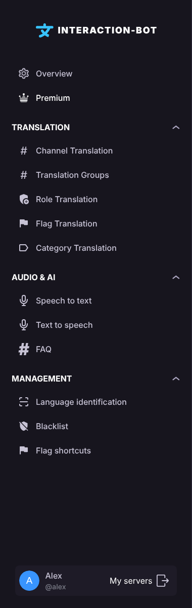

# 🌐 Dashboard

The configuration of the bot is done on the dashboard. First, link your Discord account, then select the server you want to configure. Each feature has its own page in the navigation bar.

## Login to the dashboard

Go to the website of the bot, you can find it at the bottom of this text :)



Click on the _**Login**_ button: you are redirected to the Discord login page. The dashboard only asks Discord for your identity (`identify`) and the list of your servers (`guilds`). Your Discord password is never shared with the bot.

<figure><figcaption></figcaption></figure>

Once you are logged in, select the server that you want to configure and click on the _**Configure**_ button. You are now on the configuration page of your server.

## Who can configure a server

You can change the configuration of a server if you have the **Administrator** permission or the **Manage Server** permission on it, and if the bot is on this server. Otherwise, the dashboard refuses access.

## Navigate on the dashboard

Each page of the dashboard can be accessed with the navigation bar on the left of the page.

<figure><figcaption>
Navigation bar
</figcaption></figure>

The navigation bar is organized in sections:

* **Overview** and **Premium** at the top.
* **Translation**: Channel Translation, Translation Groups, Role Translation, Flag Translation and Category Translation.
* **Audio & AI**: Speech to text, Text to speech, Text to speech settings, Voice recording, Temp voice and FAQ.
* **Management**: Language identification, Blacklist and Flag shortcuts.

Your personal settings (vote reminder, [user app](../../commands/user-app.md)) are on the [Account page](account.md), which is not linked to a server.

For mobile users, click on the burger button at the top left of the page to open the navigation bar.

<figure><figcaption></figcaption></figure>

To return to the server selection, click at the bottom of the navigation bar.

<figure><figcaption></figcaption></figure>

## Save your changes

Nothing is applied to the bot until you save. As soon as you change something on a page, a bar appears at the bottom of the screen with the message **You made changes, save them!** and two buttons:

* _**Cancel**_: removes your unsaved changes and restores the last saved configuration.
* _**Save**_: sends your configuration to the bot.

<figure><figcaption></figcaption></figure>

If the bot refuses the change (for example a premium-only option on a server without Premium, or more configurations than allowed), **nothing is saved and the bar stays on the screen without any message**. Check the page you are on, see the limits written on each page, then try again.

## Errors

* If the dashboard cannot load or save data, you are sent back to the home page, where a pop-up says **It seems something has gone wrong.** followed by the error (for example `500: Internal Server Error`). Try again, and ask the support if the error stays.
* If your session has expired or you do not have the permission to configure the server, you are sent to the login page.

## Pages of the dashboard

* [Overview](overview.md): server information, bot language and the simultaneous translation warning.
* [Premium](premium.md): enable Premium on this server with your Patreon offer.
* [Channel Translation](channel-translation.md), [Translation Groups](translation-groups.md), [Role Translation](role-translation.md), [Flag Translation](flag-translation.md) and [Category Translation](category-translation.md).
* [Speech to text](speech-to-text.md), [Text to speech](tts-channels.md), [Text to speech settings](tts-settings.md), [Voice recording](voice-recording.md), [Temp voice](temp-voice.md) and [FAQ](faq.md) (category *Audio & AI*).
* [Flag shortcuts](flag-shortcuts.md): flags shown under every message of a channel.
* [Language identification](language-identification.md): minimum message size for the detection, per channel.
* [Blacklist](blacklist.md): channels, languages and roles that are not translated (Premium).


Members with the **Administrator** permission or the **Manage Server** permission can configure the bot of their server.

