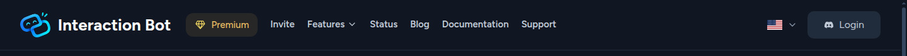
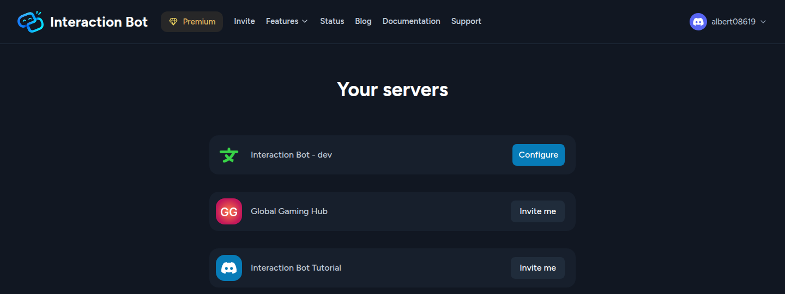
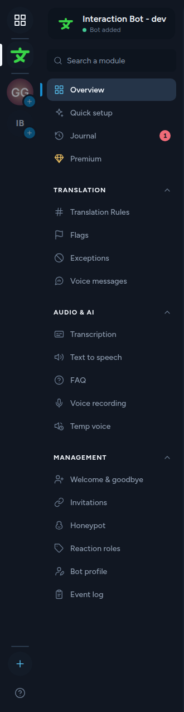
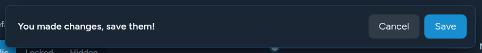

# 🌐 Dashboard

The configuration of the bot is done on the dashboard, at [interaction-bot.com](https://interaction-bot.com). First, log in with Discord, then select the server you want to configure. Each feature has its own page in the menu.

## Log in to the dashboard

Click on the _**Login**_ button of the website, then authorize the application on the Discord login page. The dashboard asks Discord only for your identity and for the list of your servers. Your Discord password is never shared with the bot.

<figure><figcaption>
The Login button at the top right of the website
</figcaption></figure>

Once you are logged in, select the server that you want to configure and click on the _**Configure**_ button. You are now on the overview page of your server.

## Who can configure a server

You can change the configuration of a server if you have the **Administrator** permission or the **Manage Server** permission on it, and if the bot is on this server. Otherwise, the dashboard refuses access.

The bot checks this right again at **every save**: a change is only applied if you still have the permission at that moment, even when the page showed you the server a few minutes earlier.

The list of your servers is kept for **10 minutes**, so that the dashboard does not ask Discord for it at every click. A permission you lost can therefore still show in the pages for a few minutes, but it is refused when you save. The _**Your servers**_ page refreshes the list, so a server where you just added the bot appears at once.

## Your servers

The _**Your servers**_ page (`interaction-bot.com/servers`) lists the servers where you can configure the bot. _**Configure**_ opens the dashboard of the server, and _**Invite me**_ opens the invitation of the bot for a server where it is not present yet.

<figure><figcaption>
The list of your servers
</figcaption></figure>

## Navigate on the dashboard

The dashboard has a left sidebar, a top bar and a content area.

<figure><figcaption>
The menu of the dashboard
</figcaption></figure>

* **Server picker** (top of the sidebar): shows the server you are configuring. Click it to switch to another server without going back to the list.
* **Sidebar**, in this order:
  * **Overview**, **Quick setup**, **Journal** and **Premium**, at the top. The Journal shows how many bot problems you have not seen yet, see [Journal](journal.md).
  * **Translation**, with four pages: **Translation Rules** (the rules of the server: channels, categories, two languages in one channel, linked channels, the whole server and roles), **Flags** (react with a flag, and flags added automatically), **Exceptions** (channels, roles and languages that are never translated, and the minimum message size) and **Voice messages**.
  * **Audio & AI**, with five pages: **Transcription**, **Text to speech**, **FAQ**, **Voice recording** and **Temp voice**.
  * **Management**, with six pages: **Welcome & goodbye**, **Invitations**, **Honeypot**, **Reaction roles**, **Bot profile** and **Event log**.
* **Top bar**: your name opens the user menu: **My servers**, **Account**, the **language** of the website, and **Log out**. The language only changes the website, not the language of the bot.

You can fold a section of the sidebar with the arrow on its right. Click the **name of a section** to open its page.

Your personal settings (vote reminder, [user app](../../commands/user-app.md), recordings, voices and privacy) are on the [Account page](account.md), which is not linked to a server.

The pages are made to be used on a phone: on a small screen, the sidebar is hidden behind the burger button at the top left of the page.

## Category pages and extensions

Each feature of the bot is an **extension**: it can be turned on or off on each server, and it has its own page. Click a **section name** in the sidebar (_Translation_, _Audio & AI_, _Management_) to see all its features as cards.

Each card shows:

* the **icon** and the **name** of the feature, with a short explanation;
* a **switch** to turn the feature on or off for this server;
* a **status**: _Enabled_, _Disabled_, _Not added_ (the feature was never set up on this server) or _Missing permission_ (the feature is on, but the bot lacks a Discord permission it needs: the page of the feature says which one, and gives a button to invite the bot again with the right permissions);
* the **Configure** button, which opens the page of the feature.

When a feature is turned off, the bot does not use it **but your settings are kept**: turn it on again and everything is as you left it. A disabled feature stays in the sidebar, greyed out, and its page shows a banner with an **Enable** button.

Turning a feature on or off is a change like the others: it is applied when you click _Save_.

## Save your changes

Nothing is applied to the bot until you save. As soon as you change something on a page, a bar appears at the bottom of the screen with the message **You made changes, save them!** and two buttons:

* _**Cancel**_: removes your unsaved changes and restores the last saved configuration.
* _**Save**_: sends your configuration to the bot.

<figure><figcaption>
The save bar at the bottom of a page
</figcaption></figure>

If the bot refuses the change (for example a Premium option on a server without Premium, or more rules than allowed), **nothing is saved**, and the page tells you why. Check the limits written on each page, then try again.

## Overview of the server

The **Overview** page is the first page of the menu. It shows the server, the **Bot settings** (language, announcements channel, language detection, warnings, edited messages and vote messages), the list of features of the server, and the **AI assistant**. At the bottom, **Your feedback** lets you rate the bot, report a problem or suggest an idea. See [Overview](overview.md).

## AI assistant

The **AI assistant** helps you configure the bot in plain words. Open it with the _**Open the assistant**_ button of the card _Set up your server with AI_ on the Overview page: it opens as a panel on the right of the dashboard, and it stays open or closed the next time you come back.

* Describe what you want (for example, translating your main channel into French, or turning on transcription for voice channels). The assistant reads the current settings of the server, then writes the **exact plan** of the changes it will make and asks you to confirm it.
* **Nothing is changed until you answer the plan with a yes.** The changes then go through the same dashboard routes and checks as a click on the page, so the assistant has no more rights than you.
* After a change, an **Undo** button is shown on the step.
* The conversation is kept in the browser of this device, for each server. **New conversation** starts a new one.
* The number of requests is limited per day: per server, and per person across all the servers. The panel shows how many requests are left. The assistant can make mistakes, and your requests are processed by an AI provider.

The same assistant is available in Discord, with `/ai setup`, see [AI setup](../../management/ai-setup.md).

## Pages of the dashboard

* [Overview](overview.md): the server, the bot settings, the features and the feedback.
* [Quick setup](../../management/quick-setup.md): the steps to set up the bot in one place.
* [Journal](journal.md): the actions made on the bot, and the problems of the bot.
* [Premium](premium.md): turn Premium on for this server, and manage your subscription.
* Category *Translation*: [Translation rules](translation-rules.md), [Flags](flag-translation.md) (with the flags added automatically), [Exceptions](exceptions.md) and [Voice messages](voice-messages.md).
* Category *Audio & AI*: [Transcription](speech-to-text.md), [Text to speech](tts-channels.md), [FAQ](faq.md), [Voice recording](voice-recording.md) and [Temp voice](temp-voice.md).
* Category *Management*: [Welcome & goodbye](welcome.md), [Invitations](invites.md), [Honeypot](honeypot.md), [Reaction roles](reaction-roles.md), [Bot profile](bot-profile.md) and [Event log](event-log.md).
* [Account](account.md): your personal settings, on every server.

The features behind these pages are described in the [Translation](../../translation/overview.md), [Audio](../../audio/overview.md) and [Server management](../../management/ai-setup.md) sections.


Members with the **Administrator** permission or the **Manage Server** permission can configure the bot of their server.

