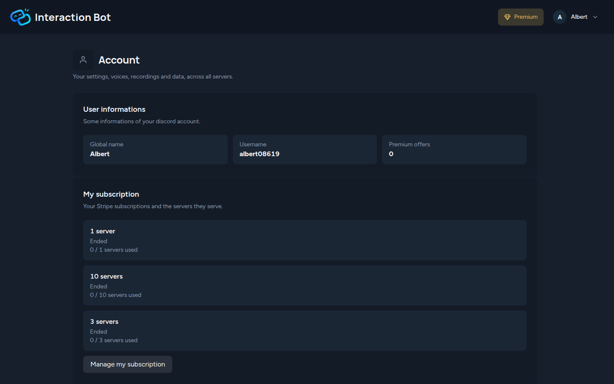

# Account

The **Account** page (`interaction-bot.com/account`) is in the user menu of the website. Unlike the other pages, it is not linked to a server: its settings are **personal** and apply to your Discord account on every server.

## User informations

Your global name, your username, and the number of your **Premium offers**: the slots of your Patreon offers and of your active subscriptions. See [Premium](premium.md).

## Vote reminder

The bot reminds you to vote for it on [top.gg](https://top.gg/bot/893494390142697493/vote), **once a day** and in a private message, as long as your last vote is more than 24 hours old. Use the switch to enable or disable the reminder. It is the same setting as the [`/reminder`](../../commands/general.md#vote-reminder) command.

## My voices

The **Manage my voices** button opens the [My voices](../my-voice.md) page. You can create up to 5 cloned voices, reserved for Premium members, and delete them. A cloned voice is stored encrypted, on our own storage only, and is deleted 30 days after your Premium has ended. See [Voices and voice cloning](../../audio/voices-and-cloning.md).

## My recordings

The **Open my recordings** button opens the [My recordings](../recordings.md) page: the voice channel recordings that you started, including those that were cut short when the bot stopped. You can listen to them, and download each track or all of them at once.

## User app

Install the bot on your Discord account and choose how it answers you. See [User app](../../commands/user-app.md).

* **Add to my account**: opens Discord to install the bot on your account (no server needed).
* **Language of my translations** (the Translate menu, `/translate` and `/personal-language`): the language used when you do not choose one. The default choice, **Discord language (default)**, uses the language of your Discord application.
* **Premium activation message**: after a subscription, the bot sends you a private message explaining how to activate Premium. Turn it off if you do not want it. No message is sent when it is off.

The settings are saved with the **Save** button of the bar at the bottom of the page. The message *Saved.* confirms it, and *The settings could not be saved.* tells you that something went wrong.

## Privacy

<figure><figcaption>
The Privacy card of the Account page
</figcaption></figure>

The **Privacy** card lets you control what the bot keeps about you. It shows how much is stored about you right now (recordings where you speak, recordings you started, notes, personal settings and cloned voices), and offers:

* **Don't process my messages (opt-out)**: the bot no longer translates, reads aloud or analyses your new messages. Messages already processed are not deleted, and your own commands are not blocked. The change is applied when you save.
* **Do not record me (opt-out)**: from the next recording, the bot does not record your voice. What is already recorded does not change. The bot applies it within 30 seconds.
* **Download my data**: a ZIP file with what the bot holds about you, in open formats (JSON and FLAC): your Discord identifiers and settings, the metadata of your cloned voices, your recordings and the notes you added.
* **Delete my data**: removes what the bot holds about you and keeps your account. Your voice is removed from the recordings where you speak (their mix is rebuilt without you), the recordings you started are deleted entirely with their notes and the voices of everyone in them, and your personal settings and cloned voices are deleted. It cannot be undone. Recordings still in progress are not touched: run it again when they have ended.
* **Delete my account**: deletes everything above and the link between your account and Patreon, then logs you out. Your Patreon subscription is **not** cancelled: cancel it on Patreon.

The same information is available in Discord with the `/privacy` command, see [Limits and privacy](../../audio/limits-and-privacy.md).
