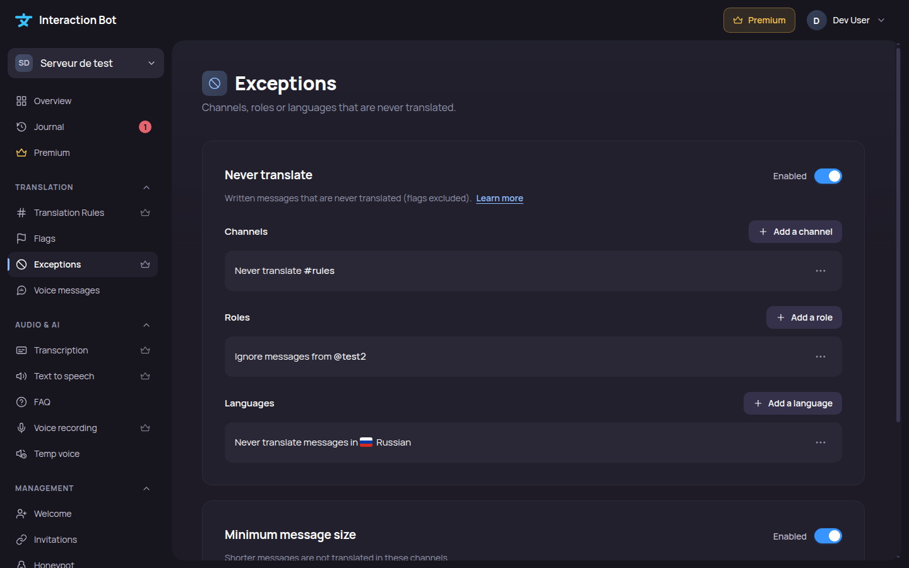

# Blacklist


On the current dashboard this page is called **Exceptions**, in the **Translation** section, and it also holds the **minimum message size** (formerly *Language identification*). Excluding channels, roles and languages is a **Premium** option.


## Localization

This page is the **Exceptions** item of the **Translation** section of the navigation bar. The card **Never translate** has three sections below it: **Channels**, **Roles** and **Languages**. The card **Minimum message size** of the same page is described in [Language identification](language-identification.md).

<figure><figcaption>
Blacklist page
</figcaption></figure>


The blacklist is a **Premium** feature: a server without Premium cannot add new entries. Entries that were saved while the server had Premium are kept, but see the notes of each section below.


The page has three sections. They share one bar of changes at the bottom of the page.

## Channels

**Add a channel** (*Never translate messages in these channels.*) adds a channel to the list. Choose one or more channels in the popup and click on _**Add the channel**_ (or _**Add N channels**_). The change is applied when you save the page.

* **Which channel?** (*Messages in this channel are never translated, whether by a rule, a linked channel or the server rule.*): the channel.

A message posted in a blacklisted channel is **not translated at all**: no channel, role, category or group configuration translates it. Flag translations still work in this channel, because they are triggered by a reaction.

The list shows one sentence per excluded channel (*Never translate #name*). In the **⋯** menu of each row: _**Edit**_ and _**Delete**_.

## Languages

**Add a language** (*Messages detected in this language are never translated.*) adds a language to the list. Choose the language in the popup and click on _**Add the language**_. The change is applied when you save the page.

* **Which language?** (*Messages written in this language are never translated.*): the language.

When the bot detects this language in a new message, the message is not translated. This is useful when a language is often confused with another one, and you do not want its messages to be translated.


The language blacklist is only applied while the server has Premium. If Premium ends, the entries are kept but not applied until Premium is active again.


The list shows one sentence per excluded language (*Never translate messages in Latin*). In the **⋯** menu of each row: _**Edit**_ and _**Delete**_.

## Roles

**Add a role** (*Ignore messages from members with these roles.*) opens a popup: choose the role in **Which role?**, then click _**Add the role**_. Then save the page with the bar at the bottom.

Messages sent by a member who has one of these roles are **not translated at all**.


Adding a role to the blacklist is a Premium feature. On a server without Premium, the list is locked and clicking on it opens the Premium pop-up.


## Save configurations

Click on _**Save**_ in the bar at the bottom of the page (*You made changes, save them!*) to apply your changes. _**Cancel**_ removes your unsaved changes.

If the bot refuses to save (for example because the server has no Premium), nothing is saved, and the page shows *Saving failed. If your server is not Premium, excluding channels, roles and languages is reserved for Premium. Try again.*

## Errors

* **It looks like you found a premium feature!** (pop-up): you clicked on *Add a channel*, *Add a language*, *Edit* or *Add a role* on a server without Premium. *Subscribe* opens the Premium page of the dashboard.
* Messages under the popup, which keep the add button disabled: **Choose a channel first.**, **Choose a role first.** or **Choose a language first.** (nothing is selected), and **This channel is already excluded. Edit it instead.** (or the same message for a role or a language).

## Premium

| | Free | Premium |
| --- | --- | --- |
| Add entries to the blacklist | Not available | Available (up to 250 channels and 250 roles) |

## Tips

* Blacklist the channel where members talk in their own language, for example a *#francophone* channel, to avoid translating it.
* Blacklist a role used by bots, for example *@Bots*, if you do not want their messages to be translated.
* To stop translating a channel for a short time without losing the other settings, use [Channel Translation](channel-translation.md) and uncheck **Enabled** instead.
