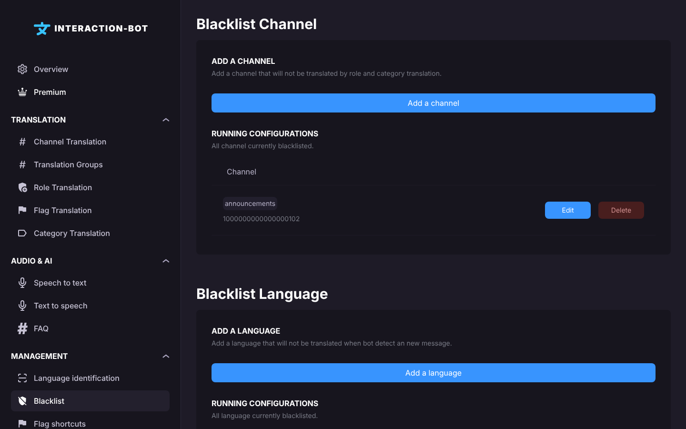

# Blacklist

## Localization

This page is in the **Management** section of the navigation bar. Its title is **Blacklist Channel**, and the page has three sections below it.

<figure><figcaption>
Blacklist page
</figcaption></figure>


The blacklist is a **Premium** feature: a server without Premium cannot add new entries. Entries that were saved while the server had Premium are kept, but see the notes of each section below.


The page has three sections. They share one bar of changes at the bottom of the page.

## Blacklist Channel

**Add a channel** (*Add a channel that will not be translated by role and category translation.*) adds a channel to the blacklist. Choose the channel in the popup and click on _**Save**_ in the popup. The change is applied when you save the page.

* **CHANNEL** (*The channel that will be blacklisted.*): the channel.

A message posted in a blacklisted channel is **not translated at all**: no channel, role, category or group configuration translates it. Flag translations still work in this channel, because they are triggered by a reaction.

The list shows the channels of the blacklist, with _**Edit**_ and _**Delete**_ buttons on each row.

## Blacklist Language

**Add a language** (*Add a language that will not be translated when bot detect an new message.*) adds a language to the blacklist. Choose the language in the popup and click on _**Save**_ in the popup. The change is applied when you save the page.

* **LANGUAGE** (*The language that will be blacklisted.*): the language.

When the bot detects this language in a new message, the message is not translated. This is useful when a language is often confused with another one, and you do not want its messages to be translated.


The language blacklist is only applied while the server has Premium. If Premium ends, the entries are kept but not applied until Premium is active again.


The list shows the blacklisted languages, with _**Edit**_ and _**Delete**_ buttons on each row.

## Blacklist Role

**Add a role** (*Add a role that will not be translated.*) is a list: click on the roles that you want to blacklist, click again to remove one, and use the search field when the list is long. Then save the page with the bar at the bottom.

Messages sent by a member who has one of these roles are **not translated at all**.


Adding a role to the blacklist is a Premium feature. On a server without Premium, the list is locked and clicking on it opens the Premium pop-up.


## Save configurations

Click on _**Save**_ in the bar at the bottom of the page (*You made changes, save them!*) to apply your changes. _**Cancel**_ removes your unsaved changes.

If the bot refuses to save a new channel, language or role (because the server has no Premium), nothing is saved and the bar stays on the screen without any message.

## Errors

* **It looks like you found a premium feature!** (pop-up): you clicked on *Add a channel*, *Add a language*, *Edit* or the role list on a server without Premium. *Subscribe* opens the Premium page of the dashboard.
* **Error - You have not completed all the required fields.** (pop-up): no channel or no language is selected in the popup.

## Premium

| | Free | Premium |
| --- | --- | --- |
| Add entries to the blacklist | Not available | Available (up to 250 channels and 250 roles) |

## Tips

* Blacklist the channel where members talk in their own language, for example a *#francophone* channel, to avoid translating it.
* Blacklist a role used by bots, for example *@Bots*, if you do not want their messages to be translated.
* To stop translating a channel for a short time without losing the other settings, use [Channel Translation](channel-translation.md) and uncheck **Enabled** instead.
