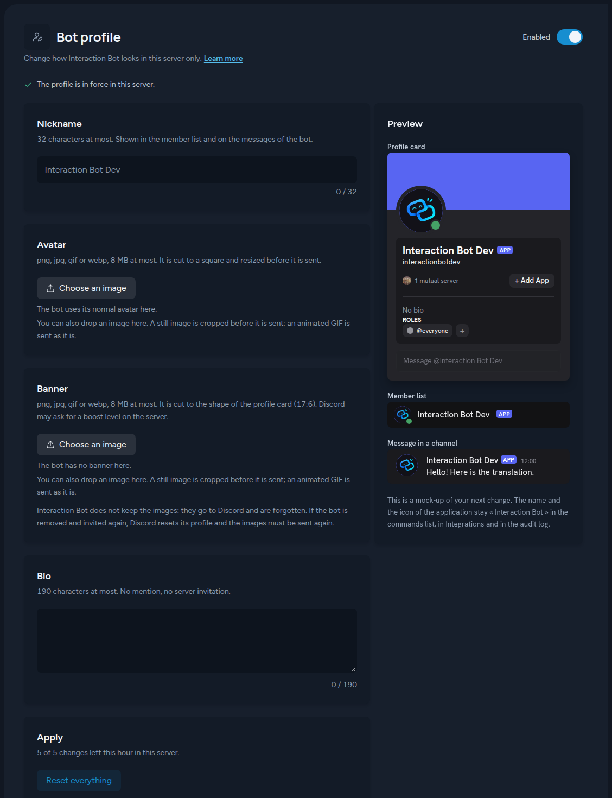

# Bot profile

<figure><figcaption>
The Bot profile page
</figcaption></figure>

The Bot profile page sets how Interaction Bot looks on this server only. What it does, the rules and the Discord permissions are explained in [Bot profile](../../management/bot-profile.md).

Navbar > category _**Management**_ > _**Bot profile**_.

The page is for **Premium** servers. On a free server the page can be read, but its fields are locked: the button _**Discover Premium**_ opens the Premium window.

## Top of the page

| Element | What it shows |
| --- | --- |
| Title and description | *Bot profile*, and *Change how Interaction Bot looks in this server only.* |
| Switch (in the page header) | Turns the bot profile on or off for this server. It is on by default. When it is off, the page does not apply changes. |
| State line | The state of the profile in this server, for example *The profile is in force in this server.* |
| Attention banner | Shown for a state that needs an action: a nickname changed by hand, a reset by Discord, a failed change, or a wait. Its button _**Apply again**_ sends the saved text again. |
| Missing permission banner | *The bot cannot change its nickname here*, with the link _**Give the permission**_. |

## Card Nickname

| Field | Default | What it does |
| --- | --- | --- |
| Nickname | Empty: the name of the bot | The name of the bot on this server. 32 characters at most, the counter shows *n / 32*. Empty means the default name. |
| _**Reset**_ | Shown when a nickname was applied | Brings the nickname back to the default of Discord. |

Errors appear under the field: for example *The nickname cannot contain @, a code block or mention markup.* or *The nickname cannot contain a link or a server invitation.*

## Card Avatar

| Control | What it does |
| --- | --- |
| _**Choose an image**_ | Opens the file choice. Also possible by dropping an image on the box. A still image is cropped to a square before it is sent; an animated GIF is sent as it is. |
| _**Choose another image**_ | Replaces the image you chose. |
| _**Cancel the new image**_ | Removes the image you chose, before you apply. |
| _**Reset**_ | Brings the avatar back to the normal avatar of the bot. |

png, jpg, gif or webp, 8 MB at most. An image that is not one of these formats is refused with *This file is not a png, jpg, gif or webp image.*

## Card Banner

The same controls as the avatar. The banner is cut to the shape of the profile card (17:6). Discord can refuse a banner on a server without a boost level: the page then says so.

A note under the banner says that Interaction Bot does not keep the images.

## Card Bio

| Field | Default | What it does |
| --- | --- | --- |
| Bio | Empty | The "About me" text of the bot on this server. 190 characters at most, four lines at most. The counter shows *n / 190*. |
| _**Reset**_ | Shown when a bio was applied | Removes the bio. |

No mention (`@everyone`, `@here`, a member, a role or a channel) and no invitation to a server. The error is shown under the field.

## Card Apply

| Element | What it does |
| --- | --- |
| Text | *Sends what changed to Discord, in one request.* Under it, the number of changes left this hour in this server, out of 5. |
| _**Reset everything**_ | Brings the nickname, the avatar, the banner and the bio back to the default. Click it a second time within five seconds to confirm (_**Click again to confirm**_). |
| Wait line | Shown when Discord asks to wait: *The next one is possible in …*. |

## Card Preview

The preview shows the bot as members see it: the profile card, the member list and a message in a channel, with the name, the avatar, the banner and the bio you wrote. It is a mock-up of the next change: nothing is sent to Discord until you apply.

## Save bar

When you change a field, a bar at the bottom of the page says _You made changes, save them!_, with a **Save** button that applies the changes to Discord. A failed change shows its reason in this bar, and **Cancel** puts back the saved text and removes the chosen images.

## Messages of the page

| Message | Meaning |
| --- | --- |
| *Nothing to change: Discord already has this profile.* | The saved profile is already in force. |
| *Applied on Discord: nickname, avatar.* | The listed fields were sent. |
| *Saved.* | The text is saved, nothing was sent to Discord. |
| *Check the image of the field marked in red.* | One of the images was refused. |
| *The bot does not answer right now. You can save the text and apply it later.* | The bot cannot be reached: the text is kept. |
| *The bot profile is switched off: turn on the switch at the top of the page and save to apply it.* | The switch is off. |

## Related

* [Bot profile](../../management/bot-profile.md): the rules, the states and the permissions.
* [Premium](premium.md): the offers.
* [Journal](journal.md): each change is written there, with the fields sent (never the text or the images).
