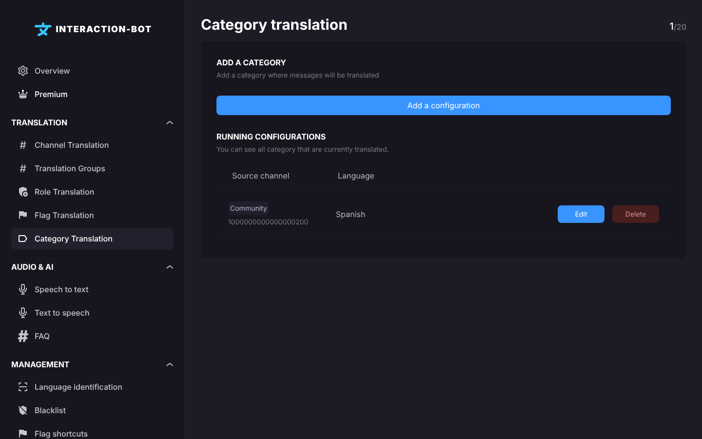
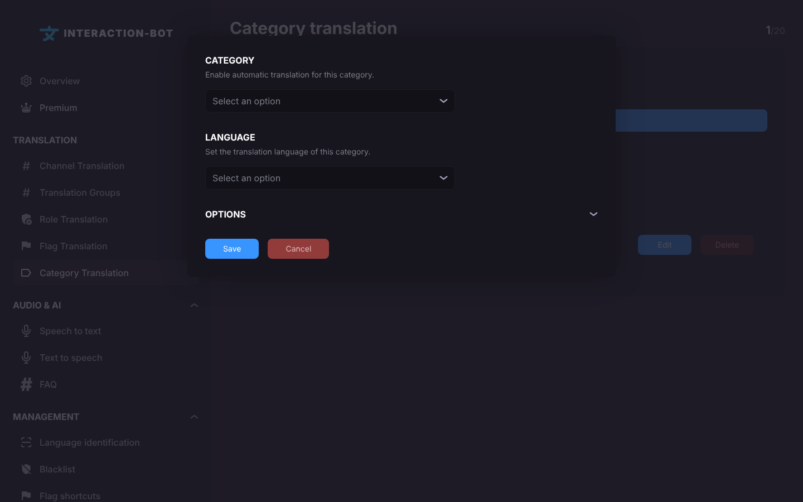

# Category Translation

## Localization

This page is the third item of the **Translation** section of the navigation bar. Its title is **Category translation**.

<figure><figcaption>
Category translation page
</figcaption></figure>

## What does category translation do?

A configuration says: *the messages posted in any channel of this **category** that are not in this **language** are translated, and the translation is sent to the **sending channel** (or to the channel of the original message).*

It works like [Channel Translation](channel-translation.md), but for all the channels of the category at once:

* A channel that you create in the category later is covered automatically.
* A channel that you move out of the category is no longer covered.
* The skip rules are the same as in [Channel Translation](channel-translation.md#when-is-a-message-not-translated).

## Running configurations

The list shows all the category configurations of your server.

* The counter at the top right shows how many configurations you have, for example `1/20`. On a premium server, it shows `N/~` (up to 500 configurations).
* The first column is titled **Source channel** in the list, but it shows the **name of the category**. The second column is **Language**.
* _**Edit**_: opens the configuration in the popup. Clicking on the row does the same.
* _**Delete**_: removes the configuration (applied after you click on _**Save**_).

There is no **Enabled** checkbox on this page: to stop a rule, delete it.

## Add a configuration

Click on _**Add a configuration**_ (under the box *Add a category*). On a server without Premium, when you already have 20 configurations, this button opens the Premium pop-up instead.

<figure><figcaption>
Category translation popup
</figcaption></figure>

The popup has two required fields:

* **CATEGORY**: *Enable automatic translation for this category.* Choose the category.
* **LANGUAGE**: *Set the translation language of this category.* The language the messages are translated into.

Click on _**OPTIONS**_ to show the optional settings:

* **STYLE**: *Change the style of the translation that will be sent.* **Embed** (default), **Webhook** or **Message**. See [Channel Translation](channel-translation.md#add-a-configuration).
* **SENDING CHANNEL**: *Change the channel where translation will be send.* Optional. If it is empty, the translation is posted in the channel where the original message was posted.
* **DELETE MESSAGE** (*Delete the original message.*): the original message is deleted once its translation is sent.
* **DELETE TRANSLATION** (*Delete the message sent by the bot.*): the translation is deleted after the reading time (0.13 second per character, minimum 25 seconds). This page has no option to choose another delay.
* **TRANSLATE BOT** (*Translate message send by bot.*): translates the messages sent by bots. **Premium only**: on a server without Premium, clicking on this toggle opens the Premium pop-up.
* **ALWAYS SEND** (*Sending the translation even if the message is already in the same target language.*): sends the translation even when a skip rule applies.

Click on _**Save**_ in the popup, then click on _**Save**_ in the bar at the bottom of the page.

### Example

Your *Support* category has five channels, each with questions in different languages. You want every question to be readable in English, sent to #support-english:

* **CATEGORY**: Support
* **LANGUAGE**: English
* **SENDING CHANNEL**: #support-english
* **DELETE TRANSLATION**: off, so the translations stay in the channel

## Save configurations

When you have made all your configuration, don't forget to click on _**Save**_ in the bar at the bottom of the page.

<figure><figcaption></figcaption></figure>

## Errors

* **Error - You have not completed all the required fields.** (pop-up): no category or no language is selected.
* **It seems something has gone wrong.** (pop-up, followed by the error): the save failed.
* The bar stays on the screen without any message when the bot refuses the save, for example because **TRANSLATE BOT** is used without Premium, or because the sending channel no longer exists. Nothing has been saved.


Channels in the [blacklist](blacklist.md) are not translated, even when they belong to a configured category.


## Premium

| | Free | Premium |
| --- | --- | --- |
| Configurations | 20 | 500 |
| TRANSLATE BOT | Not available | Available |
