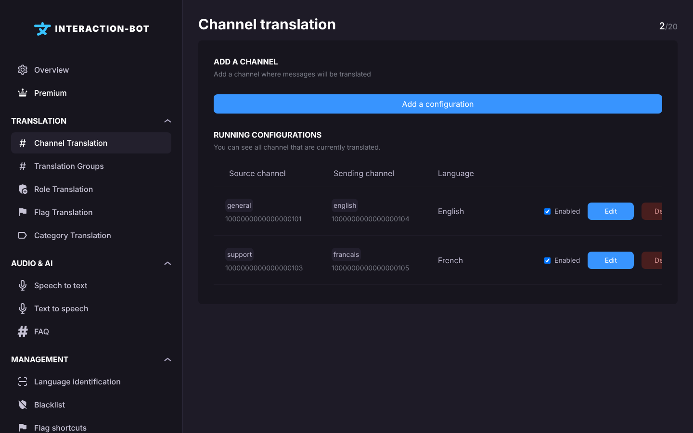
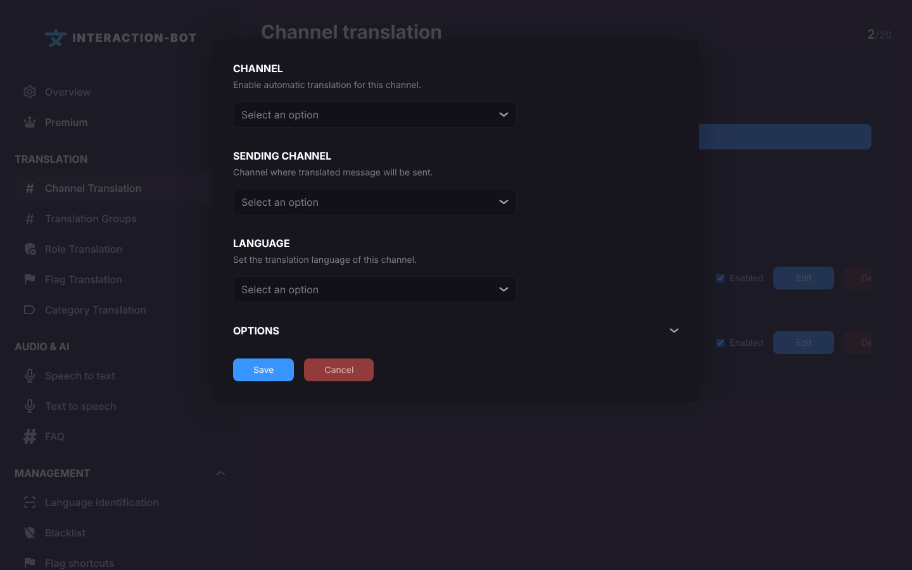
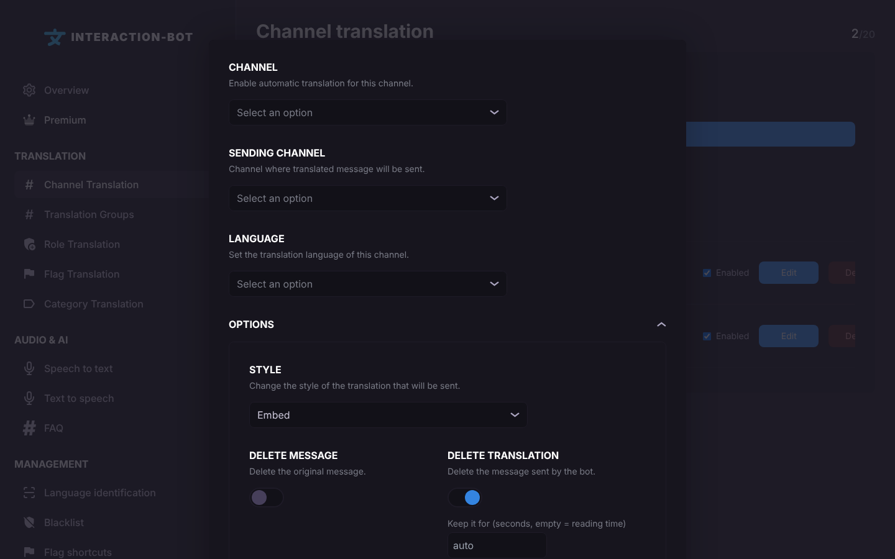

# Channel Translation

## Localization

This page is the first item of the **Translation** section of the navigation bar. Its title is **Channel translation**.

<figure><figcaption>
Channel translation page
</figcaption></figure>

## What does channel translation do?

A configuration says: *the messages posted in this **source channel** that are not in this **language** are translated, and the translation is sent to the **sending channel***.

* It is a **one way** rule. To translate in both directions, create a second configuration in the other direction, or use [translation groups](translation-groups.md). See [Which method should I use?](../../translation/overview.md) and the [recipes](../../translation/guides.md).
* The source channel and the sending channel can be the same channel.

### When is a message not translated?

The bot skips a message for a configuration when:

* the message is already in the **LANGUAGE** of the configuration (unless **ALWAYS SEND** is on);
* the bot is not sure of the language of the message (unless **ALWAYS SEND** is on);
* the message is made of one character repeated (for example `aaaaaa`) (unless **ALWAYS SEND** is on);
* the message was sent by a bot, and **TRANSLATE BOT** is off;
* the translation is almost identical to the original message (similarity of 0.6 or more) (unless **ALWAYS SEND** is on);
* the configuration is paused (**Enabled** unchecked);
* the source channel is in the [blacklist](blacklist.md), or the message is shorter than the minimum of the [language identification](language-identification.md) of this channel.

## Running configurations

The list shows all the configurations of your server.

* The counter at the top right shows how many configurations you have, for example `3/20`. On a premium server, it shows `N/~`: there is no fixed number shown, the server can have up to 500 configurations.
* The columns are **Source channel**, **Sending channel** and **Language**.
* **Enabled** (checkbox, on each row): when unchecked, the configuration is kept but does not translate anything. A tooltip shows *Paused: kept but not translating* or *Active*. Use it to pause a configuration without losing its settings. Click on _**Save**_ to apply.
* _**Edit**_: opens the configuration in the popup. Clicking on the row does the same.
* _**Delete**_: removes the configuration (applied after you click on _**Save**_).

## Add a configuration


You can also manage the configurations in Discord, with `/channel-translation manage`: see [Configuration commands](../../commands/configuration.md#channel-translation).


Click on _**Add a configuration**_ (under the box *Add a channel*).

<figure><figcaption></figcaption></figure>

On a server without Premium, when you already have 20 configurations, this button opens the Premium pop-up instead.

<figure><figcaption>
Channel translation popup
</figcaption></figure>

The popup has three required fields:

* **CHANNEL**: *Enable automatic translation for this channel.* The source channel: the messages posted here are checked.
* **SENDING CHANNEL**: *Channel where translated message will be sent.* The channel where the translation is posted.
* **LANGUAGE**: *Set the translation language of this channel.* The language the messages are translated into.

Click on _**OPTIONS**_ to show the optional settings.

<figure><figcaption>
Options
</figcaption></figure>

* **STYLE**: *Change the style of the translation that will be sent.* The choices are:
  * **Embed** (default): an embed with the name and avatar of the author of the original message, and the two languages in the footer.
  * **Webhook**: the translation is posted with the name and avatar of the author of the original message, as if the author had written it. The bot creates a webhook in the sending channel. If the webhook cannot be created, the bot posts a normal message instead.
  * **Message**: a normal message from the bot, without embed.
  * **Thread**: the translations are sent in a **thread under the original message**, which stays in the channel. See [Translation in threads](../../translation/threads.md). When you choose it, the sending channel is not needed and three options appear:

<figure><figcaption>
Options of the Thread style
</figcaption></figure>

    * **LOOK IN THE THREAD**: *Webhook* (name and avatar of the author, default), *Message* or *Embed*.
    * **ARCHIVE THE THREAD AFTER**: inactivity before the thread is archived: 1 hour, 24 hours (default), 3 days or 7 days.
    * **SHOW THE LANGUAGE**: writes the language above each translation (on by default).
* **DELETE MESSAGE** (*Delete the original message.*): the original message is deleted once its translation is sent. If the bot has no permission to delete it, the original message stays. Not available with the **Thread** style, which keeps the original message.
* **DELETE TRANSLATION** (*Delete the message sent by the bot.*): the translation is deleted after a time. When it is on, the field **Keep it for (seconds, empty = reading time)** appears:
  * a value from **5** to **86400** seconds (24 hours). A value outside this range makes the save fail (see [Errors](#errors)).
  * empty (`auto`): the reading time, 0.13 second per character with a minimum of 25 seconds.
* **TRANSLATE BOT** (*Translate message send by bot.*): translates the messages sent by bots. **Premium only**: on a server without Premium, clicking on this toggle opens the Premium pop-up.
* **ALWAYS SEND** (*Sending the translation even if the message is already in the same target language.*): sends the translation even when one of the skip rules above applies.

Click on _**Save**_ in the popup, then click on _**Save**_ in the bar at the bottom of the page.

### Example

You want the French messages of #english-chat to be visible in English for French members in #english-chat-fr:

* **CHANNEL**: #english-chat
* **SENDING CHANNEL**: #english-chat-fr
* **LANGUAGE**: English
* Options: **STYLE**: Embed, **DELETE TRANSLATION** on, **Keep it for (seconds, empty = reading time)**: `60`

Messages in English are not translated (they are already in English). Messages in other languages are translated to English and the translation disappears after 60 seconds.

## Save configurations

When you have configured all the channels that you want to be translated, don't forget to click on _**Save**_ in the bar at the bottom of the page.

<figure><figcaption></figcaption></figure>

## Errors

* **Error - You have not completed all the required fields.** (pop-up): one of CHANNEL, SENDING CHANNEL or LANGUAGE is empty. Fill it in and click on _**Save**_ again.
* **It seems something has gone wrong.** (pop-up, followed by the error, for example `422: Unprocessable Entity`): the save failed, for example because a value is out of range.
* The bar stays on the screen without any message when the bot refuses the save, for example because a channel no longer exists or *TRANSLATE BOT* is used without Premium. Nothing has been saved: remove or fix the configuration, then click on _**Save**_ again.
* **You made changes, save them!** (bar): your changes are not active yet, click on _**Save**_.

## Premium

| | Free | Premium |
| --- | --- | --- |
| Configurations | 20 | 500 |
| Translations of one message | 3 | 20 |
| TRANSLATE BOT | Not available | Available |

## Tips

* To stop a configuration for a while, uncheck **Enabled** instead of deleting it.
* Keep **ALWAYS SEND** off unless you really need it: it bypasses all the skip rules above.
* Short messages are often detected wrongly. Use the [Language identification](language-identification.md) page to ignore messages under a number of characters in a channel.
* To translate a whole category at once, use [Category Translation](category-translation.md). To give a translation to members with a role, use [Role Translation](role-translation.md).
