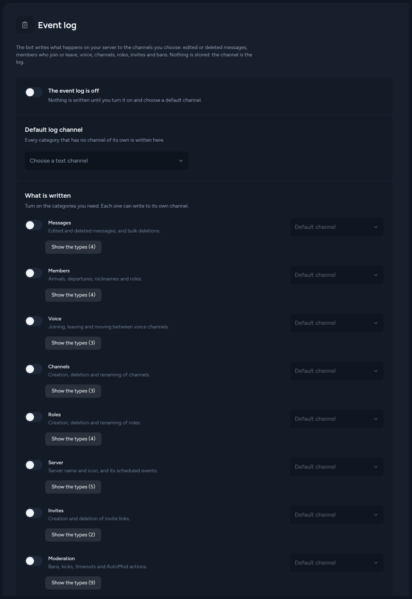

# Event log

The **Event log** page is in the **Management** section. It sets the channels where the bot writes what happens on your server: edited or deleted messages, arrivals and departures, voice, channels, roles, invites and bans. The bot stores nothing: **the channel is the log**.

<figure><figcaption>
The Event log page
</figcaption></figure>

Navbar > section _**Management**_ > _**Event log**_.

* The event log is **off by default**. Choose a **default log channel**, then turn it on.
* Each category can write to its own channel. A category without one writes to the default channel.

For the categories, the exclusions (ignored channels, roles and bots), the permissions and the limits, read [Event log](../../management/event-log.md).
