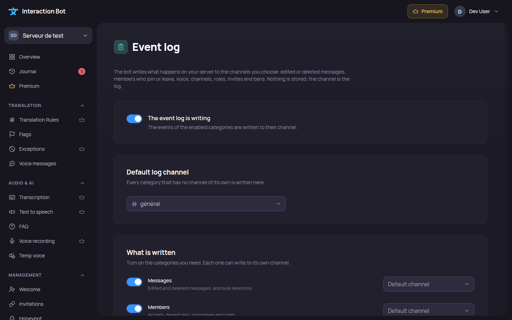

# Event log

The **Event log** page is in the **Management** section. The bot writes what happens on your server to the text channels you choose: edited or deleted messages, members who join or leave, voice, channels, roles, invites and bans. Nothing is stored by the bot: **the channel is the log**.

<figure><figcaption>
Event log page
</figcaption></figure>

The event log is **off by default**. To use it, choose a **default log channel**, then turn it on.

## Default log channel

Every category that has no channel of its own is written here. The bot needs to see the channel, write in it and embed links; the page tells you when something is missing, and when the bot paused itself after Discord refused its messages (it tries again after 10 minutes, or when you click _**Check again**_).

## What is written

Turn on the categories you need. Each one can write to its own channel.

| Category | Events |
| --- | --- |
| **Messages** | Edited and deleted messages, bulk deletions. |
| **Members** | Arrivals, departures, nicknames and roles. Needs the **Server Members** intent of the bot; the page says when it is not available. |
| **Voice** | Joining, leaving and moving between voice channels. |
| **Channels** | Creation, deletion and renaming. |
| **Roles** | Creation, deletion and renaming. |
| **Server** | Name and icon of the server, and its emojis. |
| **Invites** | Creation and deletion of invite links. |
| **Moderation** | Bans and unbans. |

## Exclusions

Events that are not written, even when their category is on: up to 50 **ignored channels**, up to 50 **ignored roles**, and **Ignore bots**.

To avoid flooding your channels, the bot writes at most 300 events per 10 minutes on a server.
