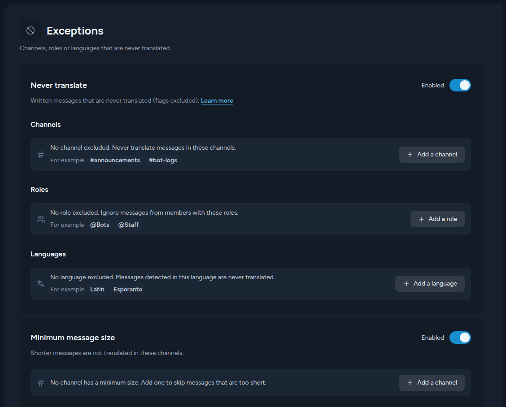

# Exceptions

The **Exceptions** page is the third page of the **Translation** section of the dashboard. It holds two cards:

* **Never translate**: channels, roles and languages whose messages are never translated (**Premium**).
* **Minimum message size**: a number of characters per channel. Shorter messages are not translated.

<figure><figcaption>
The Exceptions page
</figcaption></figure>

## Localization

**Translation** > **Exceptions** in the sidebar, at `/dashboard/{guild}/translation/exceptions`. The former **Blacklist** and **Language identification** pages open this page.

## When the checks happen

When a member writes a message, the bot checks the exceptions **before** any rule, in this order. If one of them applies, nothing is translated:

1. the **minimum size** of the channel: the message is shorter than the number of characters set for this channel;
2. the **channel** is in *Never translate*;
3. one of the **roles** of the author is in *Never translate*;
4. the **language** of the message is detected, then, if it is in *Never translate*, nothing is translated.

The exceptions do **not** apply to **flag reactions**, nor to the commands and menus (`/translate`, Apps > Translate): those are requested by a member on purpose.

## Never translate

Three lists, each with **Add** and the **⋯** menu of a row (**Edit**, **Remove**).

| Exception                   | Sentence on the page                                                  | Meaning                                                                                                       |
| --------------------------- | --------------------------------------------------------------------- | ------------------------------------------------------------------------------------------------------------- |
| **Channels**                | *Never translate #announcements*                                      | The messages of this channel are never translated: by a rule, by a linked channel, or by a whole-server rule. |
| **Roles**                   | *Ignore messages from @Bots*                                          | The messages of the members with this role are never translated, whatever the rule.                          |
| **Languages**               | *Never translate messages in Latin*                                   | A message detected in this language is never translated.                                                      |

Examples: an announcements channel that is already multilingual, the messages of your other bots (their role), or a language that the detection often confuses with another one.


Exclusions are a **Premium** feature. On a server without Premium, the page refuses to add one (*Saving failed. If your server is not Premium, excluding channels, roles and languages is reserved for Premium.*). When a server stops being Premium, its exclusions are kept but not applied, until it is Premium again.


## Minimum message size

The minimum size is a **length threshold**, not a language detection: a message of a channel shorter than the number of characters you set is not translated.

* Each channel has **one** minimum, from **0 to 500 characters**. A new channel starts at 5 characters.
* The length is the length of the text of the message. For a voice message, it is the length of its transcript. A message without text (a picture alone) counts as 0 characters.
* When you add several channels at once, the same minimum applies to each of them.
* Without Premium, **20 channels** at most can have a minimum. With Premium, **500**.
* The card has a switch that turns the whole minimum size on or off, without losing the channels.

Raise the minimum if very short messages (*ok*, *lol*, *haha*) are mistranslated. See [Language detection](../../translation/language-detection.md) for the other ways to improve the detection.

## Save

Click **Save** in the bar at the bottom of the page to store the changes, **Cancel** to drop them. The bar is shared by the two cards.

## Premium

| | Free | Premium |
| --- | --- | --- |
| *Never translate*: channels, roles and languages | Not available | Available |
| Channels with a minimum message size | 20 | 500 |

See [Premium](../../premium/premium.md) for all the limits.

## See also

* [Translation rules](translation-rules.md), where the rules that the exceptions come before are set.
* [Language detection](../../translation/language-detection.md).
