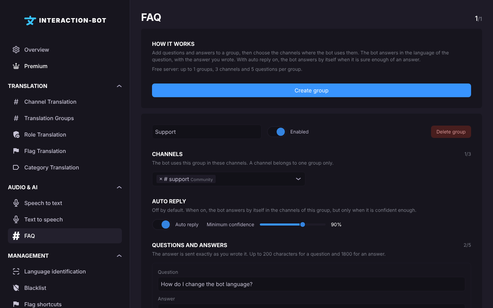

# FAQ

<figure><figcaption>
FAQ page
</figcaption></figure>

## Localization

Navbar > category _**Audio & AI**_ > _**FAQ**_. Members use it with [`/ask`](../../commands/faq.md).

The counter at the top right shows how many groups you use, for example `1/1` on a free server.

## How it works

Add questions and answers to a **group**, then choose the channels where the bot uses them. Members search the group with [`/ask`](../../commands/faq.md). With **Auto reply** on, the bot also answers by itself, in the channels of the group, when it is sure enough of the answer.

The bot never writes answers: it only sends the answers you wrote. When a question is in another language, the answer is translated into that language.

For the questions members usually ask about this feature, read [FAQ guides](../../commands/faq-guides.md).

## Create a group

Click _**Create group**_. The new group appears with these settings:

1. **Name**: up to 40 characters. Two groups cannot have the same name.
2. **Enabled**: the toggle pauses the whole group without deleting it.
3. **Channels**: the text channels where the bot uses this group. A channel belongs to one group only: if you select a channel that another group already uses, the save is refused with the message `A channel can only belong to one group.` (see below). The counter shows how many channels you use, for example `2/3`.
4. **Auto reply**: off by default. When it is on, the bot answers by itself in the channels of this group, only when it is confident enough.
5. **Minimum confidence**: the slider goes from **80%** to **95%**, and the default is **84%**. See below.
6. **Questions and answers**: click _**+ Add a question**_, write the question and its answer, then repeat. Each question needs an answer. The counter shows how many questions the group has, for example `3/5`.

Click _**Save**_ in the popup at the bottom of the page. _**Cancel**_ goes back to the last saved configuration. You can also delete a question with _**Delete this question**_, or a whole group with _**Delete group**_.


Make sure the bot can send messages and embeds in the channels you select, otherwise it cannot answer there. Run [`/check-permissions`](../../commands/flags.md#diagnostics-check-permissions) on your server to see what is missing.


## Minimum confidence

The minimum confidence is the score a question must reach before the bot uses it, from 80% to 95%. It applies to the automatic replies and to `/ask`.

* **Higher values** (for example 92%): fewer answers, but only for very close questions.
* **Lower values** (for example 82%): more answers, with more risk of a reply that does not fit.

The default of 84% is a good start. Change it only after you have read some automatic replies. The score of each automatic reply is shown in its footer.

## Questions and answers

| Field | Rule |
| ----- | ---- |
| **Question** | Up to 200 characters. Write it the way members ask it, as a full sentence. |
| **Answer** | Up to 1800 characters. Put the most useful information first. Links and channel mentions are kept when the answer is translated. |

Each question needs an answer: the page shows `Every question needs an answer.` if one is missing. The complete advice is in [How do I write a good question?](../../commands/faq-guides.md#how-do-i-write-a-good-question).

## Limits

| Free                                              | Premium                                              |
| ------------------------------------------------- | ---------------------------------------------------- |
| 1 group, 3 channels and 5 questions per group     | 5 groups, 10 channels and 150 questions per group    |

If Premium ends, the extra groups are switched off and the extra questions and channels are not used by the bot, but nothing is deleted. The dashboard does not let you add more than the free limits. See [What happens when Premium ends?](../../commands/faq-guides.md#what-happens-when-premium-ends).

## Messages you may see

| Message | What to do |
| ------- | ---------- |
| `Every group needs a name.` | Give the group a name. |
| `Two groups cannot have the same name.` | Rename one of the groups. |
| `Every question needs an answer.` | Write the answer, or delete the question. |
| `One of the channels is not a text channel of this server.` | Choose a text channel of this server. |
| `A channel can only belong to one group.` | Remove the channel from the other group, or select it in this group only. |
| `A group or a question was removed in the meantime.` | Reload the page and check the group. |
| `The configuration could not be saved.` | Try again. If it still fails, contact the [support server](https://discord.gg/wjWjf6mCjf). |

When you try to go beyond your plan's limits, a popup suggests Premium instead.

## Good to know

* Members see the answer in the language of their question.
* Deleting a group deletes its channels and questions.
* Changes are sent to the bot when you save, and the bot uses them straight away in most cases.
