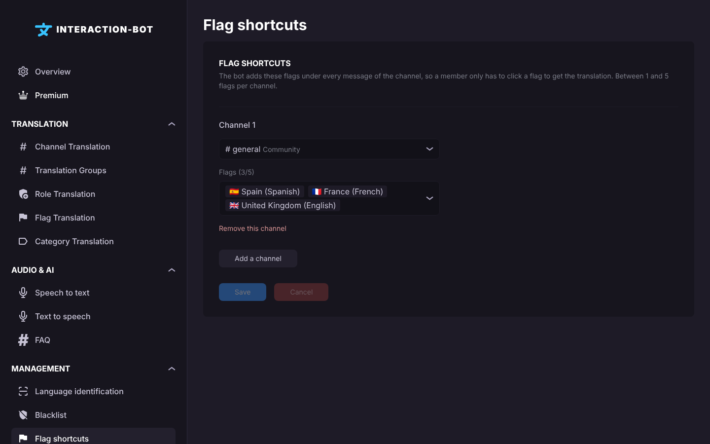

# Flag shortcuts

<figure><figcaption>
Flag shortcuts page
</figcaption></figure>

## Localization

Navbar > category _**Management**_ > _**Flag shortcuts**_.

The bot adds the chosen flags under every new message of the channel, so a member only has to click a flag to get the translation. Between 1 and 5 flags per channel, on every plan. The same can be done with [`/flags`](../../commands/flags.md).

**Example.** In `#general`, you choose 🇬🇧 🇫🇷 🇪🇸. Every new message gets these three flags. A member who wants the message in French clicks 🇫🇷, and the bot replies with the French translation (see [Flag translation](../../translation/flags.md)).

## Set up the shortcuts

1. Click _**Add a channel**_.
2. Choose the text channel in the list.
3. Pick the flags in the list. It is searchable by country or language, for example `French` or `🇫🇷`. The counter shows how many flags you picked, for example `Flags (3/5)`.
4. Add other channels the same way, if you need them.
5. Click _**Save**_.

Each row needs a channel and at least one flag, and no more than 5 flags. The _**Save**_ button stays disabled until every row is valid. _**Remove this channel**_ removes a row, and _**Cancel**_ goes back to the last saved list.


Saving replaces the whole flag shortcut configuration of the server with the rows of the page. A channel that you removed from the page stops getting flags.


## Rules

* A channel can only be used once: a second row for the same channel is refused with `A channel can only be used once.`
* The bot adds the flags only to **new** messages. Older messages are not changed.
* The bot does not add flags under messages written by bots, or under messages without text, embed or attachment.
* The bot needs the *Add Reactions* permission in the channel. If the permission is missing, the reactions are not added.
* A click on a flag follows the [Flag translation](flag-translation.md) settings of the channel. If it is turned off there, a click does nothing.

## Messages you may see

| Message | What to do |
| ------- | ---------- |
| `One of the channels is not a text channel of this server.` | Choose a text channel of this server. |
| `A channel can only be used once.` | Remove the duplicate row. |
| `The configuration could not be saved.` | Try again. If it still fails, contact the [support server](https://discord.gg/wjWjf6mCjf). |

## Troubleshooting

* **No flags appear under new messages.** Check that the channel is in the list and saved, and that the bot has *Add Reactions* in that channel. Run [`/check-permissions`](../../commands/flags.md#diagnostics-check-permissions) to see what is missing.
* **The flags appear but a click does nothing.** Check the [Flag translation](flag-translation.md) page for that channel.
* **Some flags are not in the list.** Only the flags the bot can translate are listed. The pirate flag 🏴‍☠️ is not one of them.
