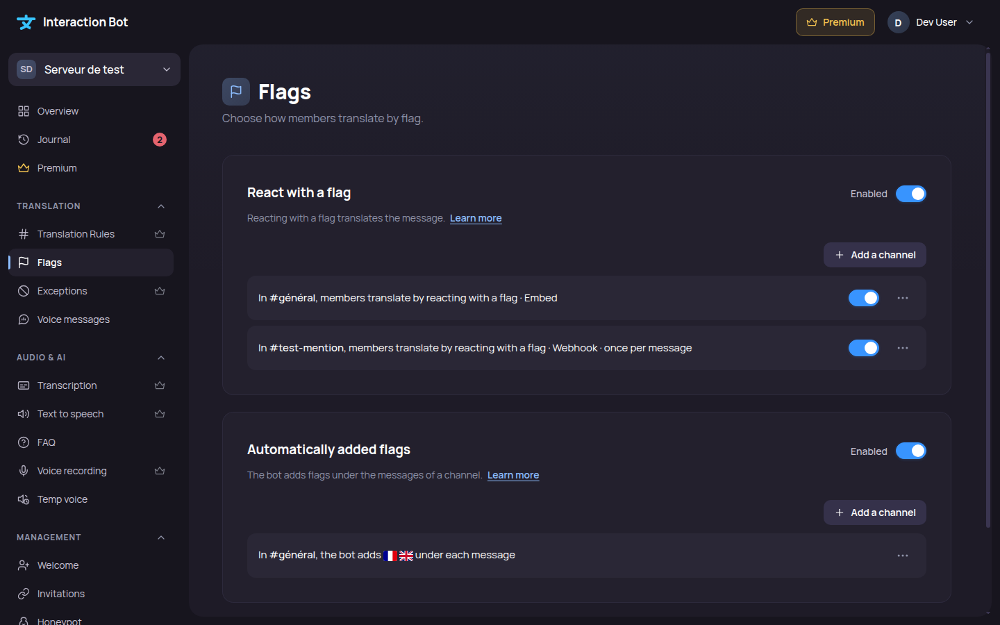
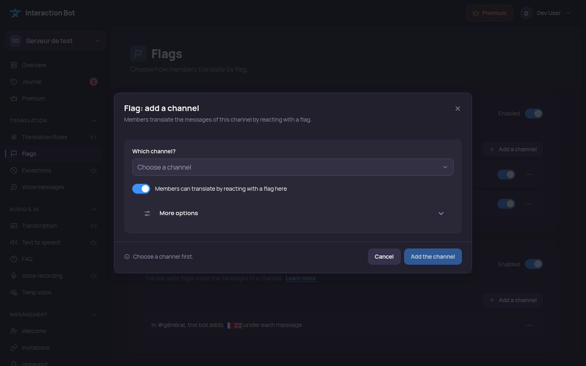
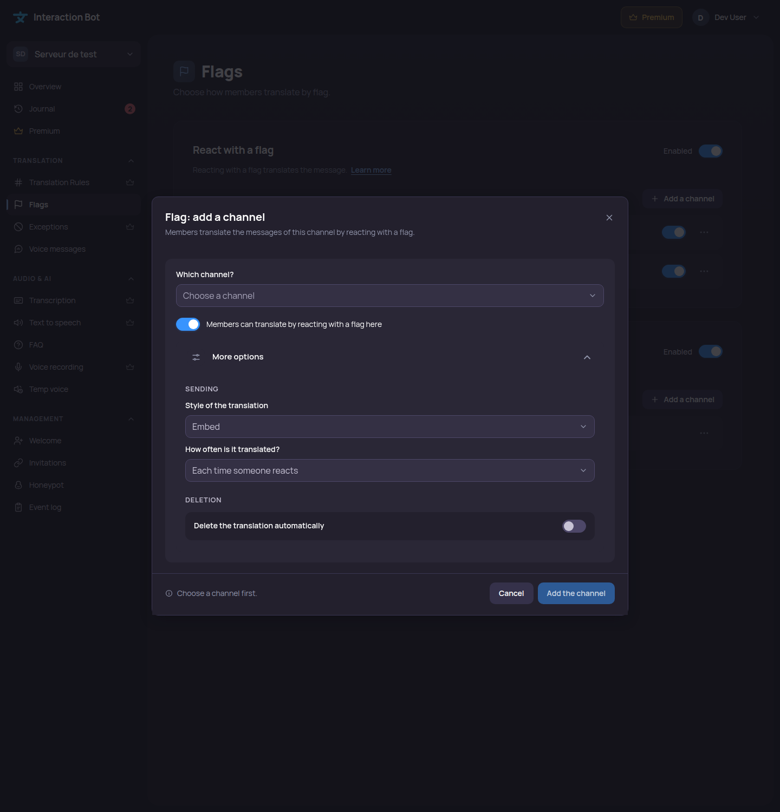

# Flag translation

## Localization

This page is the **React with a flag** card of the **Flags** page, the second item of the **Translation** section of the navigation bar. The former **Flag translation** page redirects there.

<figure><figcaption>
Flag translation page
</figcaption></figure>

## What does flag translation do?

A member adds a flag reaction under a message, for example 🇫🇷 (French), 🇪🇸 (Spanish) or 🇯🇵 (Japanese). The bot replies under this message with the translation into the language of the flag, so everybody can read it. See [Languages and flags](../../translation/languages.md).


Flag translation works **without any configuration**, in every channel. This page is only needed to change the behaviour of a channel: turn it off, choose how often a message is translated, or choose whether the translation is deleted.


Without any configuration, the reply is deleted automatically after the reading time (0.13 second per character, minimum 25 seconds).

## Running configurations

The list shows the channels that have their own flag translation settings.

* Each row is a sentence with the channel, the style and the options that are on (for example *In #general, members translate by reacting with a flag · Embed · once per message*). A switch on the row turns the flag translation of this channel on or off.
* In the **⋯** menu of each row:
  * _**Edit**_: opens the configuration in the popup.
  * _**Delete**_: removes the configuration (applied after you click on _**Save**_). The channel then goes back to the default behaviour.

## Add a configuration

Click on _**Add a channel**_. On a server without Premium, when you already have 20 configurations, this button opens the Premium pop-up instead.

<figure><figcaption>
Flag translation popup
</figcaption></figure>

The popup has these fields:

* **Which channel?**: *Members translate the messages of this channel by reacting with a flag.* Each channel can have only one configuration.
* **Members can translate by reacting with a flag here** (switch): a new configuration starts **on**: turn this switch off to stop the flags from translating in this channel.

Click on _**More options**_ to show the optional settings.

<figure><figcaption>
Options
</figcaption></figure>

* **Style** (default: _Embed_): how the translation is sent when someone reacts:
  * _Embed_: a card with the translation (the default).
  * _Webhook_: the translation is posted with the name and avatar of the author of the message.
  * _Message_: a plain message.
  * _Thread_: the translation is sent in a thread under the original message, which is kept. Three options appear: **Look in the thread** (_Webhook_ by default, _Message_ or _Embed_), **Archive the thread after** (_1 h_, _24 h_ by default, _3 d_ or _7 d_) and **Show the language** (on by default).
  * _Private message_: the translation is sent in a private message to the member who reacted, and nothing is posted in the channel.
* **How often is it translated?**: choose one of two modes.
  * **Each time someone reacts**: each flag reaction makes a new translation, even if the message was already translated.
  * **Once per message**: only the first flag reaction on a message is translated. The bot remembers the last 1,000 translated messages. This memory is kept in the bot's memory, so it is cleared when the bot restarts.
* **Delete the translation automatically**: when on, the translation is deleted after the reading time (0.13 second per character, minimum 25 seconds). A new configuration starts **off**: the translations then stay in the channel.

Click on _**Save**_ in the popup, then click on _**Save**_ in the bar at the bottom of the page.

### Example

In #general, you want the translations to be shown only once per message, and to disappear by themselves:

* **Which channel?**: #general
* **Members can translate by reacting with a flag here**: on
* **How often is it translated?**: Once per message
* **Delete the translation automatically**: on

In #announcements, you want flags to be disabled:

* **Which channel?**: #announcements
* **Members can translate by reacting with a flag here**: off

## Save configurations

When you have made all your configuration, don't forget to click on _**Save**_ in the bar at the bottom of the page.

<figure><figcaption></figcaption></figure>


Want the flags to appear automatically under every message? Use the [Flag shortcuts](flag-shortcuts.md).


## Errors

Messages under the popup, which keep the _**Add the channel**_ button disabled:

* **Choose a channel first.**: no channel is selected.
* **This channel already has a configuration. Edit it instead.**: the channel is already configured.

When the save fails, the message *Saving failed. Your changes are still here: try again.* appears above the list. Nothing has been saved.

## Premium

| | Free | Premium |
| --- | --- | --- |
| Flag reactions on messages of bots | Not available | Available |
| Configurations | 20 (dashboard) | 500 |

On a server without Premium, flags on the messages sent by bots are ignored. A reaction added by a bot never triggers a translation, on any server.

## Tips

* To disable flags in a channel without losing the settings, turn off the switch of the row (or the switch of the popup) and save.
* Use **Once per message** in busy channels: a message is translated once, even when many members add the same flag.
* Use **Delete the translation automatically** in channels where the translations would make the conversation hard to read.
