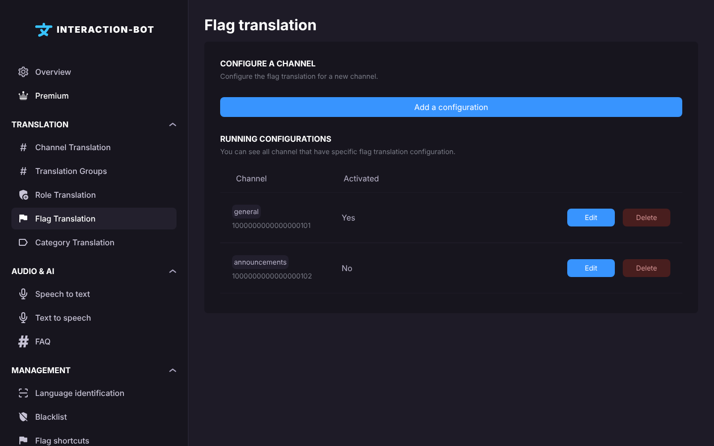
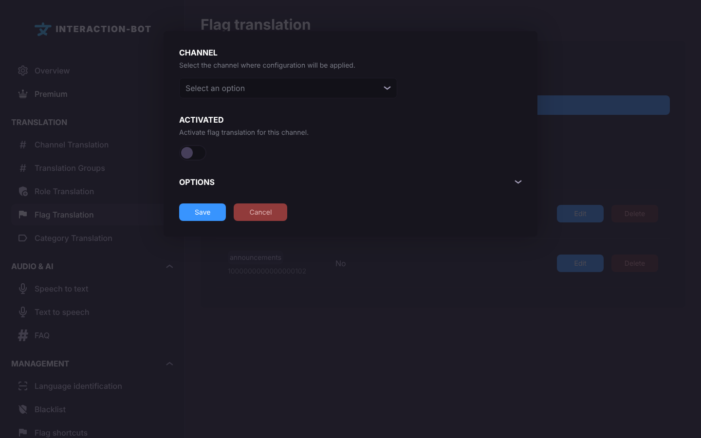
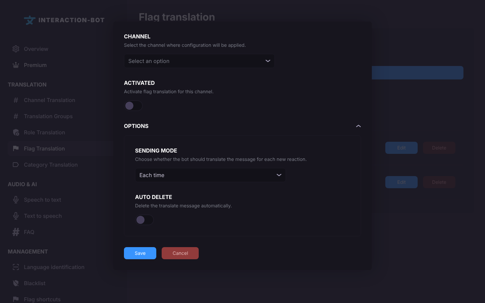

# Flag translation

## Localization

This page is the third item of the **Translation** section of the navigation bar, after [Role Translation](role-translation.md). Its title is **Flag translation**.

<figure><figcaption>
Flag translation page
</figcaption></figure>

## What does flag translation do?

A member adds a flag reaction under a message, for example 🇫🇷 (French), 🇪🇸 (Spanish) or 🇯🇵 (Japanese). The bot replies under this message with the translation into the language of the flag, so everybody can read it. See [Languages and flags](../../translation/languages.md).


Flag translation works **without any configuration**, in every channel. This page is only needed to change the behaviour of a channel: turn it off, choose how often a message is translated, or choose whether the translation is deleted.


Without any configuration, the reply is deleted automatically after the reading time (0.13 second per character, minimum 25 seconds).

## Running configurations

The list shows the channels that have their own flag translation settings.

* The columns are **Channel** and **Activated** (*Yes* or *No*).
* _**Edit**_: opens the configuration in the popup. Clicking on the row does the same.
* _**Delete**_: removes the configuration (applied after you click on _**Save**_). The channel then goes back to the default behaviour.

## Add a configuration

Click on _**Add a configuration**_ (under the box *Configure a channel*). On a server without Premium, when you already have 20 configurations, this button opens the Premium pop-up instead.

<figure><figcaption></figcaption></figure>

<figure><figcaption>
Flag translation popup
</figcaption></figure>

The popup has these fields:

* **CHANNEL**: *Select the channel where configuration will be applied.* Each channel can have only one configuration.
* **ACTIVATED**: *Activate flag translation for this channel.* A new configuration starts **off**: flags do nothing in this channel until you turn this toggle on.

Click on _**OPTIONS**_ to show the optional settings.

<figure><figcaption>
Options
</figcaption></figure>

* **SENDING MODE** (*Choose whether the bot should translate the message for each new reaction.*): choose one of two modes.
  * **Each time**: each flag reaction makes a new translation, even if the message was already translated.
  * **One time**: only the first flag reaction on a message is translated. The bot remembers the last 1,000 translated messages. This memory is kept in the bot's memory, so it is cleared when the bot restarts.
* **AUTO DELETE** (*Delete the translate message automatically.*): when on, the translation is deleted after the reading time (0.13 second per character, minimum 25 seconds). A new configuration starts **off**: the translations then stay in the channel.

Click on _**Save**_ in the popup, then click on _**Save**_ in the bar at the bottom of the page.

### Example

In #general, you want the translations to be shown only once per message, and to disappear by themselves:

* **CHANNEL**: #general
* **ACTIVATED**: on
* **SENDING MODE**: One time
* **AUTO DELETE**: on

In #announcements, you want flags to be disabled:

* **CHANNEL**: #announcements
* **ACTIVATED**: off

## Save configurations

When you have made all your configuration, don't forget to click on _**Save**_ in the bar at the bottom of the page.

<figure><figcaption></figcaption></figure>


Want the flags to appear automatically under every message? Use the [Flag shortcuts](flag-shortcuts.md).


## Errors

* **Error - You have not completed all the required fields.** (pop-up): no channel is selected.
* **It seems something has gone wrong.** (pop-up, followed by the error): the save failed.
* The bar stays on the screen without any message when the bot refuses the save, for example when a channel is configured twice, or when a channel no longer exists. Nothing has been saved.

## Premium

| | Free | Premium |
| --- | --- | --- |
| Flag reactions on messages of bots | Not available | Available |
| Configurations | 20 (dashboard) | 500 |

On a server without Premium, flags on the messages sent by bots are ignored. A reaction added by a bot never triggers a translation, on any server.

## Tips

* To disable flags in a channel without losing the settings, turn **ACTIVATED** off and save.
* Use **One time** in busy channels: a message is translated once, even when many members add the same flag.
* Use **AUTO DELETE** in channels where the translations would make the conversation hard to read.
