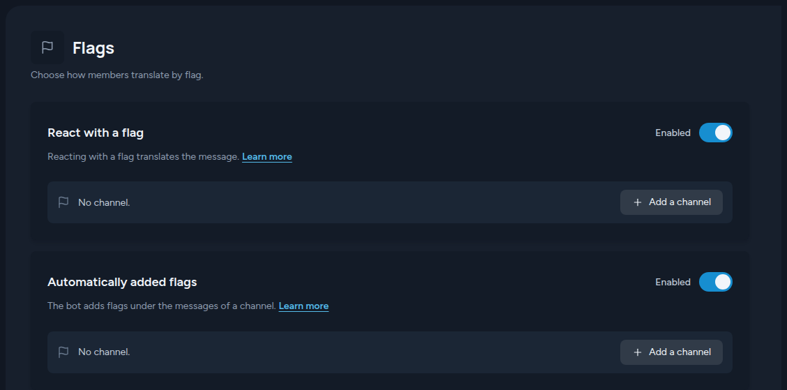

# Flags

The **Flags** page is the second page of the **Translation** section of the dashboard. It has two cards:

* **React with a flag**: members translate a message by adding a flag reaction under it. The bot replies under the message with the translation.
* **Automatically added flags**: the bot adds 1 to 5 flags itself under the messages of a channel, so members only have to click one.

<figure><figcaption>
The Flags page
</figcaption></figure>

## Localization

**Translation** > **Flags** in the sidebar, at `/dashboard/{guild}/translation/flags`. The former **Flag translation** and **Flag shortcuts** pages open this page.

## React with a flag

A member adds a flag reaction under a message, for example 🇫🇷 (French), 🇪🇸 (Spanish) or 🇯🇵 (Japanese). The bot replies under this message with the translation into the language of the flag, so everybody can read it. See [Languages and flags](../../translation/languages.md).


Flag translation works **without any configuration**, in every channel. The popup of this card is only needed to change the behaviour of a channel: turn it off, choose how often a message is translated, or choose whether the translation is deleted.


Without any configuration, the reply is deleted automatically after the reading time (0.13 second per character, at least 25 seconds).

### The list of channels

The card lists the channels that have their own settings. Each row is a sentence, for example *In #general, members translate by reacting with a flag · once per message · translation deleted automatically*. The switch of a row turns the flag translation of this channel on or off.

The **⋯** menu of a row has **Edit** (opens the popup) and **Delete** (the channel goes back to the default behaviour, once you click **Save**).

### Add a channel

Click **Add a channel**. The popup has these fields:

* **Which channel?**: the channel where members translate by reacting. Each channel has only one setting.
* **Members can translate by reacting with a flag here** (switch): on by default for a new channel. Turn it off to stop flag translations in this channel.

Click **More options** to show the other settings:

* **Style of the translation**: how the translation is sent. *Embed* (the default, a card), *Webhook* (with the name and avatar of the author), *Message* (a plain message), *Thread* (a thread under the original message, with three options: *Look in the thread*, *Archive the thread after* and *Show the language*), or *Private message* (sent to the member who reacted; nothing is posted in the channel).
* **How often is it translated?**:
  * **Each time someone reacts** (the default): each flag reaction makes a translation, even if the message was already translated.
  * **Once per message**: only the first flag reaction on a message is translated. The bot remembers the last 1,000 translated messages, in its memory: this list is cleared when the bot restarts.
* **Delete the translation automatically**: when on, the translation is deleted after the reading time (0.13 second per character, at least 25 seconds). A new channel starts with this option **off**, so its translations stay in the channel.

Click **Save** in the popup, then **Save** in the bar at the bottom of the page.

### Example

In #general, the translations should be shown once per message, and disappear by themselves. In #announcements, flags should be disabled.

* **#general**: *Members can translate by reacting with a flag here* on, *How often is it translated?* **Once per message**, *Delete the translation automatically* on.
* **#announcements**: *Members can translate by reacting with a flag here* off.

### Errors

Messages under the popup keep the **Add the channel** button disabled:

* **Choose a channel first.**: no channel is selected.
* **This channel already has a configuration. Edit it instead.**: the channel is already configured.

When the save fails, *Saving failed. Your changes are still here: try again.* appears above the list. Nothing has been saved.

## Automatically added flags

The bot adds the flags of a channel under every **new** message written by a member of this channel, so that a member only has to click one of them. The bot does not add flags under the messages of bots.

The card lists the channels that have flags. Each row is a sentence, for example *In #general, the bot adds 🇬🇧 🇫🇷 🇪🇸 under each message*. The **Edit** action of a row changes its flags, and **Remove** deletes them.

### Add a channel

Click **Add a channel**, then choose:

* **Which text channel?**: a text channel of the server. Each channel has only one set of flags.
* **Which flags?** (1 to 5): the flags the bot adds, in this order. The preview shows what members will see.

Click **Add the channel**, then **Save** in the bar at the bottom of the page.

The bot needs the *Add Reactions* and *Read Message History* permissions in the channel. The page reports *One of the channels is not a text channel of this server.* when a channel cannot be used.

## Save

When you have made all your changes, click **Save** in the bar at the bottom of the page. **Cancel** drops them. The bar is shared by the two cards: one bar saves both.

## Premium

| | Free | Premium |
| --- | --- | --- |
| Flag reactions on messages written by bots | Not available: ignored | Available |
| Channels with a flag translation setting | 20 | 500 |

On a server without Premium, a flag added on a message written by a bot does nothing. A reaction added by a bot never triggers a translation, on any server. A server that has more than 20 channels keeps them; the **Add a channel** button of the card then opens the Premium window.

## Tips

* To disable flags in a channel without losing its settings, turn off its switch, then save.
* Use **Once per message** in busy channels: a message is translated once, even when many members add the same flag.
* Use **Delete the translation automatically** in channels where the translations would make the conversation hard to read.
* Flags are not affected by the [exceptions](exceptions.md) of the server.

See also [Flag translation](../../translation/flags.md) for how members use flags, and [Styles and options](../../translation/styles-and-options.md).
