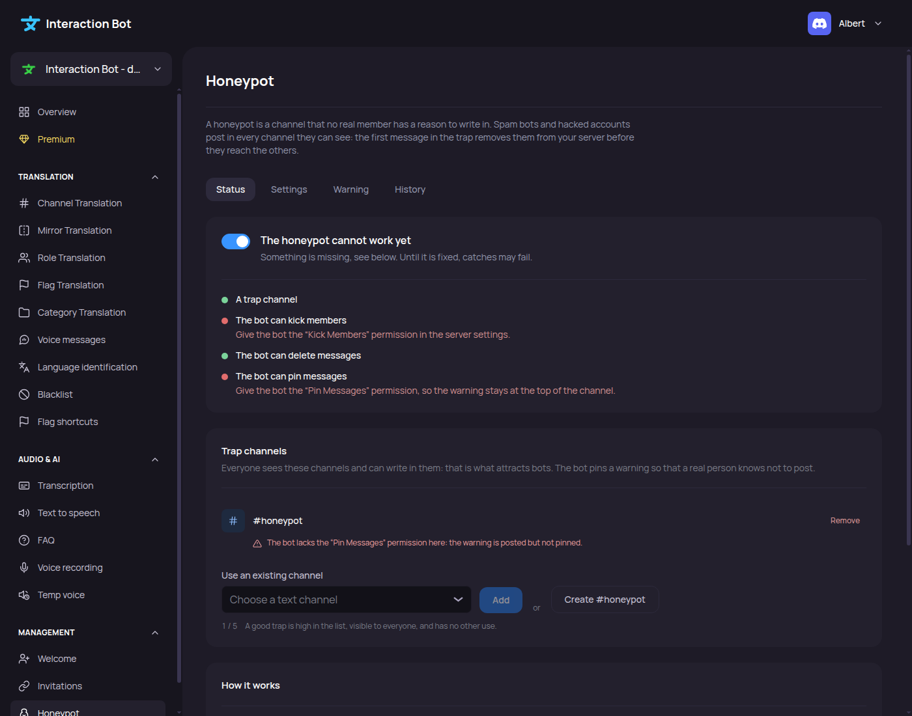

# Honeypot

<figure><figcaption>
Honeypot page
</figcaption></figure>

The Honeypot page sets up the trap channels that remove spam bots. How the feature works, the permissions it needs and its rules are explained in [Honeypot](../../management/honeypot.md).

Navbar > category _**Management**_ > _**Honeypot**_.

The page has four tabs: _**Status**_, _**Settings**_, _**Warning**_ and _**History**_.

## Saving

* **Trap channels** (tab _**Status**_): adding, creating and removing a trap channel is applied at once. The bot updates the warning of the channel. There is no save bar for these.
* **Everything else**: when you change a setting, a bar at the bottom of the page says _You made changes, save them!_ with _**Cancel**_ and _**Save**_ buttons. _**Save**_ applies the changes, _**Cancel**_ restores the last saved settings.

If a save is refused, the page shows the reason under the bar (see [Messages of the page](#messages-of-the-page)).

## Tab Status

The tab shows whether the honeypot works, and what is missing.

| Field | Default | What it does |
| --- | --- | --- |
| Toggle (next to the state) | Off | Turns the honeypot on or off. Needs at least one trap channel. Saved with the bar at the bottom. |
| State | _The honeypot is off_ | One of: _The honeypot is watching_ (on and ready), _The honeypot is off_, _The honeypot cannot work yet_ (a check fails), _The honeypot is paused_ (see below). |
| _**Start again**_ | Shown only when paused | Starts the honeypot again after the protection against false alarms paused it. Check the trap channel first. |
| Checks | Shown when the honeypot is on | One line per condition: a trap channel, the permission of the sanction (Kick Members, Ban Members or Timeout Members), Manage Messages and Pin Messages. A green dot means OK. A red dot means missing, with the fix written under it. |

### Trap channels

The list of the trap channels of the server. Each one shows its name, _Ready_ when it has no problem, and the problems found (see below).

| Control | Default | What it does |
| --- | --- | --- |
| _**Remove**_ (per channel) | None | Asks _**Remove it**_ or _**Keep**_. Removing deletes the warning of the channel. When the last trap channel is removed, the honeypot is turned off. |
| Use an existing channel | Empty | Dropdown of the text channels of the server. Choose one, then click _**Add**_. |
| _**Add**_ | Disabled until a channel is chosen | Adds the chosen channel as a trap. |
| _**Create #honeypot**_ | - | The bot creates a `#honeypot` channel: visible to everyone, everyone can write, threads closed, and the topic _Trap for spam bots: do not write here._ The channel becomes a trap. Needs the Manage Channels permission of the bot. |
| Counter | `0 / 5` | Number of trap channels, out of the limit. |

Problems shown under a trap channel:

| Problem | Meaning |
| --- | --- |
| _This channel no longer exists: remove it and add another one._ | The channel was deleted. |
| _Members cannot see this channel_ | Everyone must see the channel. |
| _Members cannot write here_ | Everyone must be able to write in the channel. |
| _The bot cannot post in this channel_ | The bot needs View Channel, Send Messages and Embed Links there. The warning is missing. |
| _The bot lacks the Pin Messages permission here_ | The warning is posted but not pinned. |

The bot also reports here when it cannot post the warning. If the bot does not answer, the page shows _The bot does not answer right now, so its permissions cannot be checked._

## Tab Settings

The tab has three sections.

### Sanction

What happens to someone who writes in a trap channel. Click one of the four cards.

| Option | Default | Description shown |
| --- | --- | --- |
| _**Kick and clean up**_ | Selected | Kicks the member and deletes their recent messages. A real person caught by mistake can join again. |
| _**Only report**_ | | Does not punish: only reports. Ideal to test the trap first. |
| _**Ban**_ | | Bans the member and deletes their recent messages. For servers raided by bots that come back. |
| _**Timeout**_ | | Mutes the member for a while and lets the moderators decide. |

When _**Timeout**_ is selected, two sliders are shown.

| Field | Default | Range | Description |
| --- | --- | --- | --- |
| Messages deleted | 24 h | 0 to 168 hours, step 1 | When someone is caught, their messages of the last hours are deleted in every channel. 0 keeps them. Shown in hours. |
| Timeout length | 24 h | 1 to 672 hours, step 1 | How long a caught member stays muted. Shown in hours below 48 hours, then in days. Shown only for _**Timeout**_. |

The _**Messages deleted**_ slider is always shown in this section, whatever the sanction.

To save _**Kick and clean up**_, _**Ban**_ or _**Timeout**_, you need the matching Discord permission yourself (Kick Members, Ban Members or Timeout Members). _**Only report**_ needs no permission.

### Exceptions

People who are never punished.

| Field | Default | Limit | Description |
| --- | --- | --- | --- |
| Exempt roles | None (_No exempt role_) | 50 | Dropdown of the roles of the server. The counter shows `n / 50`. |
| Exempt members | Empty | 100 | Text field for member ids, separated by spaces, then _**Add**_. Each id is shown as a chip with a remove button. Ids must have 15 digits or more. |

The owner, administrators, people who manage the server, bots, and members who can kick, ban, time out members or manage messages are always exempt. The page says so under the list.

### Reports

| Field | Default | Description |
| --- | --- | --- |
| Log channel | _No report_ | Text channel where each catch is reported. |
| Role to mention | _Nobody_ | Role mentioned in each report. |

## Tab Warning

The message pinned in each trap channel. Choose one mode.

| Mode | Default | What it does |
| --- | --- | --- |
| _**Standard**_ | Selected | The bot's own text: title _🍯 Do not write in this channel_ and a short explanation. |
| _**Custom**_ | | Shows the fields below. |
| _**None**_ | | No warning is posted. A note reminds you that a real person then has nothing telling them not to write there. |

Custom fields (shown only for _**Custom**_):

| Field | Limit | Description |
| --- | --- | --- |
| Title | 256 characters | Title of the warning. |
| Text | 4096 characters | Text of the warning. |
| Footer | 2048 characters | Small text at the bottom. |
| Color | - | Color bar of the warning, chosen with the color picker. |

A **Preview** on the right shows the warning as Discord displays it, with the label _Pinned by the bot_. In _**None**_, the preview says that no warning is posted.

## Tab History

_Recent catches_: the last catches of the server, newest first, over the last 30 days. The page says how many are shown, for example _The last 20 catches over 30 days._, and gives the total for the period.

Each line shows the avatar and name of the member, the date and time, and the sanction (_Kicked_, _Reported_, _Banned_ or _Timed out_), and a badge:

* _Done_: the sanction worked.
* _Failed_: the sanction did not work.

Click a line to open the evidence:

| Field | Description |
| --- | --- |
| Message | The text of the message that triggered the trap, up to 300 characters. _(no text: a file or an embed)_ when there is no text. |
| Account created | Date the account was created. |
| Joined the server | Date the member joined. |
| Why it failed | Only for a failed catch. See the reasons below. |

Reasons shown for a failed catch:

| Reason | Meaning |
| --- | --- |
| _The member has a role above the bot's._ | The bot cannot punish this member. |
| _The bot lacks the Ban Members permission._ | Give the bot Ban Members. |
| _The bot lacks the Kick Members permission._ | Give the bot Kick Members. |
| _The bot lacks the Timeout Members permission._ | Give the bot Timeout Members. |
| _Discord refused the sanction._ | Discord refused the action. |
| _The sanction failed._ | An error occurred. |

The history is kept for 30 days, and the list shows the last 20 catches.

## Messages of the page

| Message | Meaning |
| --- | --- |
| _The honeypot cannot work yet_ | A check failed. See the checks on the tab _**Status**_. |
| _The honeypot is paused_ | The protection against false alarms paused it. Check the trap channel, then click _**Start again**_. |
| _Add a trap channel before turning the honeypot on._ | Add or create a trap channel first. |
| _The log channel must be a text channel of this server._ | Choose a text channel. |
| _One of the roles no longer exists._ | Remove this role from the exceptions or from the mention. |
| _Too many exempt roles or members for this server._ | Remove some entries. |
| _To use this action you need the matching Discord permission yourself (Kick, Ban or Time out members)._ | You do not have the permission of the sanction. |
| _The bot does not answer right now. Try again in a moment._ | The bot cannot be reached. Try again later. |
| _The settings could not be saved. Try again._ | Try again. |
| _The history could not be loaded._ | Reload the page. |
| _This did not work. Try again._ | A trap channel could not be added, created or removed. Try again. |
| _This channel cannot be a trap: choose a text channel of this server._ | Choose another channel. |
| _This server has reached its limit of trap channels._ | Remove a trap channel first. The limit is 5. |
| _The bot needs the “Manage Channels” permission to create the channel._ | Give the bot Manage Channels, or choose an existing channel. |

## Limits

| Option | Limit |
| --- | --- |
| Trap channels | 5 |
| Exempt roles | 50 |
| Exempt members | 100 |
| History shown | 20 catches |
| History kept | 30 days |

These limits apply to every server. The honeypot is free for all servers.
