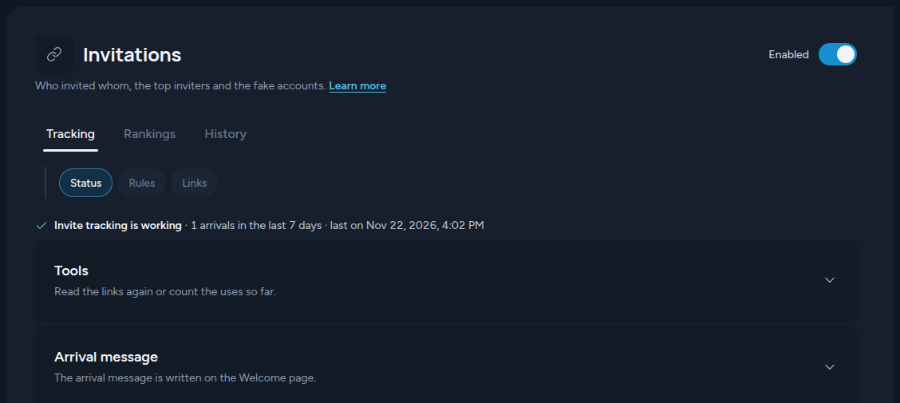
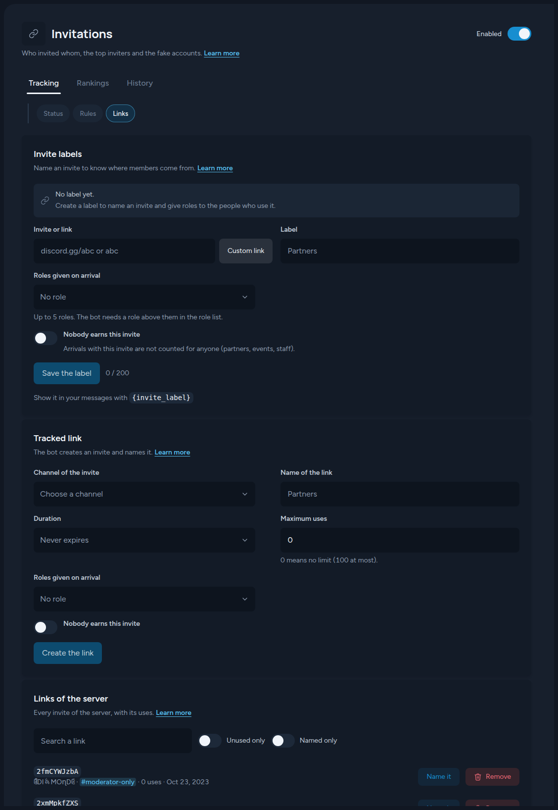
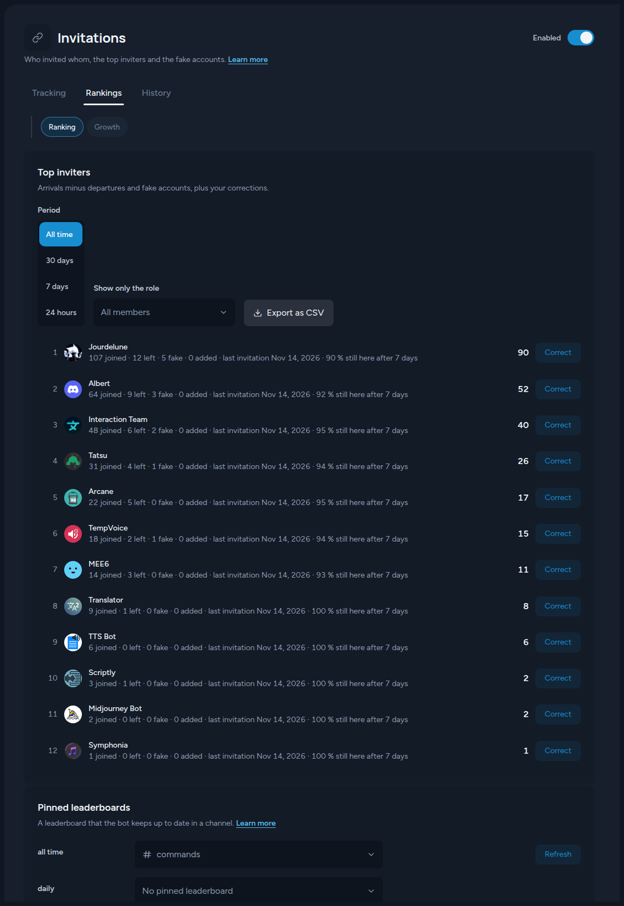
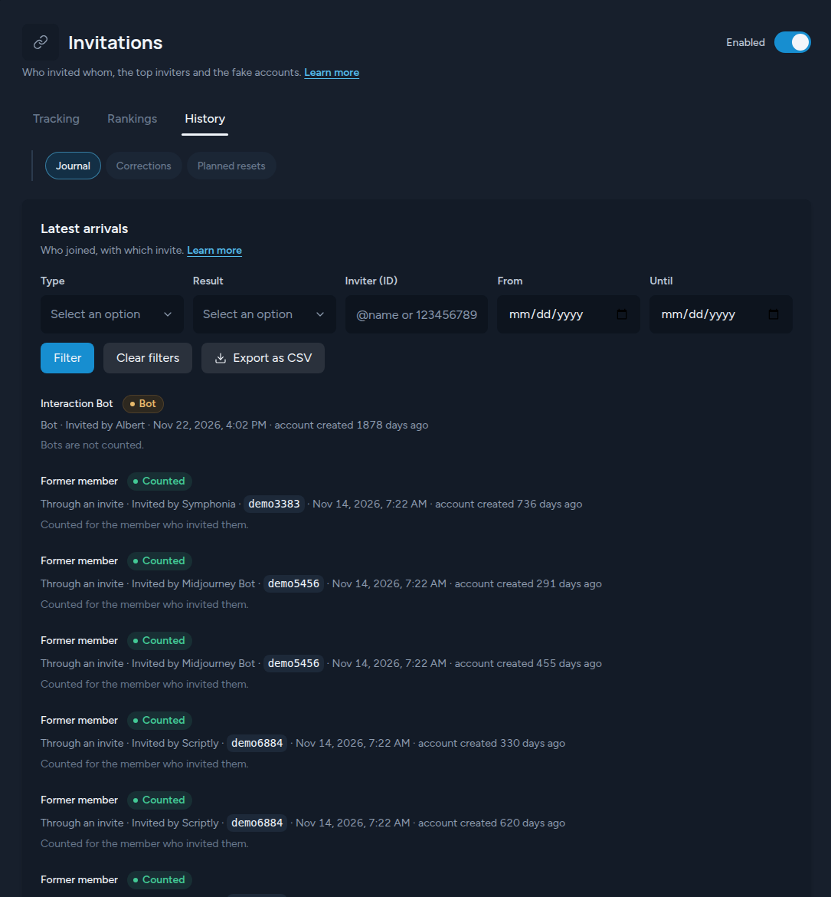
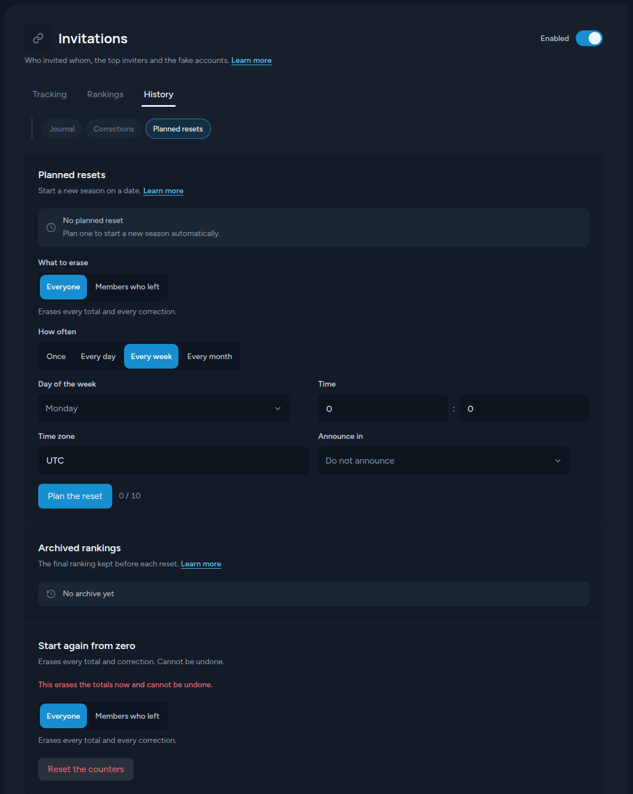

# Invitations

<figure><figcaption>
The Invitations page, Status tab
</figcaption></figure>

The **Invitations** page turns the [invite tracker](../../management/invite-tracker.md) on and off, and manages it. The page has three groups of tabs:

| Group | Tabs | What it holds |
| --- | --- | --- |
| _**Tracking**_ | _**Status**_, _**Rules**_, _**Links**_ | The state of the tracker, how arrivals are counted, the labels and the links. |
| _**Rankings**_ | _**Ranking**_, _**Growth**_ | The top inviters, the pinned leaderboards, the public page, the charts and the reports. |
| _**History**_ | _**Journal**_, _**Corrections**_, _**Planned resets**_ | Every arrival, the corrections by hand, and the resets of the counters. |

Navbar > section _**Management**_ > _**Invitations**_.

The page is free for every server. The main switch in the top right corner of the page turns the tracker on or off.

## Saving

| Tab | How changes are saved |
| --- | --- |
| _**Status**_ and _**Rules**_ (counting and privacy) | With the bar at the bottom of the page. The bar says _You made changes, save them!_, with _**Save**_ and _**Cancel**_. _**Cancel**_ restores the last saved settings. |
| _**Rules**_ (inviters who earn nothing, hidden members), _**Links**_ | Each add, edit or remove is applied at once. |
| _**Ranking**_ (pinned leaderboards, public page), _**Growth**_ (reports) | With the bar at the bottom of the page, like the Status tab. |
| _**Journal**_, _**Corrections**_, _**Planned resets**_ | Each correction, reset or planned reset is applied at once. |

## Status

The first card has the state of the tracker.

| Title | Meaning |
| --- | --- |
| _Invite tracking is off_ | Nothing is recorded. Turn the switch on and save. |
| _Invite tracking is working_ | Each arrival is linked to the invite used. The card also shows the arrivals of the last 7 days, and the date of the last arrival. |
| _Invite tracking is on but cannot work yet_ | Something is missing. Arrivals are not recorded until it is fixed. See the lights below. |
| _Invite tracking is on_, with _The bot does not answer right now, so its state cannot be checked._ | The bot could not be reached. Try again later. |

When the tracker is on, the page shows the **lights** that are missing. Five checks can appear, and the page lists only the ones that fail. Each must be green for the tracking to work.

| Light | Check | If it is red |
| --- | --- | --- |
| _The bot receives member arrivals_ | The bot gets the member events of the server. | _Member events are not enabled for the bot yet. Contact support to turn them on._ |
| _The bot can read invite changes_ | The bot gets the invite events. | _Invite events are not enabled for the bot yet. Contact support to turn them on._ |
| _The bot can see the invites of the server_ | The bot has the *Manage Server* permission. | _Give the bot the « Manage Server » permission in the role settings of your server._ |
| _« Manage Channels » permission_ | The bot has *Manage Channels*. | Needed for the invite events of a channel. |
| _« View Audit Log » permission_ | The bot has *View Audit Log*. | Needed to tell who deleted a link, and who added a bot. |

When everything works, the page says _Invite tracking is working_. A problem with a pinned leaderboard or a report is shown in the same place, with its reason (the channel was deleted, the bot cannot write there, the message was deleted). The problems appear as a banner above the tabs.

The page also shows the date the tracking started, the number of links on the server, whether the server has a custom link, and whether the bot has read the links yet.

### Arrival message

This card explains that the message of an arrival is written on the Welcome page. The button _**Open the Welcome page**_ opens it. See [Welcome and goodbye](../../management/welcome-and-goodbye.md).

The card lists the variables to use in the Welcome texts: `{inviter}`, `{inviter.name}`, `{invites}` and `{invite_label}`. See [Variables for the welcome message](../../management/invite-tracker.md#variables-for-the-welcome-message).

### Tools

| Button | What it does |
| --- | --- |
| _**Read the links again**_ | Updates the list of links and their uses. Adds nothing to the totals. Use it when the numbers look wrong. |
| _**See what would be added**_, then _**Add them**_ | _Count past uses once_: adds the uses that the links already have, when you turned the tracker on, to the totals of the members who created them. It can be done only once. |

## Rules

The _**Rules**_ tab has the rules that decide which arrivals count, and the lists of members.

### How arrivals are counted

| Setting | Default | What it does |
| --- | --- | --- |
| **Fake accounts: younger than** | 3 days | An account younger than this when it joins is a fake account for its inviter: the inviter gets the invitation and one fake, so the total does not change. The slider goes from 0 to 300 days. 0 turns the filter off. |
| **Ignore self-invites** | On | A member who joins with their own invite is not counted. |
| **When an invitation counts** | On arrival | _On arrival_: counted as soon as the member joins. _After screening_: counted once the member accepts the rules. _After verification_: counted once the member is verified (verification level or role). |
| **Minimum time on the server** | No delay | The invitation only counts if the new member is still on the server after this delay: up to 30 days. |
| **Do not count returning members** | Off | A member who leaves and comes back counts as a fake account for the inviter. Off: the invitation that was counted before is counted again. |
| **Roles that earn nothing** | No role | Someone who has one of these roles when a member joins earns nothing for it. Up to 20 roles. Not retroactive. |
| **Pause counting during a raid** | On | When many accounts arrive at once, counting stops until it calms down. |

A line that waits for the rules or the verification for more than 7 days is closed as _Not counted_.

### Privacy

| Setting | Default | What it does |
| --- | --- | --- |
| **Keep the journal for** | Forever | How long the journal of arrivals is kept: _Forever_, _30 days_, _90 days_, _180 days_ or _365 days_. The totals stay. |
| **Forget members who leave** | Off | When a member leaves, their arrival and who invited them are erased from the journal. The counters stay. |
| **Who sees who invited a member** | Staff only | _Staff only_ (the people who can manage the server) or _Everyone_. It is used in the journal and in the `/invite-info` command. |

Each member can see and erase what is kept about them with the `/privacy` command.

### Inviters who earn nothing

Add a member with a mention or an ID. Their invitees are still written in the journal, but nobody gets the point. The welcome messages are not affected.

Limit: **1000** members. Each member has a _**Remove**_ button.

### Hidden from the leaderboard

Add a member with a mention or an ID. The member is still counted. The `/invite-leaderboard` command does not show the member. The ranking of the dashboard shows the member with the badge _hidden_.

Limit: **1000** members. Each member has a _**Remove**_ button.

## Links

<figure><figcaption>
The Links tab of the Invitations page
</figcaption></figure>

The _**Links**_ tab manages the labels of the invites, the links the bot creates, the list of the invites, and the clean-up of the old invites.

### Invite labels

A label gives a name to one invite, and optionally a role to everyone who arrives with it. Use it for partners, events, or any source you want to follow.

| Field | Required | Notes |
| --- | --- | --- |
| **Invite or link** | Yes | An invite code, or a link such as `discord.gg/abc`. The button _**Custom link**_ fills in the custom link of the server. |
| **Label** | Yes | Up to 60 characters. Example: `Partners`. |
| **Role given on arrival** | No | Default: _No role_. Up to **5** roles. The bot needs a role above them. |
| **Nobody earns this invite** | Off | The arrivals with this invite are not counted for anyone (partners, events, staff). |

The role must be one that you could give yourself: you need Manage Roles, the role must be below your highest role, and it must not carry moderation or administration permissions. The bot must also have a role above the role it gives.

Click _**Save the label**_ to add a label. Saving a label with the same invite replaces it. Click _**Edit**_ to load a label in the form, and _**Remove**_ to delete it. Limit: **200** labels.

### Tracked links

The bot creates an invite, names it, and gives its roles to everyone who uses it.

| Field | Default | Notes |
| --- | --- | --- |
| **Channel of the invite** | Nothing chosen | The channel where the invite is created. |
| **Name of the link** | Empty | Up to 60 characters. It is the label of the link. |
| **Duration** | Never expires | _Never expires_, _1 hour_, _6 hours_, _12 hours_, _1 day_ or _7 days_. |
| **Maximum uses** | 0 (no limit) | Up to **100**. |

The button _**Create the link**_ needs the *Create Invite* permission in the channel. The created link is listed with the codes below.

### Codes

The list shows every invite of the server, with its uses, the member who created it, and its expiry date. Search a link, show only the unused ones or only the named ones. Click _**Name it**_ to give a label to a link, or the delete button of the link to delete it (the button asks _Delete for good?_ first).

### Clean up links

This tool deletes the old or unused invites in one go. Choose at least one filter (not used for a number of days, never used, a maximum number of uses, the member who created it, the channel), then _**See what would be deleted**_. The page lists how many links would be deleted and asks you to click again to confirm. Each run deletes at most **100** links. A link with a label is never deleted by this tool. Deleted invites cannot be restored, and the members who used them stay on the server.

## Ranking

<figure><figcaption>
The Ranking tab
</figcaption></figure>

The _**Ranking**_ tab shows _Top inviters_, 50 members per page.

| Filter | Choices |
| --- | --- |
| **Period** | _All time_ (default), _30 days_, _7 days_, _24 hours_. |
| **Role** | _All members_ (default), or _Show only the role_ with a role. |

Each row shows the rank, the name of the inviter (_Unknown_ when the bot cannot read the name, _Former member_ when the inviter has left the server), the counts _joined_, _left_, _fake_ and _added_, and the total in bold. The formula is explained in [How a total is computed](../../management/invite-tracker.md#how-a-total-is-computed).

Click _**Correct**_ on a row to open the _**Corrections**_ tab with this member already filled in.

### Pinned leaderboards

The bot keeps a leaderboard up to date in a channel, and edits it as the invitations change. There are four: _all time_, _daily_, _weekly_ and _monthly_. Choose a channel for each one you want. The bot needs to write, embed links and read the message history in these channels; to pin the leaderboard, it also needs *Pin Messages*.

Each leaderboard shows the top 10 members of its period (all time, 24 hours, 7 days or 30 days). The bot edits it at most every 15 minutes, and only when the ranking has changed. If someone deletes the message, the page reports it, and the bot posts it again only when you press _**Refresh**_.

Pinned leaderboards are free for every server.

### Public page

The public page shows the ranking to anyone who opens its link, without Discord. Only the ranking is shown, never the journal.

| Setting | Default | What it does |
| --- | --- | --- |
| **Public page** | Off | Turns the page on. |
| **Address of the page** | Empty | Lowercase letters, digits and dashes, from 3 to 32 characters. The page is at `/invites/` followed by the address. |
| **Hide names** | On | The names are replaced by _Hidden member_. |
| **Show the details** | Off | Shows the arrivals, departures and fakes of each member. |

The public page is free for every server.

## Growth

The _**Growth**_ tab shows the arrivals and the departures over the chosen period.

| Setting | Default | What it does |
| --- | --- | --- |
| **Period** | 30 days | _7 days_, _30 days_, _90 days_, _1 year_ or _Everything_. |

The tab shows the arrivals, the departures, the net change, the fake accounts, and the share of new members still on the server after **1 day** and after **7 days**. It also shows where the members come from (invite link, custom link, added by a bot, unknown, or no permission to see the invites), the best links and the top inviters. The button _**Export as CSV**_ downloads the data: at most **50 000** lines, one export a minute.

### Reports

The bot can post a short summary of the arrivals, with the best links and inviters, in a channel of your choice.

| Setting | Default | What it does |
| --- | --- | --- |
| **How often** | Off | _Every week_ or _Every month_. |
| **Channel for the report** | Nothing chosen | Required when the report is on. |
| **Day of the week** | Tuesday | For the weekly report. |
| **Hour** and **Time zone** | 9:00, UTC | When the report is posted. |

_**Send a sample now**_ sends the report at once. Save the changes first.

## Journal

<figure><figcaption>
The Journal of the Invitations page
</figcaption></figure>

The _**Journal**_ tab lists the latest arrivals, newest first, **50** at a time. Click _**Show more**_ to see older arrivals. Filter by type, by result, by inviter (ID), and by dates. _**Export as CSV**_ downloads the journal.

Each arrival shows:

* the name of the member. For a member who keeps their data private, the row shows _A member who keeps their data private_;
* the tag _very recent account_ for a fake account, and the tag _left_ when the member has left;
* the inviter (_Invited by_), or the reason when there is no inviter;
* the invite label, or the code of the invite when it has no label;
* the date of the arrival, and the date when the arrival will count if it waits.

The **result** of an arrival is the reason of its verdict, in plain words:

| Result | Meaning |
| --- | --- |
| _Counted_ | Counted for the member who invited them. |
| _Recent account_ | The account is younger than the minimum age, so it is a fake. |
| _Self-invite_ | The member used their own invite. |
| _Came back_ | The member had already joined with this invite, so it is not counted again. |
| _Came back (restored)_ | The member came back and the invite they used before is counted again. |
| _Ignored inviter_ | The inviter is in the list of inviters who earn nothing. |
| _Ignored role_ | The inviter has a role that earns nothing. |
| _During a raid_ | Too many accounts arrived at once, so counting was paused. |
| _Bot_ | A bot is not counted. |
| _No inviter_ | Discord did not say which invite was used. |
| _Waiting for the rules_, _Waiting for verification_, _Waiting for the delay_ | Counted once the condition is met. |
| _Label without credit_ | The invite is labelled so that nobody earns it. |
| _Not counted_ | This arrival is not counted. |

## Corrections

The _**Corrections**_ tab has two parts.

### Correct a total

| Field | Default | Notes |
| --- | --- | --- |
| **Member (mention or ID)** | Empty | A mention or an ID of 15 to 25 digits. |
| **Type of correction** | _Bonus_ | _Bonus_ adds invitations, for an event or a reward. _Regular_ corrects the normal invitations. _Fake_ corrects the fake accounts, which are taken off the total. _Left_ corrects the members who left, which are taken off the total. |
| **Amount** | 1 | Between **-100 000** and **100 000**. A negative number removes. 0 is not allowed. |
| **Reason** | Empty | **Required**, up to 200 characters. |

Click _**Apply the correction**_. The correction is applied at once, and the message _Correction applied._ confirms it. If it fails, the message says _The correction could not be applied. Check the member ID and the amount._

### Corrections made

The list shows the last **50** corrections, newest first. Each row shows the amount (green for a plus, red for a minus), the member, the reason and the date.

Click _**Undo**_ to cancel a correction. The amount is struck through, and the button is replaced by the word _undone_. An undone correction stays in the list.

## Planned resets

<figure><figcaption>
The Planned resets tab
</figcaption></figure>

The _**Planned resets**_ tab starts a new season, and resets the counters now.

| Setting | Default | What it does |
| --- | --- | --- |
| **What to erase** | Everyone | _Everyone_ erases every total and every correction of the server. _Members who left_ erases only the totals of the members who are no longer on the server. |
| **How often** | Once | _Once_ (on a date), _Every day_, _Every week_ or _Every month_ (on a day from 1 to 28). |
| **Time** | - | The date or the day, the hour and the minute, in the time zone of the form. |
| **Announce in** | Do not announce | A channel where the bot posts the result. |

The final ranking is archived before each reset. The _**Archived rankings**_ card lists the last **12** rankings, with their members, and lets you read them or download them. The server can have up to **10** planned resets. A planned reset that is more than 6 hours late, because the bot was offline, is skipped.

The _**Pause**_ and _**Resume**_ buttons stop a planned reset without deleting it.

### Reset now

The card _**Start again from zero**_ resets the counters at once. Only administrators can do it. For _Everyone_, type `RESET` to confirm, then click the button. For _Members who left_, no word is needed. The message _Counters reset._ confirms it, and the archived ranking is kept. It cannot be undone.

## Messages

| Message | Meaning |
| --- | --- |
| _The settings could not be saved. Try again._ | The settings were not saved. Try again. |
| _The list could not be loaded. Try again in a moment._ | The page could not read the list. Reload the page. |
| _Nobody has invited anyone yet. The ranking fills up when members join through invites._ | The ranking is empty. |
| _No arrivals yet_ | The journal is empty. |
| _No correction yet._ | The list of corrections is empty. |
| _Give the bot the « Manage Server » permission in the role settings of your server._ | The bot cannot read the invites. |

## Limits

| Item | Limit |
| --- | --- |
| Keep the journal | Forever (default), 30, 90, 180 or 365 days |
| Age of the account for a fake account | 0 to 300 days (default 3) |
| Minimum time on the server | 0 to 30 days |
| Roles that earn nothing | 20 |
| Inviters who earn nothing | 1000 |
| Members hidden from the leaderboard | 1000 |
| Invite labels | 200 |
| Roles given by a label | 5 |
| Name of a label or a link | 60 characters |
| Maximum uses of a tracked link | 100 (0 means no limit) |
| Corrections at once | From -100 000 to 100 000, not 0 |
| Reason of a correction | 200 characters, required |
| Pinned leaderboards | 4 (all time, daily, weekly, monthly), 10 members each |
| Planned resets | 10 |
| Archived rankings | The last 12 |
| Links deleted by one clean-up | 100 at most, with at least one filter; labelled links are never deleted |
| Address of the public page | 3 to 32 characters |
| Ranking, journal | 50 lines per page |
| Corrections in the dashboard | The last 50 corrections |
| Export | 50 000 lines, once a minute |

The page is free for every server.

## Related pages

* [Invite tracker](../../management/invite-tracker.md): how the tracker works, the commands, the counting rules, the privacy and the troubleshooting.
* [Welcome](welcome.md): the messages of the arrivals, and the variables of the invitations.
* [Permissions](../../permissions.md): the permissions of each feature.
