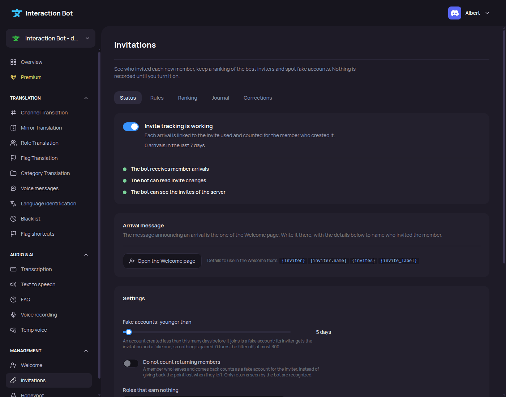

# Invitations

<figure><figcaption>
Invitations page
</figcaption></figure>

The **Invitations** page turns the [invite tracker](../../management/invite-tracker.md) on and off, and manages it. The page has five tabs: _**Status**_, _**Rules**_, _**Ranking**_, _**Journal**_ and _**Corrections**_.

## Localization

Navbar > category _**Management**_ > _**Invitations**_.

The page has no extension switch. The toggle on the _**Status**_ tab is the switch.

## Saving

| Tab | How changes are saved |
| --- | --- |
| _**Status**_ | With the bar at the bottom of the page. The bar says _You made changes, save them!_, with _**Save**_ and _**Cancel**_. _**Cancel**_ restores the last saved settings. |
| _**Rules**_ | Each add or remove is applied at once. There is no bar. |
| _**Ranking**_, _**Journal**_, _**Corrections**_ | Each correction is applied at once. The reset is applied at once too. |

## Status

The first card has the toggle, and a title that tells the state of the tracker.

| Title | Meaning |
| --- | --- |
| _Invite tracking is off_ | Nothing is recorded. Turn the toggle on and save. |
| _Invite tracking is working_ | Each arrival is linked to the invite used. The card also shows the arrivals of the last 7 days, and the date of the last arrival. |
| _Invite tracking is on but cannot work yet_ | Something is missing. Arrivals are not recorded until it is fixed. See the lights below. |
| _Invite tracking is on_, with _The bot does not answer right now, so its state cannot be checked._ | The bot could not be reached. Try again later. |

When the tracker is on, the page shows three lights. A red light means that the check failed.

| Light | Check | If it is red |
| --- | --- | --- |
| _The bot receives member arrivals_ | The bot gets the member events of the server. | _Member events are not enabled for the bot yet. Contact support to turn them on._ |
| _The bot can read invite changes_ | The bot gets the invite events. | _Invite events are not enabled for the bot yet. Contact support to turn them on._ |
| _The bot can see the invites of the server_ | The bot has the Manage Server permission. | _Give the bot the « Manage Server » permission in the role settings of your server._ |

### Arrival message

This card explains that the message of an arrival is written on the Welcome page. The button _**Open the Welcome page**_ opens it. See [Welcome and goodbye](../../management/welcome-and-goodbye.md).

The card lists the four variables to use in the Welcome texts: `{inviter}`, `{inviter.name}`, `{invites}` and `{invite_label}`. See [Variables for the welcome message](../../management/invite-tracker.md#variables-for-the-welcome-message).

### Settings

| Field | Default | What it does |
| --- | --- | --- |
| **Fake accounts: younger than** | 3 days | An account younger than this when it joins is a fake account for its inviter. The total does not change. The slider goes from 0 to 300 days. 0 turns the filter off. |
| **Do not count returning members** | Off | A member who leaves and comes back counts as a fake account for the inviter. Off: the first inviter keeps the point. |
| **Roles that earn nothing** | No role | Someone who has one of these roles when a member joins earns nothing for it. Up to 20 roles. Not retroactive. |
| **Keep the journal for** | 90 days | How long the journal is kept: _30 days_, _90 days_, _180 days_ or _365 days_. The totals stay. |

The list of roles does not show @everyone.

### Start again from zero

This card erases **every total and every correction** of the server. The journal is kept until its retention ends.

1. Click _**Reset the counters**_.
2. Click _**Yes, erase every total**_ to confirm. Click _**Cancel**_ to stop.

The message _Counters reset._ confirms the reset. It cannot be undone.

## Rules

The _**Rules**_ tab has three cards. Each card has a list, a form, and a counter such as `3 / 100`. Each add or remove is applied at once.

### Inviters who earn nothing

Add a member with a mention or an ID. Their invitees are still written in the journal, but nobody gets the point. The welcome messages are not affected.

Limit: 100 members. Each member has a _**Remove**_ button.

### Hidden from the leaderboard

Add a member with a mention or an ID. The member is still counted. The `/invite-leaderboard` command does not show the member. The ranking of the dashboard shows the member with the badge _hidden_.

Limit: 100 members. Each member has a _**Remove**_ button.

### Invite labels

A label gives a name to one invite, and optionally a role to everyone who arrives with it. See [Invite labels](../../management/invite-tracker.md#invite-labels).

| Field | Required | Notes |
| --- | --- | --- |
| **Invite or link** | Yes | An invite code, or a link such as `discord.gg/abc`. The button _**Custom link**_ fills in `vanity`, the custom link of the server. |
| **Label** | Yes | Up to 60 characters. Example: `Partners`. |
| **Role given on arrival** | No | Default: _No role_. The list shows the roles of the server, except @everyone. |

The role must be one that you could give yourself: you need Manage Roles, the role must be below your highest role, and it must not carry moderation or administration permissions. The bot must also have a role above the role it gives.

Click _**Save the label**_ to add a label. Saving a label with the same invite replaces it. Click _**Edit**_ to load a label in the form. Click _**Remove**_ to delete it.

Limit: 100 labels. The label list shows the label, the invite, and the role given, as _gives <role>_.

Messages that can appear in this tab:

| Message | Meaning |
| --- | --- |
| _Paste a member ID or a mention._ | The text is not a member. |
| _The limit is reached._ | The list is full. |
| _This role does not exist in the server._ | The role was deleted. Choose another one. |
| _You can only choose a role you could give yourself..._ | See the rule above for the role. |
| _The bot does not answer right now. Try again in a moment._ | Try again later. |
| _This could not be saved. Try again._ | Try again. |

## Ranking

The _**Ranking**_ tab shows _Top inviters_, 25 members per page. Use _**Previous**_ and _**Next**_ to change the page.

Each row shows:

* the rank;
* the name of the inviter. When the bot does not know the name, the row shows `#` followed by the last four digits of the ID;
* a line with the counts: _joined_, _left_, _fake_ and _added_;
* the total, in bold.

The formula of the total is: joined - left - fake + added. See [How a total is computed](../../management/invite-tracker.md#how-a-total-is-computed).

Click _**Correct**_ on a row to open the _**Corrections**_ tab with this member already filled in.

## Journal

The _**Journal**_ tab lists the latest arrivals, newest first, 25 at a time. Click _**Show more**_ to see older arrivals.

Each arrival shows:

* the name of the member. For a member who refused the tracking, the row shows _A member who keeps their data private_;
* the tag _very recent account_ for a fake account;
* the tag _left_ when the member has left;
* the inviter, as _Invited by_ and the name. When there is no inviter, the reason is shown: _Through an invite_, _Through the custom link of the server_, _Invite not found_ or _Came back to the server_;
* the label of the invite. When an invite has no label, its code is shown;
* the date of the arrival.

The journal keeps the arrivals for the time set in **Keep the journal for**.

## Corrections

The _**Corrections**_ tab has two parts.

### Correct a total

| Field | Default | Notes |
| --- | --- | --- |
| **Member (mention or ID)** | Empty | A mention or an ID of 15 to 25 digits. |
| **Amount** | 1 | Between -1000 and 1000. Use a negative number to remove invitations. 0 is not allowed. |
| **Reason (optional)** | Empty | Up to 200 characters. |

Click _**Apply the correction**_. The correction is applied at once. The message _Correction applied._ confirms it. If it fails, the message says _The correction could not be applied. Check the member ID and the amount._

### Corrections made

The list shows the last 50 corrections, newest first. Each row shows the amount (green for a plus, red for a minus), the member, the reason (or _No reason given_) and the date.

Click _**Undo**_ to cancel a correction. The row then shows _undone_ and is faded. A correction cannot be restored once it is undone.

## Messages

| Message | Meaning |
| --- | --- |
| _The settings could not be saved. Try again._ | The settings were not saved. Try again. |
| _The list could not be loaded. Try again in a moment._ | The page could not read the list. Reload the page. |
| _Nobody has invited anyone yet. The ranking fills in as members join through invites._ | The ranking is empty. |
| _No arrival recorded yet._ | The journal is empty. |
| _No correction yet._ | The list of corrections is empty. |


The tracker is free for every server. For the rules of the tracking, the privacy and the limits, see [Invite tracker](../../management/invite-tracker.md).

