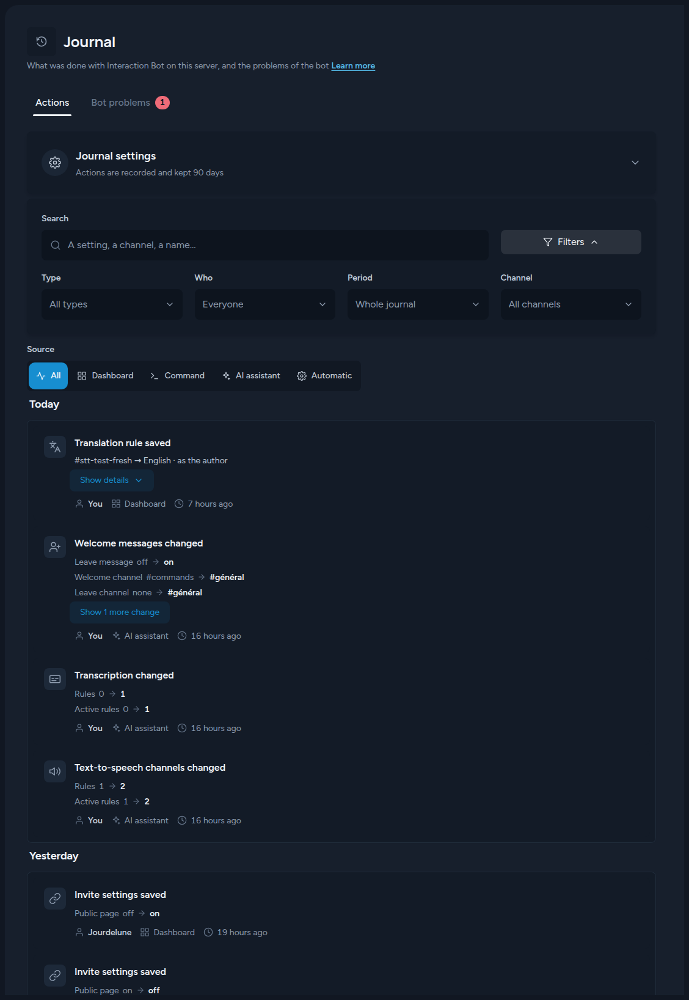

# Journal

The **Journal** page has two tabs: **Actions** and **Bot problems**. The page is the third item of the menu, after **Overview** and **Quick setup**.

<figure><figcaption>
The Journal page
</figcaption></figure>

## Actions

The _**Actions**_ tab lists the changes made to the settings of the bot on your server: from the dashboard, with a slash command, with the AI assistant, or automatically. For each action, you see who made it, when, from where (**Dashboard**, **Command**, **AI assistant** or **Automatic**), and what changed.

* **Filter** the list by type of setting, by person (**Who**), by period (**Last 24 hours**, **Last 7 days**, **Last 30 days** or **Whole journal**), by channel, and by source. You can also **search** a word, such as a setting or a channel name.
* **Load more** shows the older actions.

### What is recorded

The journal keeps who made the change (Discord ID and name at the time), when, from where, and what: the type of setting, the IDs of the channels or roles concerned, and the fixed values (on or off, a language, a style). It **never** keeps the content of the messages, the texts you type (such as a welcome message or a FAQ answer), or any secret.

### Journal settings

The **Journal settings** card at the top of the tab has two settings:

| Setting | Default | What it does |
| --- | --- | --- |
| **Record actions** | On | Turned off, new changes are no longer recorded. The lines already there stay until they expire. |
| **Keep for** | 90 days | 7, 30 or 90 days. Older actions are deleted automatically. A server keeps at most 1,000 actions. |

Once saved, a shorter period deletes the actions older than it at once.

## Bot problems

The _**Bot problems**_ tab lists what the bot could not do on your server, for example because a permission is missing, a channel no longer exists, or a translation failed. Each problem tells what happened, how many times it happened, and how to fix it.

* The number of problems you have not seen yet is shown next to the **Journal** entry of the menu. Opening the tab marks them as seen.
* Filter the list by type: **Permissions**, **Channel not found**, **Translation**, **Command** or **Other**.
* **Dismiss** removes a problem from the list. **Retry**, when it is offered, asks the bot to do the action again.
* Problems are kept **30 days** after the last time they happened.
* **Clear all** deletes every problem of this server. The page asks you to confirm first.

This tab replaces the former error log. A missing Discord permission is also shown on the card of the feature that needs it (status _Missing permission_), with a button to invite the bot again with the right permissions. See [Dashboard](README.md#category-pages-and-extensions).


The problems are for you to see what needs fixing. For a problem with translations, check the languages of the rule on the [Translation rules](translation-rules.md) page first.

