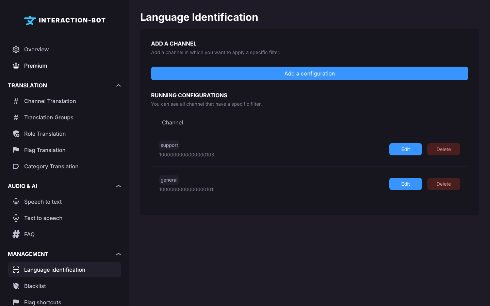

# Language identification

## Localization

This page is in the **Management** section of the navigation bar. Its title is **Language Identification**.

<figure><figcaption>
Language identification page
</figcaption></figure>

## What does language identification do?

Before translating a message, the bot detects its language. A very short message (*ok*, *lol*, *yes*) often gets a wrong language, and its translation is then wrong or useless.

On this page, you choose for a channel the **minimum number of characters** that a message must have to be translated. A message shorter than this minimum is ignored in this channel: it is not translated by any rule (channel, role, category or group translation).

* Flag translations are not affected: a flag reaction still translates a short message.
* Without a configuration, a channel has no minimum.

## Running configurations

The list shows the channels that have a minimum, with the **Channel** column.

* _**Edit**_: opens the configuration in the popup. Clicking on the row does the same.
* _**Delete**_: removes the minimum of this channel (applied after you click on _**Save**_).

## Add a configuration

Click on _**Add a configuration**_ (under the box *Add a channel*). On a server without Premium, when you already have 20 configurations, this button opens the Premium pop-up instead.

The popup has two fields:

* **CHANNEL**: *Select the channel where configuration will be applied.* Each channel can have only one configuration.
* **MINIMUM CHARACTER**: *The minimum number of characters for a message to be translated.* Type a number from **0** to **500**. A new configuration starts with **5**. Messages with fewer characters are ignored.

Click on _**Save**_ in the popup, then click on _**Save**_ in the bar at the bottom of the page.

### Example

In #general, many short messages are detected in the wrong language. Set **MINIMUM CHARACTER** to `15` for #general: messages of fewer than 15 characters are no longer translated there, and longer messages are translated as before.

## Errors

* **Error - You have not completed all the required fields.** (pop-up): no channel is selected.
* **It seems something has gone wrong.** (pop-up, followed by the error): the save failed.
* The bar stays on the screen without any message when the bot refuses the save, for example when a channel no longer exists. Nothing has been saved.

## Tips

* Start with a value between 10 and 20 in busy channels, and adjust it according to the translations you see.
* A value of `0` translates every message, as long as the other rules allow it.
* See also the [FAQ](../../faq.md) for the messages that are not translated.
